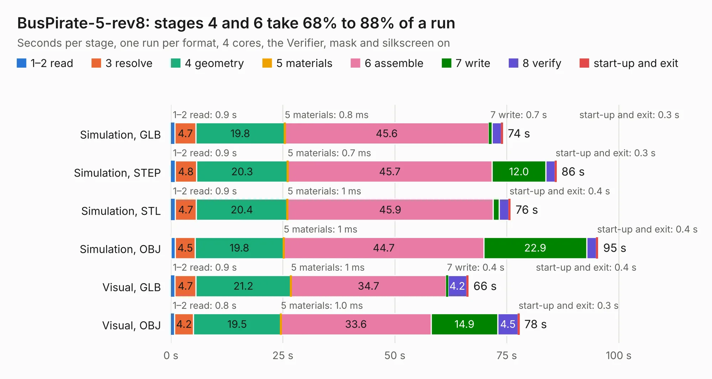

# 819. BusPirate-5-rev8

Board 819 of the 3,129 of [Corpus Testing](../Corpus-Testing.md), on [Corpus Page 8](../CorpusTestingPages/Corpus-Testing-08.md#819-buspirate-5-rev8).

| Mode and format | 1–2 read | 3 resolve | 4 geometry | 5 materials | 6 assemble | 7 write | 8 verify | start-up and exit | Total |
|---|---:|---:|---:|---:|---:|---:|---:|---:|---:|
| Simulation, GLB | 0.9 | 4.7 | 19.8 | 0.8&nbsp;ms | 45.6 | 0.7 | 2.1 | 0.3 | 74.1 |
| Simulation, STEP | 0.9 | 4.8 | 20.3 | 0.7&nbsp;ms | 45.7 | 12.0 | 2.0 | 0.3 | 86.1 |
| Simulation, STL | 0.9 | 4.7 | 20.4 | 1&nbsp;ms | 45.9 | 1.4 | 2.1 | 0.4 | 75.8 |
| Simulation, OBJ | 1.0 | 4.5 | 19.8 | 1&nbsp;ms | 44.7 | 22.9 | 2.2 | 0.4 | 95.4 |
| Visual, GLB | 0.9 | 4.7 | 21.2 | 1&nbsp;ms | 34.7 | 0.4 | 4.2 | 0.4 | 66.4 |
| Visual, OBJ | 0.8 | 4.2 | 19.5 | 1.0&nbsp;ms | 33.6 | 14.9 | 4.5 | 0.3 | 77.8 |

<table align="center"><tr><td valign="top">

| Board | Repo: [DangerousPrototypes/BusPirate5-hardware](https://github.com/DangerousPrototypes/BusPirate5-hardware) Board: `BusPirate-5-rev8.kicad_pcb` |
|---|---|
| Folder | bus_pirate_pcb / 5-REV8 |
| Complexity | 355&nbsp;/&nbsp;1000 (size&nbsp;265, features&nbsp;90) |
| KESE&nbsp;features | through vias, slotted holes, custom pads, rounded, trapezoid or chamfered pads, filled zones, copper drawings, curved board outline |
| Tested | 9th November 2026 |
| Copper&nbsp;layers | 4 |
| File&nbsp;format | KiCad 5 (20171130) |
| Parts,&nbsp;tracks,&nbsp;vias | 193, 2,281, 490 |
| Triangles,&nbsp;simulation | 3,531,122 in 210 parts |
| Verifier | PASS in all six runs |

</td><td valign="top">

<table>
<tr><th>File type</th><th>File size</th><th>Peak memory used</th></tr>
<tr><th colspan="3" align="left">Simulation</th></tr>
<tr><td>GLB</td><td align="right">123&nbsp;MB</td><td align="right">1.1&nbsp;GB</td></tr>
<tr><td>STEP</td><td align="right">535&nbsp;MB</td><td align="right">1.5&nbsp;GB</td></tr>
<tr><td>STL</td><td align="right">177&nbsp;MB</td><td align="right">1.2&nbsp;GB</td></tr>
<tr><td>OBJ</td><td align="right">378&nbsp;MB</td><td align="right">2.3&nbsp;GB</td></tr>
<tr><th colspan="3" align="left">Visual</th></tr>
<tr><td>GLB</td><td align="right">82&nbsp;MB</td><td align="right">1.4&nbsp;GB</td></tr>
<tr><td>OBJ</td><td align="right">259&nbsp;MB</td><td align="right">1.8&nbsp;GB</td></tr>
</table>

</td></tr></table>

| Previous | Next |
|:---|---:|
| [818. REV10a](b0818b_BusPirate5-hardware_REV10a.md) | [820. 5XL-REV0](b0820b_BusPirate5-hardware_5XL-REV0.md) |
