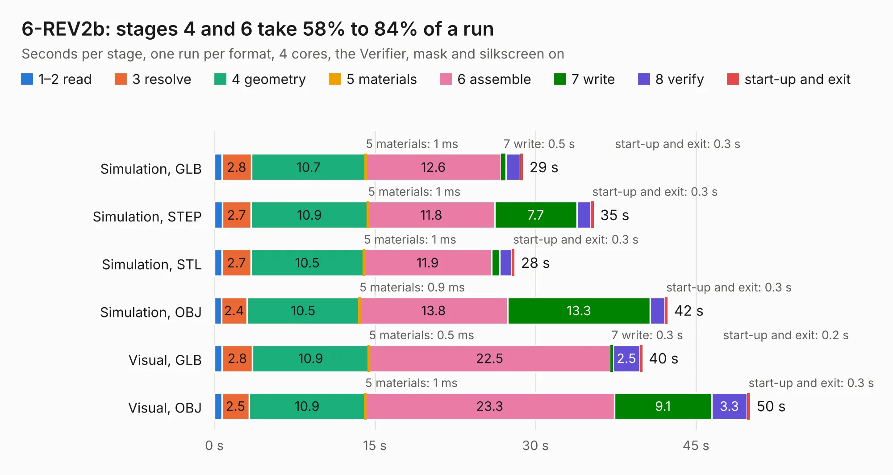

# 821. 6-REV2b

Board 821 of the 3,126 of [Corpus Testing](../Corpus-Testing.md), on [Corpus Page 8](../CorpusTestingPages/Corpus-Testing-08.md#821-6-rev2b).

| Mode and format | 1–2 read | 3 resolve | 4 geometry | 5 materials | 6 assemble | 7 write | 8 verify | start-up and exit | Total |
|---|---:|---:|---:|---:|---:|---:|---:|---:|---:|
| Simulation, GLB | 0.7 | 2.8 | 10.7 | 1&nbsp;ms | 12.6 | 0.5 | 1.3 | 0.3 | 28.8 |
| Simulation, STEP | 0.7 | 2.7 | 10.9 | 1&nbsp;ms | 11.8 | 7.7 | 1.3 | 0.3 | 35.5 |
| Simulation, STL | 0.7 | 2.7 | 10.5 | 1&nbsp;ms | 11.9 | 0.8 | 1.1 | 0.3 | 28.1 |
| Simulation, OBJ | 0.7 | 2.4 | 10.5 | 0.9&nbsp;ms | 13.8 | 13.3 | 1.4 | 0.3 | 42.4 |
| Visual, GLB | 0.7 | 2.8 | 10.9 | 0.5&nbsp;ms | 22.5 | 0.3 | 2.5 | 0.2 | 40.0 |
| Visual, OBJ | 0.7 | 2.5 | 10.9 | 1&nbsp;ms | 23.3 | 9.1 | 3.3 | 0.3 | 50.1 |

<table align="center"><tr><td valign="top">

| Board | Repo: [DangerousPrototypes/BusPirate5-hardware](https://github.com/DangerousPrototypes/BusPirate5-hardware) Board: `6-REV2b.kicad_pcb` |
|---|---|
| Folder | bus_pirate_pcb / 6-REV2B |
| Complexity | 387&nbsp;/&nbsp;1000 (size&nbsp;267, features&nbsp;120) |
| KESE&nbsp;features | through vias, slotted holes, custom pads, rounded, trapezoid or chamfered pads, filled zones, copper drawings, curved board outline, stack-up, dielectric εr and tanδ |
| Tested | 9th November 2026 |
| Copper&nbsp;layers | 4 |
| File&nbsp;format | KiCad 9 (20241229) |
| Parts,&nbsp;tracks,&nbsp;vias | 216, 2,531, 445 |
| Triangles,&nbsp;simulation | 2,941,898 in 216 parts |
| Verifier | PASS in all six runs |

</td><td valign="top">

<table>
<tr><th>File type</th><th>File size</th><th>Peak memory used</th></tr>
<tr><th colspan="3" align="left">Simulation</th></tr>
<tr><td>GLB</td><td align="right">101&nbsp;MB</td><td align="right">1.0&nbsp;GB</td></tr>
<tr><td>STEP</td><td align="right">485&nbsp;MB</td><td align="right">1.3&nbsp;GB</td></tr>
<tr><td>STL</td><td align="right">147&nbsp;MB</td><td align="right">978&nbsp;MB</td></tr>
<tr><td>OBJ</td><td align="right">315&nbsp;MB</td><td align="right">1.9&nbsp;GB</td></tr>
<tr><th colspan="3" align="left">Visual</th></tr>
<tr><td>GLB</td><td align="right">70&nbsp;MB</td><td align="right">1.4&nbsp;GB</td></tr>
<tr><td>OBJ</td><td align="right">222&nbsp;MB</td><td align="right">1.5&nbsp;GB</td></tr>
</table>

</td></tr></table>

| Previous | Next |
|:---|---:|
| [820. 5XL-REV0](b0820b_BusPirate5-hardware_5XL-REV0.md) | [822. BusPirate-5-rev10](b0822b_BusPirate5-hardware_BusPirate-5-rev10.md) |
