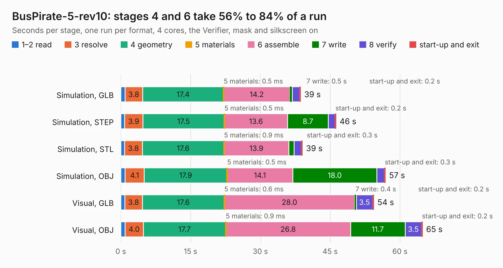

# 821. BusPirate-5-rev10

Board 821 of the 3,121 of [Corpus Testing](../Corpus-Testing.md), on [Corpus Page 8](../CorpusTestingPages/Corpus-Testing-08.md#821-buspirate-5-rev10).

| Mode and format | 1–2 read | 3 resolve | 4 geometry | 5 materials | 6 assemble | 7 write | 8 verify | start-up and exit | Total |
|---|---:|---:|---:|---:|---:|---:|---:|---:|---:|
| Simulation, GLB | 0.9 | 3.8 | 17.4 | 0.5&nbsp;ms | 14.2 | 0.5 | 1.5 | 0.2 | 38.7 |
| Simulation, STEP | 0.8 | 3.9 | 17.5 | 0.5&nbsp;ms | 13.6 | 8.7 | 1.4 | 0.2 | 46.3 |
| Simulation, STL | 0.8 | 3.8 | 17.6 | 0.9&nbsp;ms | 13.9 | 1.1 | 1.6 | 0.3 | 39.1 |
| Simulation, OBJ | 0.9 | 4.1 | 17.9 | 0.5&nbsp;ms | 14.1 | 18.0 | 1.6 | 0.3 | 56.9 |
| Visual, GLB | 0.8 | 3.8 | 17.6 | 0.6&nbsp;ms | 28.0 | 0.4 | 3.5 | 0.2 | 54.4 |
| Visual, OBJ | 0.9 | 4.0 | 17.7 | 0.9&nbsp;ms | 26.8 | 11.7 | 3.5 | 0.2 | 64.9 |

<table align="center"><tr><td valign="top">

| Board | Repo: [DangerousPrototypes/BusPirate5-hardware](https://github.com/DangerousPrototypes/BusPirate5-hardware) Board: `BusPirate-5-rev10.kicad_pcb` |
|---|---|
| Folder | bus_pirate_pcb / development / 5-REV10-PFET-bug |
| Complexity | 387&nbsp;/&nbsp;1000 (size&nbsp;267, features&nbsp;120) |
| KESE&nbsp;features | through vias, slotted holes, custom pads, rounded, trapezoid or chamfered pads, filled zones, copper drawings, curved board outline, stack-up, dielectric εr and tanδ |
| Tested | 9th November 2026 |
| Copper&nbsp;layers | 4 |
| File&nbsp;format | KiCad 7 (20221018) |
| Parts,&nbsp;tracks,&nbsp;vias | 210, 2,414, 548 |
| Triangles,&nbsp;simulation | 3,359,754 in 215 parts |
| Verifier | PASS in all six runs |

</td><td valign="top">

<table>
<tr><th>File type</th><th>File size</th><th>Peak memory used</th></tr>
<tr><th colspan="3" align="left">Simulation</th></tr>
<tr><td>GLB</td><td align="right">116&nbsp;MB</td><td align="right">1.1&nbsp;GB</td></tr>
<tr><td>STEP</td><td align="right">551&nbsp;MB</td><td align="right">1.4&nbsp;GB</td></tr>
<tr><td>STL</td><td align="right">168&nbsp;MB</td><td align="right">1.1&nbsp;GB</td></tr>
<tr><td>OBJ</td><td align="right">362&nbsp;MB</td><td align="right">2.2&nbsp;GB</td></tr>
<tr><th colspan="3" align="left">Visual</th></tr>
<tr><td>GLB</td><td align="right">76&nbsp;MB</td><td align="right">1.3&nbsp;GB</td></tr>
<tr><td>OBJ</td><td align="right">242&nbsp;MB</td><td align="right">1.6&nbsp;GB</td></tr>
</table>

</td></tr></table>

| Previous | Next |
|:---|---:|
| [820. 6-REV2b](b0820b_BusPirate5-hardware_6-REV2b.md) | [822. 7-REV0](b0822b_BusPirate5-hardware_7-REV0.md) |
