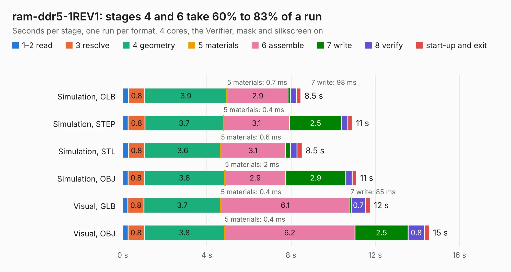

# 824. ram-ddr5-1REV1

Board 824 of the 3,105 of [Corpus Testing](../Corpus-Testing.md), on [Corpus Page 8](../CorpusTestingPages/Corpus-Testing-08.md#824-ram-ddr5-1rev1).

| Mode and format | 1–2 read | 3 resolve | 4 geometry | 5 materials | 6 assemble | 7 write | 8 verify | start-up and exit | Total |
|---|---:|---:|---:|---:|---:|---:|---:|---:|---:|
| Simulation, GLB | 0.3 | 0.8 | 3.9 | 0.7&nbsp;ms | 2.9 | 98&nbsp;ms | 0.3 | 0.2 | 8.5 |
| Simulation, STEP | 0.3 | 0.8 | 3.7 | 0.4&nbsp;ms | 3.1 | 2.5 | 0.3 | 0.2 | 10.9 |
| Simulation, STL | 0.3 | 0.8 | 3.6 | 0.6&nbsp;ms | 3.1 | 0.2 | 0.3 | 0.2 | 8.5 |
| Simulation, OBJ | 0.3 | 0.8 | 3.8 | 2&nbsp;ms | 2.9 | 2.9 | 0.3 | 0.2 | 11.1 |
| Visual, GLB | 0.2 | 0.8 | 3.7 | 0.4&nbsp;ms | 6.1 | 85&nbsp;ms | 0.7 | 0.2 | 11.8 |
| Visual, OBJ | 0.3 | 0.8 | 3.8 | 0.4&nbsp;ms | 6.2 | 2.5 | 0.8 | 0.2 | 14.6 |

<table align="center"><tr><td valign="top">

| Board | Repo: [DangerousPrototypes/BusPirate5-hardware](https://github.com/DangerousPrototypes/BusPirate5-hardware) Board: `ram-ddr5-1REV1.kicad_pcb` |
|---|---|
| Folder | development / adapter-ram-ddr5-1REV1 |
| Complexity | 258&nbsp;/&nbsp;1000 (size&nbsp;148, features&nbsp;110) |
| KESE&nbsp;features | through vias, slotted holes, rounded, trapezoid or chamfered pads, filled zones, curved board outline, knockout text, stack-up, dielectric εr and tanδ |
| Tested | 9th November 2026 |
| Copper&nbsp;layers | 2 |
| File&nbsp;format | KiCad 9 (20241229) |
| Parts,&nbsp;tracks,&nbsp;vias | 23, 184, 61 |
| Triangles,&nbsp;simulation | 701,270 in 213 parts |
| Verifier | PASS in all six runs |

</td><td valign="top">

<table>
<tr><th>File type</th><th>File size</th><th>Peak memory used</th></tr>
<tr><th colspan="3" align="left">Simulation</th></tr>
<tr><td>GLB</td><td align="right">25&nbsp;MB</td><td align="right">420&nbsp;MB</td></tr>
<tr><td>STEP</td><td align="right">121&nbsp;MB</td><td align="right">469&nbsp;MB</td></tr>
<tr><td>STL</td><td align="right">35&nbsp;MB</td><td align="right">420&nbsp;MB</td></tr>
<tr><td>OBJ</td><td align="right">73&nbsp;MB</td><td align="right">540&nbsp;MB</td></tr>
<tr><th colspan="3" align="left">Visual</th></tr>
<tr><td>GLB</td><td align="right">21&nbsp;MB</td><td align="right">478&nbsp;MB</td></tr>
<tr><td>OBJ</td><td align="right">61&nbsp;MB</td><td align="right">586&nbsp;MB</td></tr>
</table>

</td></tr></table>

| Previous | Next |
|:---|---:|
| [823. ram-ddr5](b0823b_BusPirate5-hardware_ram-ddr5.md) | [825. sim-iccard-rev4](b0825b_BusPirate5-hardware_sim-iccard-rev4.md) |
