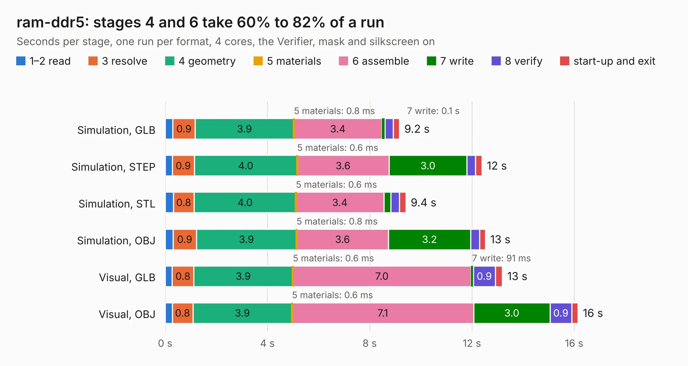

# 824. ram-ddr5

Board 824 of the 3,106 of [Corpus Testing](../Corpus-Testing.md), on [Corpus Page 8](../CorpusTestingPages/Corpus-Testing-08.md#824-ram-ddr5).

| Mode and format | 1–2 read | 3 resolve | 4 geometry | 5 materials | 6 assemble | 7 write | 8 verify | start-up and exit | Total |
|---|---:|---:|---:|---:|---:|---:|---:|---:|---:|
| Simulation, GLB | 0.3 | 0.9 | 3.9 | 0.8&nbsp;ms | 3.4 | 0.1 | 0.3 | 0.2 | 9.2 |
| Simulation, STEP | 0.3 | 0.9 | 4.0 | 0.6&nbsp;ms | 3.6 | 3.0 | 0.3 | 0.3 | 12.4 |
| Simulation, STL | 0.3 | 0.8 | 4.0 | 0.6&nbsp;ms | 3.4 | 0.3 | 0.3 | 0.3 | 9.4 |
| Simulation, OBJ | 0.3 | 0.9 | 3.9 | 0.8&nbsp;ms | 3.6 | 3.2 | 0.3 | 0.2 | 12.5 |
| Visual, GLB | 0.3 | 0.8 | 3.9 | 0.6&nbsp;ms | 7.0 | 91&nbsp;ms | 0.9 | 0.3 | 13.2 |
| Visual, OBJ | 0.3 | 0.8 | 3.9 | 0.6&nbsp;ms | 7.1 | 3.0 | 0.9 | 0.2 | 16.1 |

<table align="center"><tr><td valign="top">

| Board | Repo: [DangerousPrototypes/BusPirate5-hardware](https://github.com/DangerousPrototypes/BusPirate5-hardware) Board: `ram-ddr5.kicad_pcb` |
|---|---|
| Folder | development / adapter-ram-ddr5-1REV0 |
| Complexity | 248&nbsp;/&nbsp;1000 (size&nbsp;148, features&nbsp;100) |
| KESE&nbsp;features | through vias, slotted holes, rounded, trapezoid or chamfered pads, filled zones, knockout text, stack-up, dielectric εr and tanδ |
| Tested | 9th November 2026 |
| Copper&nbsp;layers | 2 |
| File&nbsp;format | KiCad 9 (20241229) |
| Parts,&nbsp;tracks,&nbsp;vias | 23, 188, 60 |
| Triangles,&nbsp;simulation | 679,542 in 213 parts |
| Verifier | PASS in all six runs |

</td><td valign="top">

<table>
<tr><th>File type</th><th>File size</th><th>Peak memory used</th></tr>
<tr><th colspan="3" align="left">Simulation</th></tr>
<tr><td>GLB</td><td align="right">24&nbsp;MB</td><td align="right">427&nbsp;MB</td></tr>
<tr><td>STEP</td><td align="right">117&nbsp;MB</td><td align="right">471&nbsp;MB</td></tr>
<tr><td>STL</td><td align="right">34&nbsp;MB</td><td align="right">427&nbsp;MB</td></tr>
<tr><td>OBJ</td><td align="right">71&nbsp;MB</td><td align="right">527&nbsp;MB</td></tr>
<tr><th colspan="3" align="left">Visual</th></tr>
<tr><td>GLB</td><td align="right">20&nbsp;MB</td><td align="right">538&nbsp;MB</td></tr>
<tr><td>OBJ</td><td align="right">59&nbsp;MB</td><td align="right">496&nbsp;MB</td></tr>
</table>

</td></tr></table>

| Previous | Next |
|:---|---:|
| [823. kaybee-plank](b0823b_BusPirate5-hardware_development-adapter-kaybee-plank-1REV1_kaybee-plank.md) | [825. ram-ddr5-1REV1](b0825b_BusPirate5-hardware_ram-ddr5-1REV1.md) |
