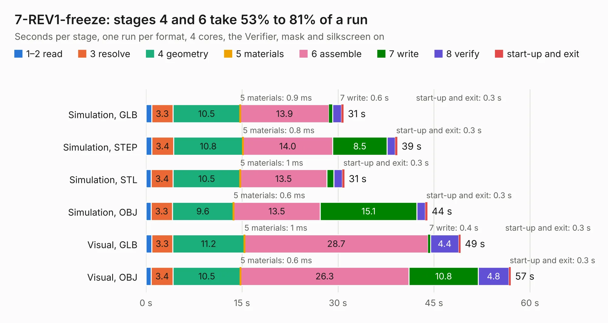

# 825. 7-REV1-freeze

Board 825 of the 3,131 of [Corpus Testing](../Corpus-Testing.md), on [Corpus Page 8](../CorpusTestingPages/Corpus-Testing-08.md#825-7-rev1-freeze).

| Mode and format | 1–2 read | 3 resolve | 4 geometry | 5 materials | 6 assemble | 7 write | 8 verify | start-up and exit | Total |
|---|---:|---:|---:|---:|---:|---:|---:|---:|---:|
| Simulation, GLB | 0.9 | 3.3 | 10.5 | 0.9&nbsp;ms | 13.9 | 0.6 | 1.4 | 0.3 | 30.9 |
| Simulation, STEP | 0.9 | 3.4 | 10.8 | 0.8&nbsp;ms | 14.0 | 8.5 | 1.3 | 0.3 | 39.3 |
| Simulation, STL | 0.8 | 3.4 | 10.5 | 1&nbsp;ms | 13.5 | 1.1 | 1.3 | 0.3 | 31.0 |
| Simulation, OBJ | 0.8 | 3.3 | 9.6 | 0.6&nbsp;ms | 13.5 | 15.1 | 1.3 | 0.3 | 44.0 |
| Visual, GLB | 0.9 | 3.3 | 11.2 | 1&nbsp;ms | 28.7 | 0.4 | 4.4 | 0.3 | 49.2 |
| Visual, OBJ | 0.8 | 3.4 | 10.5 | 0.6&nbsp;ms | 26.3 | 10.8 | 4.8 | 0.3 | 57.0 |

<table align="center"><tr><td valign="top">

| Board | Repo: [DangerousPrototypes/BusPirate5-hardware](https://github.com/DangerousPrototypes/BusPirate5-hardware) Board: `7-REV1-freeze.kicad_pcb` |
|---|---|
| Folder | bus_pirate_pcb / development / 7-REV1-vout-protection |
| Complexity | 390&nbsp;/&nbsp;1000 (size&nbsp;270, features&nbsp;120) |
| KESE&nbsp;features | through vias, slotted holes, custom pads, rounded, trapezoid or chamfered pads, filled zones, copper drawings, curved board outline, stack-up, dielectric εr and tanδ |
| Tested | 9th November 2026 |
| Copper&nbsp;layers | 4 |
| File&nbsp;format | KiCad 8 (20240108) |
| Parts,&nbsp;tracks,&nbsp;vias | 249, 2,812, 465 |
| Triangles,&nbsp;simulation | 2,909,062 in 247 parts |
| Verifier | PASS in all six runs |

</td><td valign="top">

<table>
<tr><th>File type</th><th>File size</th><th>Peak memory used</th></tr>
<tr><th colspan="3" align="left">Simulation</th></tr>
<tr><td>GLB</td><td align="right">98&nbsp;MB</td><td align="right">969&nbsp;MB</td></tr>
<tr><td>STEP</td><td align="right">404&nbsp;MB</td><td align="right">1.3&nbsp;GB</td></tr>
<tr><td>STL</td><td align="right">145&nbsp;MB</td><td align="right">995&nbsp;MB</td></tr>
<tr><td>OBJ</td><td align="right">307&nbsp;MB</td><td align="right">2.0&nbsp;GB</td></tr>
<tr><th colspan="3" align="left">Visual</th></tr>
<tr><td>GLB</td><td align="right">70&nbsp;MB</td><td align="right">1.2&nbsp;GB</td></tr>
<tr><td>OBJ</td><td align="right">220&nbsp;MB</td><td align="right">1.5&nbsp;GB</td></tr>
</table>

</td></tr></table>

| Previous | Next |
|:---|---:|
| [824. 7-REV0](b0824b_BusPirate5-hardware_7-REV0.md) | [826. 7-REV1B](b0826b_BusPirate5-hardware_7-REV1B.md) |
