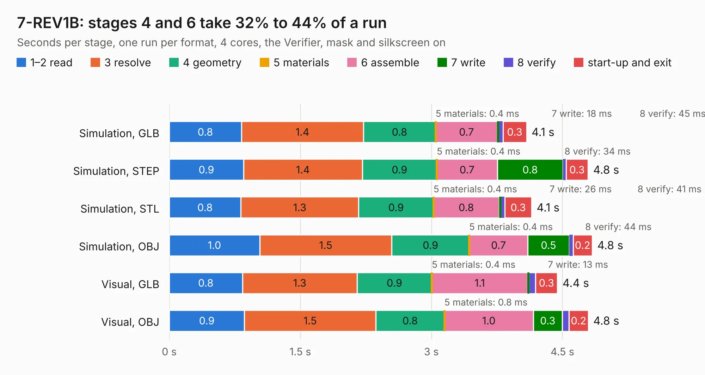

# 826 7-REV1B

Board 826 of the 3,138 of [Corpus Testing](../Corpus-Testing.md), on [Corpus Page 8](../CorpusTestingPages/Corpus-Testing-08.md#826-7-rev1b).

| Mode and format | 1–2 read | 3 resolve | 4 geometry | 5 materials | 6 assemble | 7 write | 8 verify | start-up and exit | Total |
|---|---:|---:|---:|---:|---:|---:|---:|---:|---:|
| Simulation, GLB | 0.8 | 1.4 | 0.8 | 0.4&nbsp;ms | 0.7 | 18&nbsp;ms | 45&nbsp;ms | 0.3 | 4.1 |
| Simulation, STEP | 0.9 | 1.4 | 0.9 | 0.4&nbsp;ms | 0.7 | 0.8 | 34&nbsp;ms | 0.3 | 4.8 |
| Simulation, STL | 0.8 | 1.3 | 0.9 | 0.4&nbsp;ms | 0.8 | 26&nbsp;ms | 41&nbsp;ms | 0.3 | 4.1 |
| Simulation, OBJ | 1.0 | 1.5 | 0.9 | 0.4&nbsp;ms | 0.7 | 0.5 | 44&nbsp;ms | 0.2 | 4.8 |
| Visual, GLB | 0.8 | 1.3 | 0.9 | 0.4&nbsp;ms | 1.1 | 13&nbsp;ms | 77&nbsp;ms | 0.3 | 4.4 |
| Visual, OBJ | 0.9 | 1.5 | 0.8 | 0.8&nbsp;ms | 1.0 | 0.3 | 78&nbsp;ms | 0.2 | 4.8 |

<table align="center"><tr><td valign="top">

| Board | Repo: [DangerousPrototypes/BusPirate5-hardware](https://github.com/DangerousPrototypes/BusPirate5-hardware) Board: `7-REV1B.kicad_pcb` |
|---|---|
| Folder | bus_pirate_pcb / development / 7-REV1B-prototype-2 |
| Complexity | 390&nbsp;/&nbsp;1000 (size&nbsp;270, features&nbsp;120) |
| KESE&nbsp;features | through vias, slotted holes, custom pads, rounded, trapezoid or chamfered pads, filled zones, copper drawings, curved board outline, stack-up, dielectric εr and tanδ |
| Tested | 9th November 2026 |
| Copper&nbsp;layers | 4 |
| File&nbsp;format | KiCad 8 (20240108) |
| Parts,&nbsp;tracks,&nbsp;vias | 240, 2,924, 508 |
| Triangles,&nbsp;simulation | 95,348 in 26 parts |
| Verifier | PASS in all six runs |

</td><td valign="top">

<table>
<tr><th>File type</th><th>File size</th><th>Peak memory used</th></tr>
<tr><th colspan="3" align="left">Simulation</th></tr>
<tr><td>GLB</td><td align="right">3.2&nbsp;MB</td><td align="right">230&nbsp;MB</td></tr>
<tr><td>STEP</td><td align="right">7.6&nbsp;MB</td><td align="right">229&nbsp;MB</td></tr>
<tr><td>STL</td><td align="right">4.8&nbsp;MB</td><td align="right">232&nbsp;MB</td></tr>
<tr><td>OBJ</td><td align="right">9.5&nbsp;MB</td><td align="right">228&nbsp;MB</td></tr>
<tr><th colspan="3" align="left">Visual</th></tr>
<tr><td>GLB</td><td align="right">2.6&nbsp;MB</td><td align="right">207&nbsp;MB</td></tr>
<tr><td>OBJ</td><td align="right">7.3&nbsp;MB</td><td align="right">205&nbsp;MB</td></tr>
</table>

</td></tr></table>

| Previous | Next |
|:---|---:|
| [825 7-REV1-freeze](b0825b_BusPirate5-hardware_7-REV1-freeze.md) | [827 7-REV2-vout-protection](b0827b_BusPirate5-hardware_bus-pirate-pcb-development-7-REV2-prototype3a_7-REV2-vout-protection.md) |
