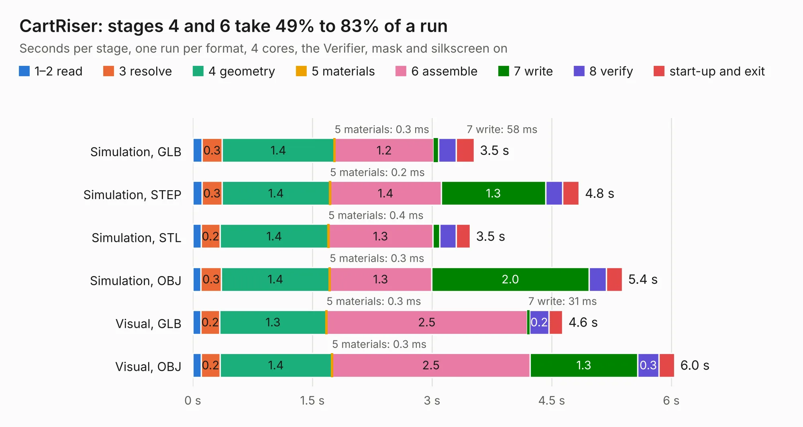

# 827. CartRiser

Board 827 of the 3,101 of [Corpus Testing](../Corpus-Testing.md), on [Corpus Page 8](../CorpusTestingPages/Corpus-Testing-08.md#827-cartriser).

| Mode and format | 1–2 read | 3 resolve | 4 geometry | 5 materials | 6 assemble | 7 write | 8 verify | start-up and exit | Total |
|---|---:|---:|---:|---:|---:|---:|---:|---:|---:|
| Simulation, GLB | 0.1 | 0.3 | 1.4 | 0.3&nbsp;ms | 1.2 | 58&nbsp;ms | 0.2 | 0.2 | 3.5 |
| Simulation, STEP | 0.1 | 0.3 | 1.4 | 0.2&nbsp;ms | 1.4 | 1.3 | 0.2 | 0.2 | 4.8 |
| Simulation, STL | 0.1 | 0.2 | 1.4 | 0.4&nbsp;ms | 1.3 | 86&nbsp;ms | 0.2 | 0.2 | 3.5 |
| Simulation, OBJ | 0.1 | 0.3 | 1.4 | 0.3&nbsp;ms | 1.3 | 2.0 | 0.2 | 0.2 | 5.4 |
| Visual, GLB | 0.1 | 0.2 | 1.3 | 0.3&nbsp;ms | 2.5 | 31&nbsp;ms | 0.2 | 0.2 | 4.6 |
| Visual, OBJ | 0.1 | 0.2 | 1.4 | 0.3&nbsp;ms | 2.5 | 1.3 | 0.3 | 0.2 | 6.0 |

<table align="center"><tr><td valign="top">

| Board | Repo: [danwerner21/TI99_22](https://github.com/danwerner21/TI99_22) Board: `CartRiser.kicad_pcb` |
|---|---|
| Folder | CartRiser / CartRiser |
| Complexity | 162&nbsp;/&nbsp;1000 (size&nbsp;112, features&nbsp;50) |
| KESE&nbsp;features | filled zones, stack-up, dielectric εr and tanδ |
| Tested | 9th November 2026 |
| Copper&nbsp;layers | 2 |
| File&nbsp;format | KiCad 6 (20211014) |
| Parts,&nbsp;tracks,&nbsp;vias | 2, 159, 0 |
| Triangles,&nbsp;simulation | 407,960 in 45 parts |
| Verifier | PASS in all six runs |

</td><td valign="top">

<table>
<tr><th>File type</th><th>File size</th><th>Peak memory used</th></tr>
<tr><th colspan="3" align="left">Simulation</th></tr>
<tr><td>GLB</td><td align="right">13&nbsp;MB</td><td align="right">268&nbsp;MB</td></tr>
<tr><td>STEP</td><td align="right">55&nbsp;MB</td><td align="right">302&nbsp;MB</td></tr>
<tr><td>STL</td><td align="right">20&nbsp;MB</td><td align="right">275&nbsp;MB</td></tr>
<tr><td>OBJ</td><td align="right">40&nbsp;MB</td><td align="right">307&nbsp;MB</td></tr>
<tr><th colspan="3" align="left">Visual</th></tr>
<tr><td>GLB</td><td align="right">8.1&nbsp;MB</td><td align="right">292&nbsp;MB</td></tr>
<tr><td>OBJ</td><td align="right">24&nbsp;MB</td><td align="right">291&nbsp;MB</td></tr>
</table>

</td></tr></table>

| Previous | Next |
|:---|---:|
| [826. DragonKeyboard](b0826b_Dragon64_DragonKeyboard.md) | [828. IO_Riser](b0828b_TI99-22_IO-Riser.md) |
