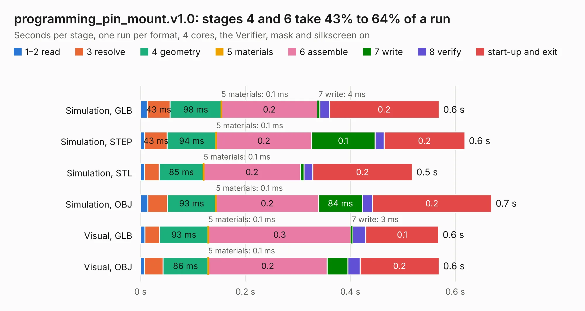

# 828. programming_pin_mount.v1.0

Board 828 of the 3,123 of [Corpus Testing](../Corpus-Testing.md), on [Corpus Page 8](../CorpusTestingPages/Corpus-Testing-08.md#828-programming_pin_mountv10).

| Mode and format | 1–2 read | 3 resolve | 4 geometry | 5 materials | 6 assemble | 7 write | 8 verify | start-up and exit | Total |
|---|---:|---:|---:|---:|---:|---:|---:|---:|---:|
| Simulation, GLB | 13&nbsp;ms | 43&nbsp;ms | 98&nbsp;ms | 0.1&nbsp;ms | 0.2 | 4&nbsp;ms | 18&nbsp;ms | 0.2 | 0.6 |
| Simulation, STEP | 8&nbsp;ms | 43&nbsp;ms | 94&nbsp;ms | 0.1&nbsp;ms | 0.2 | 0.1 | 18&nbsp;ms | 0.2 | 0.6 |
| Simulation, STL | 8&nbsp;ms | 28&nbsp;ms | 85&nbsp;ms | 0.1&nbsp;ms | 0.2 | 7&nbsp;ms | 17&nbsp;ms | 0.2 | 0.5 |
| Simulation, OBJ | 14&nbsp;ms | 37&nbsp;ms | 93&nbsp;ms | 0.1&nbsp;ms | 0.2 | 84&nbsp;ms | 19&nbsp;ms | 0.2 | 0.7 |
| Visual, GLB | 8&nbsp;ms | 28&nbsp;ms | 93&nbsp;ms | 0.1&nbsp;ms | 0.3 | 3&nbsp;ms | 25&nbsp;ms | 0.1 | 0.6 |
| Visual, OBJ | 8&nbsp;ms | 35&nbsp;ms | 86&nbsp;ms | 0.1&nbsp;ms | 0.2 | 39&nbsp;ms | 24&nbsp;ms | 0.2 | 0.6 |

<table align="center"><tr><td valign="top">

| Board | Repo: [DangerousPrototypes/BusPirate5-hardware](https://github.com/DangerousPrototypes/BusPirate5-hardware) Board: `programming_pin_mount.v1.0.kicad_pcb` |
|---|---|
| Folder | debug-station |
| Complexity | 47&nbsp;/&nbsp;1000 (size&nbsp;47, features&nbsp;0) |
| Tested | 9th November 2026 |
| Copper&nbsp;layers | 2 |
| File&nbsp;format | KiCad 5 (20171130) |
| Parts,&nbsp;tracks,&nbsp;vias | 1, 3, 0 |
| Triangles,&nbsp;simulation | 21,728 in 13 parts |
| Verifier | PASS in all six runs |

</td><td valign="top">

<table>
<tr><th>File type</th><th>File size</th><th>Peak memory used</th></tr>
<tr><th colspan="3" align="left">Simulation</th></tr>
<tr><td>GLB</td><td align="right">711&nbsp;kB</td><td align="right">42&nbsp;MB</td></tr>
<tr><td>STEP</td><td align="right">2.3&nbsp;MB</td><td align="right">44&nbsp;MB</td></tr>
<tr><td>STL</td><td align="right">1.1&nbsp;MB</td><td align="right">41&nbsp;MB</td></tr>
<tr><td>OBJ</td><td align="right">2.0&nbsp;MB</td><td align="right">46&nbsp;MB</td></tr>
<tr><th colspan="3" align="left">Visual</th></tr>
<tr><td>GLB</td><td align="right">357&nbsp;kB</td><td align="right">50&nbsp;MB</td></tr>
<tr><td>OBJ</td><td align="right">918&nbsp;kB</td><td align="right">58&nbsp;MB</td></tr>
</table>

</td></tr></table>

| Previous | Next |
|:---|---:|
| [827. 7-REV2-vout-protection](b0827b_BusPirate5-hardware_bus-pirate-pcb-development-7-REV2-prototype3b-side-leds_7-REV2-vout-protection.md) | [829. flash-dip-rev4](b0829b_BusPirate5-hardware_flash-dip-rev4.md) |
