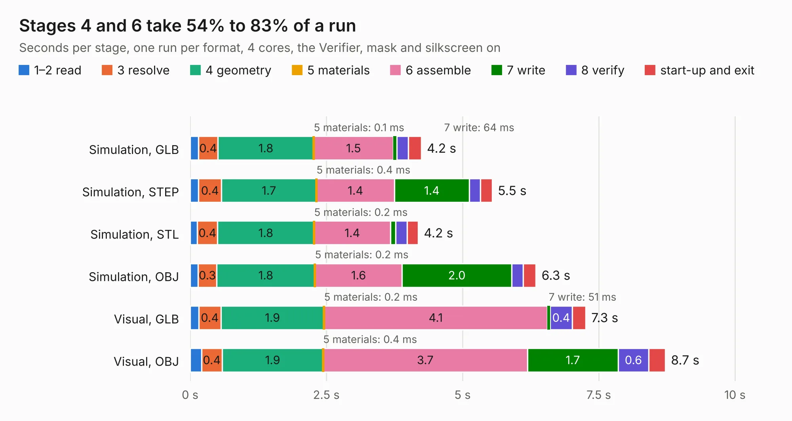

# 828. stemma-qwiic-grove-gravity-bog-plank

Board 828 of the 3,110 of [Corpus Testing](../Corpus-Testing.md), on [Corpus Page 8](../CorpusTestingPages/Corpus-Testing-08.md#828-stemma-qwiic-grove-gravity-bog-plank).

| Mode and format | 1–2 read | 3 resolve | 4 geometry | 5 materials | 6 assemble | 7 write | 8 verify | start-up and exit | Total |
|---|---:|---:|---:|---:|---:|---:|---:|---:|---:|
| Simulation, GLB | 0.2 | 0.4 | 1.8 | 0.1&nbsp;ms | 1.5 | 64&nbsp;ms | 0.2 | 0.2 | 4.2 |
| Simulation, STEP | 0.2 | 0.4 | 1.7 | 0.4&nbsp;ms | 1.4 | 1.4 | 0.2 | 0.2 | 5.5 |
| Simulation, STL | 0.1 | 0.4 | 1.8 | 0.2&nbsp;ms | 1.4 | 94&nbsp;ms | 0.2 | 0.2 | 4.2 |
| Simulation, OBJ | 0.1 | 0.3 | 1.8 | 0.2&nbsp;ms | 1.6 | 2.0 | 0.2 | 0.2 | 6.3 |
| Visual, GLB | 0.2 | 0.4 | 1.9 | 0.2&nbsp;ms | 4.1 | 51&nbsp;ms | 0.4 | 0.2 | 7.3 |
| Visual, OBJ | 0.2 | 0.4 | 1.9 | 0.4&nbsp;ms | 3.7 | 1.7 | 0.6 | 0.3 | 8.7 |

<table align="center"><tr><td valign="top">

| Board | Repo: [DangerousPrototypes/BusPirate5-hardware](https://github.com/DangerousPrototypes/BusPirate5-hardware) Board: `stemma-qwiic-grove-gravity-bog-plank.kicad_pcb` |
|---|---|
| Folder | development / adapter-stemma-qwiic-grove-gravity-bog-1REV0 |
| Complexity | 242&nbsp;/&nbsp;1000 (size&nbsp;142, features&nbsp;100) |
| KESE&nbsp;features | through vias, rounded, trapezoid or chamfered pads, filled zones, curved board outline, knockout text, stack-up, dielectric εr and tanδ |
| Tested | 9th November 2026 |
| Copper&nbsp;layers | 2 |
| File&nbsp;format | KiCad 9 (20241229) |
| Parts,&nbsp;tracks,&nbsp;vias | 13, 124, 77 |
| Triangles,&nbsp;simulation | 397,162 in 24 parts |
| Verifier | PASS in all six runs |

</td><td valign="top">

<table>
<tr><th>File type</th><th>File size</th><th>Peak memory used</th></tr>
<tr><th colspan="3" align="left">Simulation</th></tr>
<tr><td>GLB</td><td align="right">14&nbsp;MB</td><td align="right">271&nbsp;MB</td></tr>
<tr><td>STEP</td><td align="right">60&nbsp;MB</td><td align="right">302&nbsp;MB</td></tr>
<tr><td>STL</td><td align="right">20&nbsp;MB</td><td align="right">265&nbsp;MB</td></tr>
<tr><td>OBJ</td><td align="right">41&nbsp;MB</td><td align="right">324&nbsp;MB</td></tr>
<tr><th colspan="3" align="left">Visual</th></tr>
<tr><td>GLB</td><td align="right">10&nbsp;MB</td><td align="right">299&nbsp;MB</td></tr>
<tr><td>OBJ</td><td align="right">31&nbsp;MB</td><td align="right">297&nbsp;MB</td></tr>
</table>

</td></tr></table>

| Previous | Next |
|:---|---:|
| [827. sim-iccard-rev4](b0827b_BusPirate5-hardware_sim-iccard-rev4.md) | [829. BPUv2a](b0829b_BusPirateUltraHardware_BPUv2a.md) |
