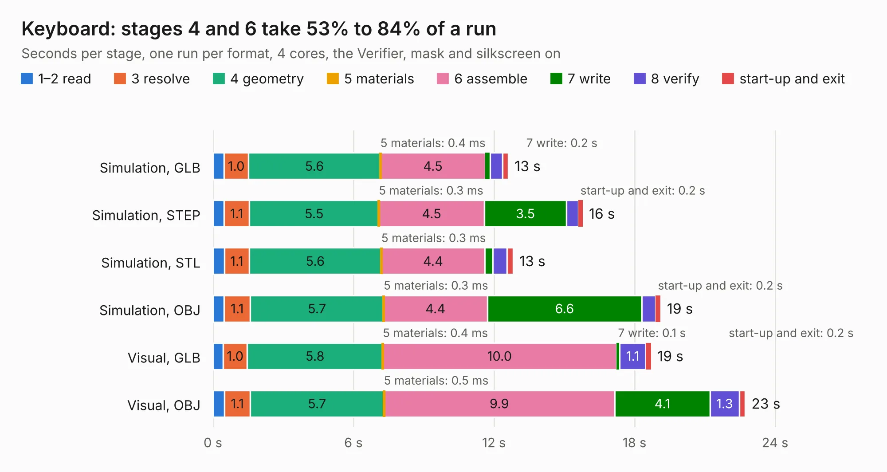

# 829. Keyboard

Board 829 of the 3,101 of [Corpus Testing](../Corpus-Testing.md), on [Corpus Page 8](../CorpusTestingPages/Corpus-Testing-08.md#829-keyboard).

| Mode and format | 1–2 read | 3 resolve | 4 geometry | 5 materials | 6 assemble | 7 write | 8 verify | start-up and exit | Total |
|---|---:|---:|---:|---:|---:|---:|---:|---:|---:|
| Simulation, GLB | 0.5 | 1.0 | 5.6 | 0.4&nbsp;ms | 4.5 | 0.2 | 0.5 | 0.3 | 12.6 |
| Simulation, STEP | 0.5 | 1.1 | 5.5 | 0.3&nbsp;ms | 4.5 | 3.5 | 0.5 | 0.2 | 15.8 |
| Simulation, STL | 0.5 | 1.1 | 5.6 | 0.3&nbsp;ms | 4.4 | 0.3 | 0.6 | 0.3 | 12.8 |
| Simulation, OBJ | 0.5 | 1.1 | 5.7 | 0.3&nbsp;ms | 4.4 | 6.6 | 0.6 | 0.2 | 19.1 |
| Visual, GLB | 0.4 | 1.0 | 5.8 | 0.4&nbsp;ms | 10.0 | 0.1 | 1.1 | 0.2 | 18.7 |
| Visual, OBJ | 0.5 | 1.1 | 5.7 | 0.5&nbsp;ms | 9.9 | 4.1 | 1.3 | 0.2 | 22.7 |

<table align="center"><tr><td valign="top">

| Board | Repo: [danwerner21/TI99_22](https://github.com/danwerner21/TI99_22) Board: `Keyboard.kicad_pcb` |
|---|---|
| Folder | Keyboard |
| Complexity | 205&nbsp;/&nbsp;1000 (size&nbsp;160, features&nbsp;45) |
| KESE&nbsp;features | through vias, filled zones, curved board outline |
| Tested | 9th November 2026 |
| Copper&nbsp;layers | 2 |
| File&nbsp;format | KiCad 6 (20211014) |
| Parts,&nbsp;tracks,&nbsp;vias | 57, 390, 8 |
| Triangles,&nbsp;simulation | 1,564,256 in 45 parts |
| Verifier | PASS in all six runs |

</td><td valign="top">

<table>
<tr><th>File type</th><th>File size</th><th>Peak memory used</th></tr>
<tr><th colspan="3" align="left">Simulation</th></tr>
<tr><td>GLB</td><td align="right">53&nbsp;MB</td><td align="right">691&nbsp;MB</td></tr>
<tr><td>STEP</td><td align="right">255&nbsp;MB</td><td align="right">755&nbsp;MB</td></tr>
<tr><td>STL</td><td align="right">78&nbsp;MB</td><td align="right">687&nbsp;MB</td></tr>
<tr><td>OBJ</td><td align="right">162&nbsp;MB</td><td align="right">1.1&nbsp;GB</td></tr>
<tr><th colspan="3" align="left">Visual</th></tr>
<tr><td>GLB</td><td align="right">34&nbsp;MB</td><td align="right">683&nbsp;MB</td></tr>
<tr><td>OBJ</td><td align="right">101&nbsp;MB</td><td align="right">818&nbsp;MB</td></tr>
</table>

</td></tr></table>

| Previous | Next |
|:---|---:|
| [828. IO_Riser](b0828b_TI99-22_IO-Riser.md) | [830. Console](b0830b_TI99-22_Console.md) |
