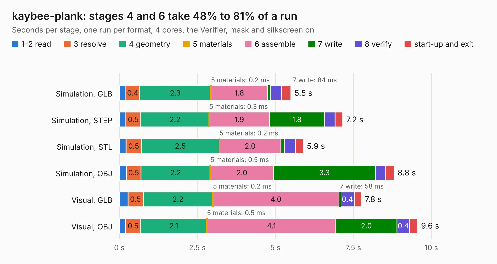

# 830. kaybee-plank

Board 830 of the 3,120 of [Corpus Testing](../Corpus-Testing.md), on [Corpus Page 8](../CorpusTestingPages/Corpus-Testing-08.md#830-kaybee-plank).

| Mode and format | 1–2 read | 3 resolve | 4 geometry | 5 materials | 6 assemble | 7 write | 8 verify | start-up and exit | Total |
|---|---:|---:|---:|---:|---:|---:|---:|---:|---:|
| Simulation, GLB | 0.2 | 0.4 | 2.3 | 0.2&nbsp;ms | 1.8 | 84&nbsp;ms | 0.4 | 0.3 | 5.5 |
| Simulation, STEP | 0.2 | 0.5 | 2.2 | 0.3&nbsp;ms | 1.9 | 1.8 | 0.3 | 0.2 | 7.2 |
| Simulation, STL | 0.2 | 0.5 | 2.5 | 0.2&nbsp;ms | 2.0 | 0.1 | 0.3 | 0.3 | 5.9 |
| Simulation, OBJ | 0.2 | 0.5 | 2.2 | 0.5&nbsp;ms | 2.0 | 3.3 | 0.3 | 0.3 | 8.8 |
| Visual, GLB | 0.3 | 0.5 | 2.2 | 0.2&nbsp;ms | 4.0 | 58&nbsp;ms | 0.4 | 0.2 | 7.8 |
| Visual, OBJ | 0.2 | 0.5 | 2.1 | 0.5&nbsp;ms | 4.1 | 2.0 | 0.4 | 0.3 | 9.6 |

<table align="center"><tr><td valign="top">

| Board | Repo: [DangerousPrototypes/BusPirate5-hardware](https://github.com/DangerousPrototypes/BusPirate5-hardware) Board: `kaybee-plank.kicad_pcb` |
|---|---|
| Folder | development / adapter-kaybee-plank-1REV0 |
| Complexity | 250&nbsp;/&nbsp;1000 (size&nbsp;140, features&nbsp;110) |
| KESE&nbsp;features | through vias, slotted holes, rounded, trapezoid or chamfered pads, filled zones, curved board outline, knockout text, stack-up, dielectric εr and tanδ |
| Tested | 9th November 2026 |
| Copper&nbsp;layers | 2 |
| File&nbsp;format | KiCad 8 (20240108) |
| Parts,&nbsp;tracks,&nbsp;vias | 20, 175, 24 |
| Triangles,&nbsp;simulation | 421,190 in 37 parts |
| Verifier | PASS in all six runs |

</td><td valign="top">

<table>
<tr><th>File type</th><th>File size</th><th>Peak memory used</th></tr>
<tr><th colspan="3" align="left">Simulation</th></tr>
<tr><td>GLB</td><td align="right">15&nbsp;MB</td><td align="right">270&nbsp;MB</td></tr>
<tr><td>STEP</td><td align="right">70&nbsp;MB</td><td align="right">310&nbsp;MB</td></tr>
<tr><td>STL</td><td align="right">21&nbsp;MB</td><td align="right">266&nbsp;MB</td></tr>
<tr><td>OBJ</td><td align="right">43&nbsp;MB</td><td align="right">317&nbsp;MB</td></tr>
<tr><th colspan="3" align="left">Visual</th></tr>
<tr><td>GLB</td><td align="right">10&nbsp;MB</td><td align="right">315&nbsp;MB</td></tr>
<tr><td>OBJ</td><td align="right">30&nbsp;MB</td><td align="right">313&nbsp;MB</td></tr>
</table>

</td></tr></table>

| Previous | Next |
|:---|---:|
| [829. flash-sop-rev4](b0829b_BusPirate5-hardware_flash-sop-rev4.md) | [831. kaybee-plank](b0831b_BusPirate5-hardware_development-adapter-kaybee-plank-1REV1_kaybee-plank.md) |
