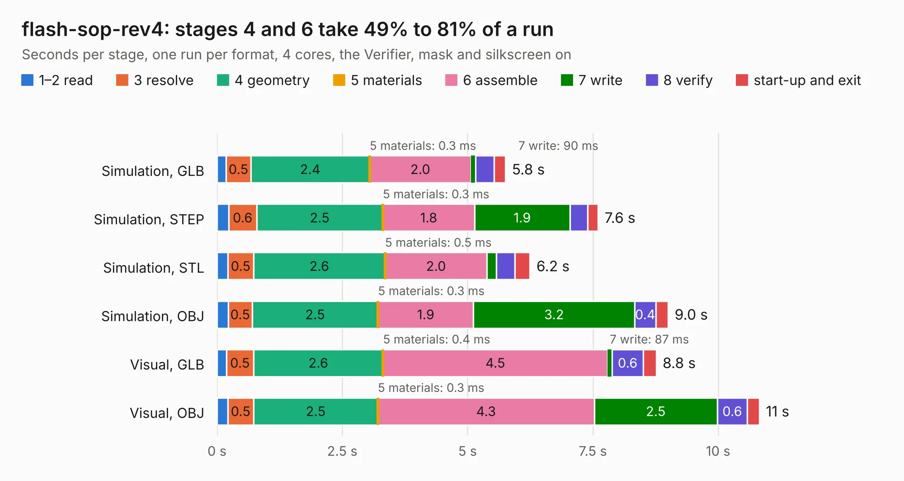

# 830. flash-sop-rev4

Board 830 of the 3,126 of [Corpus Testing](../Corpus-Testing.md), on [Corpus Page 8](../CorpusTestingPages/Corpus-Testing-08.md#830-flash-sop-rev4).

| Mode and format | 1–2 read | 3 resolve | 4 geometry | 5 materials | 6 assemble | 7 write | 8 verify | start-up and exit | Total |
|---|---:|---:|---:|---:|---:|---:|---:|---:|---:|
| Simulation, GLB | 0.2 | 0.5 | 2.4 | 0.3&nbsp;ms | 2.0 | 90&nbsp;ms | 0.4 | 0.2 | 5.8 |
| Simulation, STEP | 0.2 | 0.6 | 2.5 | 0.3&nbsp;ms | 1.8 | 1.9 | 0.4 | 0.2 | 7.6 |
| Simulation, STL | 0.2 | 0.5 | 2.6 | 0.5&nbsp;ms | 2.0 | 0.2 | 0.4 | 0.3 | 6.2 |
| Simulation, OBJ | 0.2 | 0.5 | 2.5 | 0.3&nbsp;ms | 1.9 | 3.2 | 0.4 | 0.2 | 9.0 |
| Visual, GLB | 0.2 | 0.5 | 2.6 | 0.4&nbsp;ms | 4.5 | 87&nbsp;ms | 0.6 | 0.3 | 8.8 |
| Visual, OBJ | 0.2 | 0.5 | 2.5 | 0.3&nbsp;ms | 4.3 | 2.5 | 0.6 | 0.2 | 10.8 |

<table align="center"><tr><td valign="top">

| Board | Repo: [DangerousPrototypes/BusPirate5-hardware](https://github.com/DangerousPrototypes/BusPirate5-hardware) Board: `flash-sop-rev4.kicad_pcb` |
|---|---|
| Folder | development / adapter-flash-sop-1REV4 |
| Complexity | 207&nbsp;/&nbsp;1000 (size&nbsp;137, features&nbsp;70) |
| KESE&nbsp;features | through vias, rounded, trapezoid or chamfered pads, filled zones, curved board outline, knockout text |
| Tested | 9th November 2026 |
| Copper&nbsp;layers | 2 |
| File&nbsp;format | KiCad 9 (20241229) |
| Parts,&nbsp;tracks,&nbsp;vias | 10, 172, 48 |
| Triangles,&nbsp;simulation | 493,998 in 29 parts |
| Verifier | PASS in all six runs |

</td><td valign="top">

<table>
<tr><th>File type</th><th>File size</th><th>Peak memory used</th></tr>
<tr><th colspan="3" align="left">Simulation</th></tr>
<tr><td>GLB</td><td align="right">17&nbsp;MB</td><td align="right">299&nbsp;MB</td></tr>
<tr><td>STEP</td><td align="right">71&nbsp;MB</td><td align="right">344&nbsp;MB</td></tr>
<tr><td>STL</td><td align="right">25&nbsp;MB</td><td align="right">297&nbsp;MB</td></tr>
<tr><td>OBJ</td><td align="right">50&nbsp;MB</td><td align="right">368&nbsp;MB</td></tr>
<tr><th colspan="3" align="left">Visual</th></tr>
<tr><td>GLB</td><td align="right">13&nbsp;MB</td><td align="right">359&nbsp;MB</td></tr>
<tr><td>OBJ</td><td align="right">37&nbsp;MB</td><td align="right">360&nbsp;MB</td></tr>
</table>

</td></tr></table>

| Previous | Next |
|:---|---:|
| [829. flash-dip-rev4](b0829b_BusPirate5-hardware_flash-dip-rev4.md) | [831. kaybee-plank](b0831b_BusPirate5-hardware_development-adapter-kaybee-plank-1REV0_kaybee-plank.md) |
