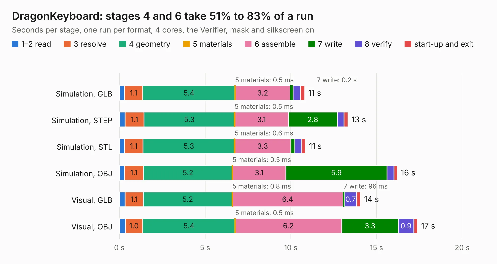

# 831. DragonKeyboard

Board 831 of the 3,111 of [Corpus Testing](../Corpus-Testing.md), on [Corpus Page 8](../CorpusTestingPages/Corpus-Testing-08.md#831-dragonkeyboard).

| Mode and format | 1–2 read | 3 resolve | 4 geometry | 5 materials | 6 assemble | 7 write | 8 verify | start-up and exit | Total |
|---|---:|---:|---:|---:|---:|---:|---:|---:|---:|
| Simulation, GLB | 0.3 | 1.1 | 5.4 | 0.5&nbsp;ms | 3.2 | 0.2 | 0.4 | 0.3 | 10.8 |
| Simulation, STEP | 0.3 | 1.1 | 5.3 | 0.5&nbsp;ms | 3.1 | 2.8 | 0.4 | 0.2 | 13.3 |
| Simulation, STL | 0.3 | 1.1 | 5.3 | 0.6&nbsp;ms | 3.3 | 0.2 | 0.4 | 0.2 | 10.9 |
| Simulation, OBJ | 0.3 | 1.1 | 5.2 | 0.5&nbsp;ms | 3.1 | 5.9 | 0.4 | 0.2 | 16.2 |
| Visual, GLB | 0.3 | 1.1 | 5.2 | 0.8&nbsp;ms | 6.4 | 96&nbsp;ms | 0.7 | 0.2 | 14.1 |
| Visual, OBJ | 0.4 | 1.0 | 5.4 | 0.5&nbsp;ms | 6.2 | 3.3 | 0.9 | 0.2 | 17.4 |

<table align="center"><tr><td valign="top">

| Board | Repo: [danwerner21/Dragon64](https://github.com/danwerner21/Dragon64) Board: `DragonKeyboard.kicad_pcb` |
|---|---|
| Folder | Dragon64Keyboard |
| Complexity | 192&nbsp;/&nbsp;1000 (size&nbsp;167, features&nbsp;25) |
| KESE&nbsp;features | through vias, curved board outline |
| Tested | 9th November 2026 |
| Copper&nbsp;layers | 2 |
| File&nbsp;format | KiCad 5 (20171130) |
| Parts,&nbsp;tracks,&nbsp;vias | 55, 590, 27 |
| Triangles,&nbsp;simulation | 1,111,518 in 27 parts |
| Verifier | PASS in all six runs |

</td><td valign="top">

<table>
<tr><th>File type</th><th>File size</th><th>Peak memory used</th></tr>
<tr><th colspan="3" align="left">Simulation</th></tr>
<tr><td>GLB</td><td align="right">38&nbsp;MB</td><td align="right">480&nbsp;MB</td></tr>
<tr><td>STEP</td><td align="right">177&nbsp;MB</td><td align="right">544&nbsp;MB</td></tr>
<tr><td>STL</td><td align="right">56&nbsp;MB</td><td align="right">516&nbsp;MB</td></tr>
<tr><td>OBJ</td><td align="right">114&nbsp;MB</td><td align="right">790&nbsp;MB</td></tr>
<tr><th colspan="3" align="left">Visual</th></tr>
<tr><td>GLB</td><td align="right">22&nbsp;MB</td><td align="right">524&nbsp;MB</td></tr>
<tr><td>OBJ</td><td align="right">66&nbsp;MB</td><td align="right">530&nbsp;MB</td></tr>
</table>

</td></tr></table>

| Previous | Next |
|:---|---:|
| [830. dragon64](b0830b_Dragon64_dragon64.md) | [832. CartRiser](b0832b_TI99-22_CartRiser.md) |
