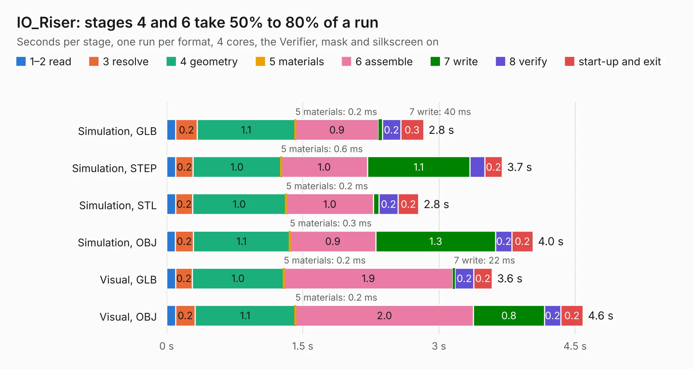

# 833. IO_Riser

Board 833 of the 3,110 of [Corpus Testing](../Corpus-Testing.md), on [Corpus Page 8](../CorpusTestingPages/Corpus-Testing-08.md#833-io_riser).

| Mode and format | 1–2 read | 3 resolve | 4 geometry | 5 materials | 6 assemble | 7 write | 8 verify | start-up and exit | Total |
|---|---:|---:|---:|---:|---:|---:|---:|---:|---:|
| Simulation, GLB | 0.1 | 0.2 | 1.1 | 0.2&nbsp;ms | 0.9 | 40&nbsp;ms | 0.2 | 0.3 | 2.8 |
| Simulation, STEP | 0.1 | 0.2 | 1.0 | 0.6&nbsp;ms | 1.0 | 1.1 | 0.2 | 0.2 | 3.7 |
| Simulation, STL | 0.1 | 0.2 | 1.0 | 0.2&nbsp;ms | 1.0 | 61&nbsp;ms | 0.2 | 0.2 | 2.8 |
| Simulation, OBJ | 95&nbsp;ms | 0.2 | 1.1 | 0.3&nbsp;ms | 0.9 | 1.3 | 0.2 | 0.2 | 4.0 |
| Visual, GLB | 98&nbsp;ms | 0.2 | 1.0 | 0.2&nbsp;ms | 1.9 | 22&nbsp;ms | 0.2 | 0.2 | 3.6 |
| Visual, OBJ | 99&nbsp;ms | 0.2 | 1.1 | 0.2&nbsp;ms | 2.0 | 0.8 | 0.2 | 0.2 | 4.6 |

<table align="center"><tr><td valign="top">

| Board | Repo: [danwerner21/TI99_22](https://github.com/danwerner21/TI99_22) Board: `IO_Riser.kicad_pcb` |
|---|---|
| Folder | IORiser / IO_Riser |
| Complexity | 187&nbsp;/&nbsp;1000 (size&nbsp;122, features&nbsp;65) |
| KESE&nbsp;features | through vias, filled zones, stack-up, dielectric εr and tanδ |
| Tested | 9th November 2026 |
| Copper&nbsp;layers | 2 |
| File&nbsp;format | KiCad 6 (20211014) |
| Parts,&nbsp;tracks,&nbsp;vias | 2, 274, 7 |
| Triangles,&nbsp;simulation | 249,684 in 51 parts |
| Verifier | PASS in all six runs |

</td><td valign="top">

<table>
<tr><th>File type</th><th>File size</th><th>Peak memory used</th></tr>
<tr><th colspan="3" align="left">Simulation</th></tr>
<tr><td>GLB</td><td align="right">8.0&nbsp;MB</td><td align="right">237&nbsp;MB</td></tr>
<tr><td>STEP</td><td align="right">34&nbsp;MB</td><td align="right">244&nbsp;MB</td></tr>
<tr><td>STL</td><td align="right">12&nbsp;MB</td><td align="right">221&nbsp;MB</td></tr>
<tr><td>OBJ</td><td align="right">24&nbsp;MB</td><td align="right">229&nbsp;MB</td></tr>
<tr><th colspan="3" align="left">Visual</th></tr>
<tr><td>GLB</td><td align="right">4.8&nbsp;MB</td><td align="right">217&nbsp;MB</td></tr>
<tr><td>OBJ</td><td align="right">14&nbsp;MB</td><td align="right">217&nbsp;MB</td></tr>
</table>

</td></tr></table>

| Previous | Next |
|:---|---:|
| [832. CartRiser](b0832b_TI99-22_CartRiser.md) | [834. Keyboard](b0834b_TI99-22_Keyboard.md) |
