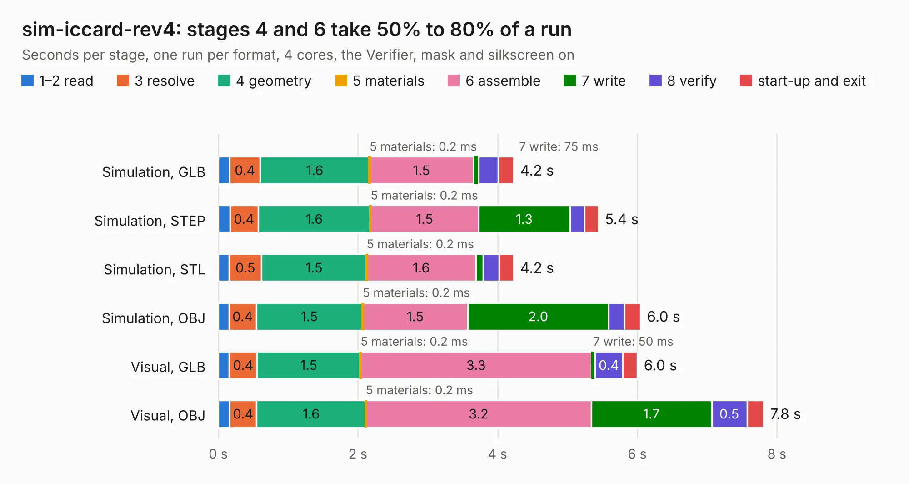

# 834. sim-iccard-rev4

Board 834 of the 3,122 of [Corpus Testing](../Corpus-Testing.md), on [Corpus Page 8](../CorpusTestingPages/Corpus-Testing-08.md#834-sim-iccard-rev4).

| Mode and format | 1–2 read | 3 resolve | 4 geometry | 5 materials | 6 assemble | 7 write | 8 verify | start-up and exit | Total |
|---|---:|---:|---:|---:|---:|---:|---:|---:|---:|
| Simulation, GLB | 0.2 | 0.4 | 1.6 | 0.2&nbsp;ms | 1.5 | 75&nbsp;ms | 0.3 | 0.2 | 4.2 |
| Simulation, STEP | 0.2 | 0.4 | 1.6 | 0.2&nbsp;ms | 1.5 | 1.3 | 0.2 | 0.2 | 5.4 |
| Simulation, STL | 0.2 | 0.5 | 1.5 | 0.2&nbsp;ms | 1.6 | 0.1 | 0.2 | 0.2 | 4.2 |
| Simulation, OBJ | 0.2 | 0.4 | 1.5 | 0.2&nbsp;ms | 1.5 | 2.0 | 0.2 | 0.2 | 6.0 |
| Visual, GLB | 0.2 | 0.4 | 1.5 | 0.2&nbsp;ms | 3.3 | 50&nbsp;ms | 0.4 | 0.2 | 6.0 |
| Visual, OBJ | 0.2 | 0.4 | 1.6 | 0.2&nbsp;ms | 3.2 | 1.7 | 0.5 | 0.2 | 7.8 |

<table align="center"><tr><td valign="top">

| Board | Repo: [DangerousPrototypes/BusPirate5-hardware](https://github.com/DangerousPrototypes/BusPirate5-hardware) Board: `sim-iccard-rev4.kicad_pcb` |
|---|---|
| Folder | development / adapter-sim-iccard-1REV4 |
| Complexity | 247&nbsp;/&nbsp;1000 (size&nbsp;147, features&nbsp;100) |
| KESE&nbsp;features | through vias, rounded, trapezoid or chamfered pads, filled zones, curved board outline, knockout text, stack-up, dielectric εr and tanδ |
| Tested | 9th November 2026 |
| Copper&nbsp;layers | 2 |
| File&nbsp;format | KiCad 9 (20241229) |
| Parts,&nbsp;tracks,&nbsp;vias | 12, 261, 87 |
| Triangles,&nbsp;simulation | 395,666 in 27 parts |
| Verifier | PASS in all six runs |

</td><td valign="top">

<table>
<tr><th>File type</th><th>File size</th><th>Peak memory used</th></tr>
<tr><th colspan="3" align="left">Simulation</th></tr>
<tr><td>GLB</td><td align="right">14&nbsp;MB</td><td align="right">269&nbsp;MB</td></tr>
<tr><td>STEP</td><td align="right">62&nbsp;MB</td><td align="right">324&nbsp;MB</td></tr>
<tr><td>STL</td><td align="right">20&nbsp;MB</td><td align="right">268&nbsp;MB</td></tr>
<tr><td>OBJ</td><td align="right">40&nbsp;MB</td><td align="right">323&nbsp;MB</td></tr>
<tr><th colspan="3" align="left">Visual</th></tr>
<tr><td>GLB</td><td align="right">12&nbsp;MB</td><td align="right">335&nbsp;MB</td></tr>
<tr><td>OBJ</td><td align="right">35&nbsp;MB</td><td align="right">334&nbsp;MB</td></tr>
</table>

</td></tr></table>

| Previous | Next |
|:---|---:|
| [833. ram-ddr5-1REV1](b0833b_BusPirate5-hardware_ram-ddr5-1REV1.md) | [835. stemma-qwiic-grove-gravity-bog-plank](b0835b_BusPirate5-hardware_stemma-qwiic-grove-gravity-bog-plank.md) |
