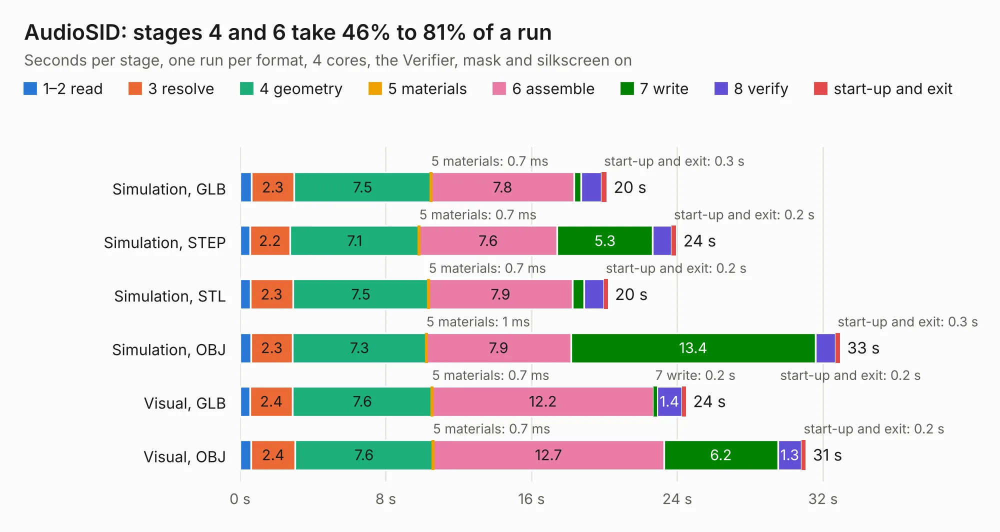

# 835. AudioSID

Board 835 of the 3,101 of [Corpus Testing](../Corpus-Testing.md), on [Corpus Page 8](../CorpusTestingPages/Corpus-Testing-08.md#835-audiosid).

| Mode and format | 1–2 read | 3 resolve | 4 geometry | 5 materials | 6 assemble | 7 write | 8 verify | start-up and exit | Total |
|---|---:|---:|---:|---:|---:|---:|---:|---:|---:|
| Simulation, GLB | 0.6 | 2.3 | 7.5 | 0.7&nbsp;ms | 7.8 | 0.4 | 1.1 | 0.3 | 20.1 |
| Simulation, STEP | 0.5 | 2.2 | 7.1 | 0.7&nbsp;ms | 7.6 | 5.3 | 1.0 | 0.2 | 23.9 |
| Simulation, STL | 0.6 | 2.3 | 7.5 | 0.7&nbsp;ms | 7.9 | 0.6 | 1.1 | 0.2 | 20.2 |
| Simulation, OBJ | 0.6 | 2.3 | 7.3 | 1&nbsp;ms | 7.9 | 13.4 | 1.1 | 0.3 | 32.9 |
| Visual, GLB | 0.5 | 2.4 | 7.6 | 0.7&nbsp;ms | 12.2 | 0.2 | 1.4 | 0.2 | 24.5 |
| Visual, OBJ | 0.6 | 2.4 | 7.6 | 0.7&nbsp;ms | 12.7 | 6.2 | 1.3 | 0.2 | 31.1 |

<table align="center"><tr><td valign="top">

| Board | Repo: [ddraig68k/hardware](https://github.com/ddraig68k/hardware) Board: `AudioSID.kicad_pcb` |
|---|---|
| Folder | expansion / AudioSID |
| Complexity | 308&nbsp;/&nbsp;1000 (size&nbsp;233, features&nbsp;75) |
| KESE&nbsp;features | through vias, slotted holes, rounded, trapezoid or chamfered pads, filled zones, copper text, curved board outline |
| Tested | 9th November 2026 |
| Copper&nbsp;layers | 4 |
| File&nbsp;format | KiCad 8 (20240108) |
| Parts,&nbsp;tracks,&nbsp;vias | 69, 754, 92 |
| Triangles,&nbsp;simulation | 2,551,884 in 130 parts |
| Verifier | PASS in all six runs |

</td><td valign="top">

<table>
<tr><th>File type</th><th>File size</th><th>Peak memory used</th></tr>
<tr><th colspan="3" align="left">Simulation</th></tr>
<tr><td>GLB</td><td align="right">85&nbsp;MB</td><td align="right">750&nbsp;MB</td></tr>
<tr><td>STEP</td><td align="right">276&nbsp;MB</td><td align="right">911&nbsp;MB</td></tr>
<tr><td>STL</td><td align="right">128&nbsp;MB</td><td align="right">723&nbsp;MB</td></tr>
<tr><td>OBJ</td><td align="right">266&nbsp;MB</td><td align="right">1.7&nbsp;GB</td></tr>
<tr><th colspan="3" align="left">Visual</th></tr>
<tr><td>GLB</td><td align="right">39&nbsp;MB</td><td align="right">859&nbsp;MB</td></tr>
<tr><td>OBJ</td><td align="right">120&nbsp;MB</td><td align="right">933&nbsp;MB</td></tr>
</table>

</td></tr></table>

| Previous | Next |
|:---|---:|
| [834. we816](b0834b_we816_we816.md) | [836. AudioYM2151](b0836b_hardware_AudioYM2151.md) |
