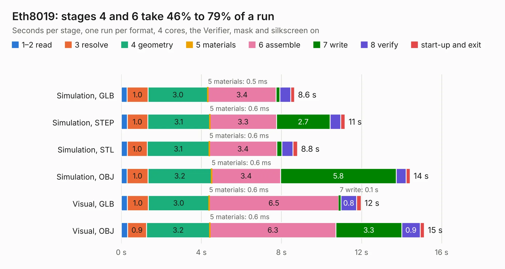

# 836. Eth8019

Board 836 of the 3,100 of [Corpus Testing](../Corpus-Testing.md), on [Corpus Page 8](../CorpusTestingPages/Corpus-Testing-08.md#836-eth8019).

| Mode and format | 1–2 read | 3 resolve | 4 geometry | 5 materials | 6 assemble | 7 write | 8 verify | start-up and exit | Total |
|---|---:|---:|---:|---:|---:|---:|---:|---:|---:|
| Simulation, GLB | 0.3 | 1.0 | 3.0 | 0.5&nbsp;ms | 3.4 | 0.2 | 0.5 | 0.2 | 8.6 |
| Simulation, STEP | 0.3 | 1.0 | 3.1 | 0.6&nbsp;ms | 3.3 | 2.7 | 0.5 | 0.2 | 11.2 |
| Simulation, STL | 0.3 | 1.0 | 3.1 | 0.6&nbsp;ms | 3.4 | 0.3 | 0.5 | 0.2 | 8.8 |
| Simulation, OBJ | 0.3 | 1.0 | 3.2 | 0.6&nbsp;ms | 3.4 | 5.8 | 0.5 | 0.2 | 14.4 |
| Visual, GLB | 0.3 | 1.0 | 3.0 | 0.6&nbsp;ms | 6.5 | 0.1 | 0.8 | 0.2 | 12.0 |
| Visual, OBJ | 0.3 | 0.9 | 3.2 | 0.6&nbsp;ms | 6.3 | 3.3 | 0.9 | 0.2 | 15.1 |

<table align="center"><tr><td valign="top">

| Board | Repo: [ddraig68k/hardware](https://github.com/ddraig68k/hardware) Board: `Eth8019.kicad_pcb` |
|---|---|
| Folder | expansion / Eth8019 |
| Complexity | 290&nbsp;/&nbsp;1000 (size&nbsp;225, features&nbsp;65) |
| KESE&nbsp;features | through vias, rounded, trapezoid or chamfered pads, filled zones, copper text, curved board outline |
| Tested | 9th November 2026 |
| Copper&nbsp;layers | 4 |
| File&nbsp;format | KiCad 8 (20240108) |
| Parts,&nbsp;tracks,&nbsp;vias | 30, 734, 109 |
| Triangles,&nbsp;simulation | 1,182,046 in 138 parts |
| Verifier | PASS in all six runs |

</td><td valign="top">

<table>
<tr><th>File type</th><th>File size</th><th>Peak memory used</th></tr>
<tr><th colspan="3" align="left">Simulation</th></tr>
<tr><td>GLB</td><td align="right">40&nbsp;MB</td><td align="right">444&nbsp;MB</td></tr>
<tr><td>STEP</td><td align="right">143&nbsp;MB</td><td align="right">523&nbsp;MB</td></tr>
<tr><td>STL</td><td align="right">59&nbsp;MB</td><td align="right">483&nbsp;MB</td></tr>
<tr><td>OBJ</td><td align="right">120&nbsp;MB</td><td align="right">804&nbsp;MB</td></tr>
<tr><th colspan="3" align="left">Visual</th></tr>
<tr><td>GLB</td><td align="right">22&nbsp;MB</td><td align="right">589&nbsp;MB</td></tr>
<tr><td>OBJ</td><td align="right">67&nbsp;MB</td><td align="right">581&nbsp;MB</td></tr>
</table>

</td></tr></table>

| Previous | Next |
|:---|---:|
| [835. AudioYM2151](b0835b_hardware_AudioYM2151.md) | [837. GfxTMS9918](b0837b_hardware_GfxTMS9918.md) |
