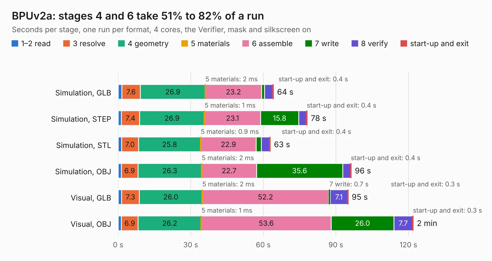

# 837. BPUv2a

Board 837 of the 3,127 of [Corpus Testing](../Corpus-Testing.md), on [Corpus Page 8](../CorpusTestingPages/Corpus-Testing-08.md#837-bpuv2a).

| Mode and format | 1–2 read | 3 resolve | 4 geometry | 5 materials | 6 assemble | 7 write | 8 verify | start-up and exit | Total |
|---|---:|---:|---:|---:|---:|---:|---:|---:|---:|
| Simulation, GLB | 1.5 | 7.6 | 26.9 | 2&nbsp;ms | 23.2 | 1.3 | 3.3 | 0.4 | 64.3 |
| Simulation, STEP | 1.4 | 7.4 | 26.9 | 1&nbsp;ms | 23.1 | 15.8 | 3.2 | 0.4 | 78.2 |
| Simulation, STL | 1.4 | 7.0 | 25.8 | 0.9&nbsp;ms | 22.9 | 2.1 | 3.4 | 0.4 | 63.0 |
| Simulation, OBJ | 1.3 | 6.9 | 26.3 | 2&nbsp;ms | 22.7 | 35.6 | 3.3 | 0.4 | 96.4 |
| Visual, GLB | 1.5 | 7.3 | 26.0 | 2&nbsp;ms | 52.2 | 0.7 | 7.1 | 0.3 | 95.1 |
| Visual, OBJ | 1.4 | 6.9 | 26.2 | 1&nbsp;ms | 53.6 | 26.0 | 7.7 | 0.3 | 122.0 |

<table align="center"><tr><td valign="top">

| Board | Repo: [DangerousPrototypes/BusPirateUltraHardware](https://github.com/DangerousPrototypes/BusPirateUltraHardware) Board: `BPUv2a.kicad_pcb` |
|---|---|
| Folder | BPUv2a |
| Complexity | 334&nbsp;/&nbsp;1000 (size&nbsp;289, features&nbsp;45) |
| KESE&nbsp;features | through vias, rounded, trapezoid or chamfered pads, filled zones |
| Tested | 9th November 2026 |
| Copper&nbsp;layers | 4 |
| File&nbsp;format | KiCad 5 (20171130) |
| Parts,&nbsp;tracks,&nbsp;vias | 211, 4,865, 509 |
| Triangles,&nbsp;simulation | 5,364,414 in 332 parts |
| Verifier | PASS in all six runs |

</td><td valign="top">

<table>
<tr><th>File type</th><th>File size</th><th>Peak memory used</th></tr>
<tr><th colspan="3" align="left">Simulation</th></tr>
<tr><td>GLB</td><td align="right">186&nbsp;MB</td><td align="right">1.7&nbsp;GB</td></tr>
<tr><td>STEP</td><td align="right">904&nbsp;MB</td><td align="right">1.8&nbsp;GB</td></tr>
<tr><td>STL</td><td align="right">268&nbsp;MB</td><td align="right">1.6&nbsp;GB</td></tr>
<tr><td>OBJ</td><td align="right">579&nbsp;MB</td><td align="right">3.5&nbsp;GB</td></tr>
<tr><th colspan="3" align="left">Visual</th></tr>
<tr><td>GLB</td><td align="right">119&nbsp;MB</td><td align="right">1.9&nbsp;GB</td></tr>
<tr><td>OBJ</td><td align="right">380&nbsp;MB</td><td align="right">2.5&nbsp;GB</td></tr>
</table>

</td></tr></table>

| Previous | Next |
|:---|---:|
| [836. stemma-qwiic-grove-gravity-bog-plank](b0836b_BusPirate5-hardware_stemma-qwiic-grove-gravity-bog-plank.md) | [838. dragon64](b0838b_Dragon64_dragon64.md) |
