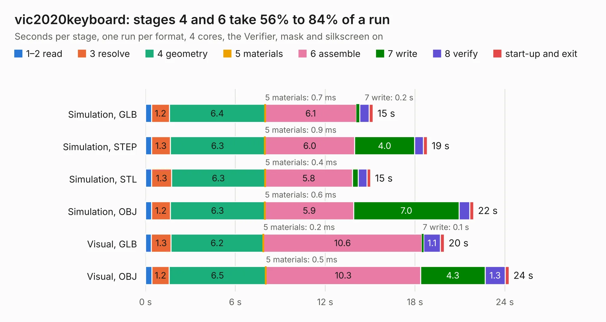

# 837. vic2020keyboard

Board 837 of the 3,110 of [Corpus Testing](../Corpus-Testing.md), on [Corpus Page 8](../CorpusTestingPages/Corpus-Testing-08.md#837-vic2020keyboard).

| Mode and format | 1–2 read | 3 resolve | 4 geometry | 5 materials | 6 assemble | 7 write | 8 verify | start-up and exit | Total |
|---|---:|---:|---:|---:|---:|---:|---:|---:|---:|
| Simulation, GLB | 0.4 | 1.2 | 6.4 | 0.7&nbsp;ms | 6.1 | 0.2 | 0.6 | 0.3 | 15.2 |
| Simulation, STEP | 0.4 | 1.3 | 6.3 | 0.9&nbsp;ms | 6.0 | 4.0 | 0.6 | 0.3 | 18.8 |
| Simulation, STL | 0.4 | 1.3 | 6.3 | 0.4&nbsp;ms | 5.8 | 0.4 | 0.6 | 0.3 | 15.0 |
| Simulation, OBJ | 0.4 | 1.2 | 6.3 | 0.6&nbsp;ms | 5.9 | 7.0 | 0.7 | 0.3 | 21.9 |
| Visual, GLB | 0.4 | 1.3 | 6.2 | 0.2&nbsp;ms | 10.6 | 0.1 | 1.1 | 0.3 | 20.0 |
| Visual, OBJ | 0.4 | 1.2 | 6.5 | 0.5&nbsp;ms | 10.3 | 4.3 | 1.3 | 0.3 | 24.3 |

<table align="center"><tr><td valign="top">

| Board | Repo: [danwerner21/vic2020](https://github.com/danwerner21/vic2020) Board: `vic2020keyboard.kicad_pcb` |
|---|---|
| Folder | vic2020keyboard |
| Complexity | 223&nbsp;/&nbsp;1000 (size&nbsp;168, features&nbsp;55) |
| KESE&nbsp;features | through vias, filled zones, copper text, curved board outline |
| Tested | 9th November 2026 |
| Copper&nbsp;layers | 2 |
| File&nbsp;format | KiCad 5 (20171130) |
| Parts,&nbsp;tracks,&nbsp;vias | 68, 545, 19 |
| Triangles,&nbsp;simulation | 1,505,518 in 31 parts |
| Verifier | PASS in all six runs |

</td><td valign="top">

<table>
<tr><th>File type</th><th>File size</th><th>Peak memory used</th></tr>
<tr><th colspan="3" align="left">Simulation</th></tr>
<tr><td>GLB</td><td align="right">51&nbsp;MB</td><td align="right">549&nbsp;MB</td></tr>
<tr><td>STEP</td><td align="right">232&nbsp;MB</td><td align="right">695&nbsp;MB</td></tr>
<tr><td>STL</td><td align="right">75&nbsp;MB</td><td align="right">559&nbsp;MB</td></tr>
<tr><td>OBJ</td><td align="right">156&nbsp;MB</td><td align="right">1.0&nbsp;GB</td></tr>
<tr><th colspan="3" align="left">Visual</th></tr>
<tr><td>GLB</td><td align="right">31&nbsp;MB</td><td align="right">680&nbsp;MB</td></tr>
<tr><td>OBJ</td><td align="right">94&nbsp;MB</td><td align="right">708&nbsp;MB</td></tr>
</table>

</td></tr></table>

| Previous | Next |
|:---|---:|
| [836. unicorn](b0836b_TI99-22_unicorn.md) | [838. Vic2020mainboard](b0838b_vic2020_Vic2020mainboard.md) |
