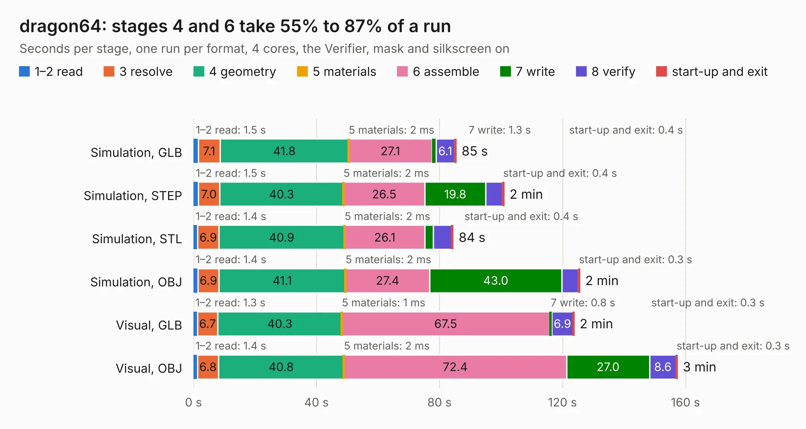

# 838. dragon64

Board 838 of the 3,126 of [Corpus Testing](../Corpus-Testing.md), on [Corpus Page 8](../CorpusTestingPages/Corpus-Testing-08.md#838-dragon64).

| Mode and format | 1–2 read | 3 resolve | 4 geometry | 5 materials | 6 assemble | 7 write | 8 verify | start-up and exit | Total |
|---|---:|---:|---:|---:|---:|---:|---:|---:|---:|
| Simulation, GLB | 1.5 | 7.1 | 41.8 | 2&nbsp;ms | 27.1 | 1.3 | 6.1 | 0.4 | 85.3 |
| Simulation, STEP | 1.5 | 7.0 | 40.3 | 2&nbsp;ms | 26.5 | 19.8 | 5.5 | 0.4 | 100.9 |
| Simulation, STL | 1.4 | 6.9 | 40.9 | 2&nbsp;ms | 26.1 | 2.7 | 6.0 | 0.4 | 84.4 |
| Simulation, OBJ | 1.4 | 6.9 | 41.1 | 2&nbsp;ms | 27.4 | 43.0 | 5.4 | 0.3 | 125.5 |
| Visual, GLB | 1.3 | 6.7 | 40.3 | 1&nbsp;ms | 67.5 | 0.8 | 6.9 | 0.3 | 123.7 |
| Visual, OBJ | 1.4 | 6.8 | 40.8 | 2&nbsp;ms | 72.4 | 27.0 | 8.6 | 0.3 | 157.3 |

<table align="center"><tr><td valign="top">

| Board | Repo: [danwerner21/Dragon64](https://github.com/danwerner21/Dragon64) Board: `dragon64.kicad_pcb` |
|---|---|
| Folder | Dragon64Board |
| Complexity | 286&nbsp;/&nbsp;1000 (size&nbsp;221, features&nbsp;65) |
| KESE&nbsp;features | through vias, rounded, trapezoid or chamfered pads, drill offsets, filled zones, curved board outline |
| Tested | 9th November 2026 |
| Copper&nbsp;layers | 2 |
| File&nbsp;format | KiCad 5 (20171130) |
| Parts,&nbsp;tracks,&nbsp;vias | 224, 6,439, 226 |
| Triangles,&nbsp;simulation | 7,758,606 in 277 parts |
| Verifier | PASS in all six runs |

</td><td valign="top">

<table>
<tr><th>File type</th><th>File size</th><th>Peak memory used</th></tr>
<tr><th colspan="3" align="left">Simulation</th></tr>
<tr><td>GLB</td><td align="right">262&nbsp;MB</td><td align="right">2.4&nbsp;GB</td></tr>
<tr><td>STEP</td><td align="right">1.3&nbsp;GB</td><td align="right">3.0&nbsp;GB</td></tr>
<tr><td>STL</td><td align="right">388&nbsp;MB</td><td align="right">2.3&nbsp;GB</td></tr>
<tr><td>OBJ</td><td align="right">823&nbsp;MB</td><td align="right">4.9&nbsp;GB</td></tr>
<tr><th colspan="3" align="left">Visual</th></tr>
<tr><td>GLB</td><td align="right">166&nbsp;MB</td><td align="right">2.6&nbsp;GB</td></tr>
<tr><td>OBJ</td><td align="right">529&nbsp;MB</td><td align="right">3.2&nbsp;GB</td></tr>
</table>

</td></tr></table>

| Previous | Next |
|:---|---:|
| [837. BPUv2a](b0837b_BusPirateUltraHardware_BPUv2a.md) | [839. DragonKeyboard](b0839b_Dragon64_DragonKeyboard.md) |
