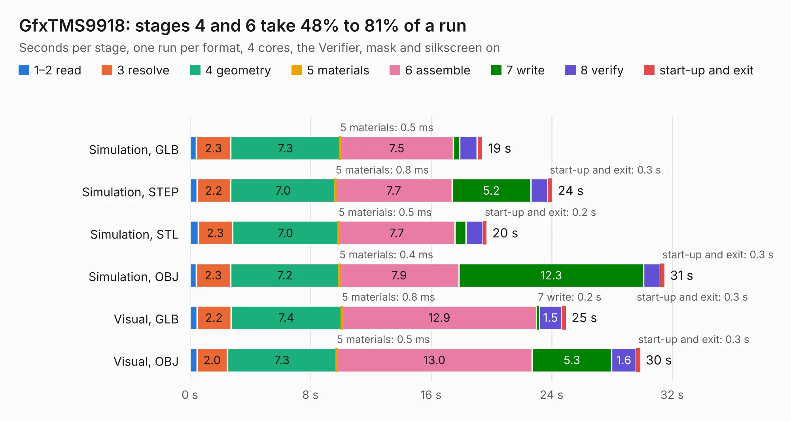

# 838. GfxTMS9918

Board 838 of the 3,101 of [Corpus Testing](../Corpus-Testing.md), on [Corpus Page 8](../CorpusTestingPages/Corpus-Testing-08.md#838-gfxtms9918).

| Mode and format | 1–2 read | 3 resolve | 4 geometry | 5 materials | 6 assemble | 7 write | 8 verify | start-up and exit | Total |
|---|---:|---:|---:|---:|---:|---:|---:|---:|---:|
| Simulation, GLB | 0.4 | 2.3 | 7.3 | 0.5&nbsp;ms | 7.5 | 0.4 | 1.2 | 0.4 | 19.4 |
| Simulation, STEP | 0.5 | 2.2 | 7.0 | 0.8&nbsp;ms | 7.7 | 5.2 | 1.1 | 0.3 | 24.0 |
| Simulation, STL | 0.6 | 2.3 | 7.0 | 0.5&nbsp;ms | 7.7 | 0.7 | 1.1 | 0.2 | 19.7 |
| Simulation, OBJ | 0.4 | 2.3 | 7.2 | 0.4&nbsp;ms | 7.9 | 12.3 | 1.1 | 0.3 | 31.5 |
| Visual, GLB | 0.5 | 2.2 | 7.4 | 0.8&nbsp;ms | 12.9 | 0.2 | 1.5 | 0.3 | 24.9 |
| Visual, OBJ | 0.5 | 2.0 | 7.3 | 0.5&nbsp;ms | 13.0 | 5.3 | 1.6 | 0.3 | 29.9 |

<table align="center"><tr><td valign="top">

| Board | Repo: [ddraig68k/hardware](https://github.com/ddraig68k/hardware) Board: `GfxTMS9918.kicad_pcb` |
|---|---|
| Folder | expansion / GfxTMS9918 |
| Complexity | 280&nbsp;/&nbsp;1000 (size&nbsp;225, features&nbsp;55) |
| KESE&nbsp;features | through vias, rounded, trapezoid or chamfered pads, filled zones, curved board outline |
| Tested | 9th November 2026 |
| Copper&nbsp;layers | 4 |
| File&nbsp;format | KiCad 8 (20240108) |
| Parts,&nbsp;tracks,&nbsp;vias | 33, 687, 120 |
| Triangles,&nbsp;simulation | 2,607,248 in 139 parts |
| Verifier | PASS in all six runs |

</td><td valign="top">

<table>
<tr><th>File type</th><th>File size</th><th>Peak memory used</th></tr>
<tr><th colspan="3" align="left">Simulation</th></tr>
<tr><td>GLB</td><td align="right">86&nbsp;MB</td><td align="right">756&nbsp;MB</td></tr>
<tr><td>STEP</td><td align="right">276&nbsp;MB</td><td align="right">973&nbsp;MB</td></tr>
<tr><td>STL</td><td align="right">130&nbsp;MB</td><td align="right">738&nbsp;MB</td></tr>
<tr><td>OBJ</td><td align="right">272&nbsp;MB</td><td align="right">1.7&nbsp;GB</td></tr>
<tr><th colspan="3" align="left">Visual</th></tr>
<tr><td>GLB</td><td align="right">38&nbsp;MB</td><td align="right">966&nbsp;MB</td></tr>
<tr><td>OBJ</td><td align="right">117&nbsp;MB</td><td align="right">1.0&nbsp;GB</td></tr>
</table>

</td></tr></table>

| Previous | Next |
|:---|---:|
| [837. Eth8019](b0837b_hardware_Eth8019.md) | [839. GfxV9958](b0839b_hardware_GfxV9958.md) |
