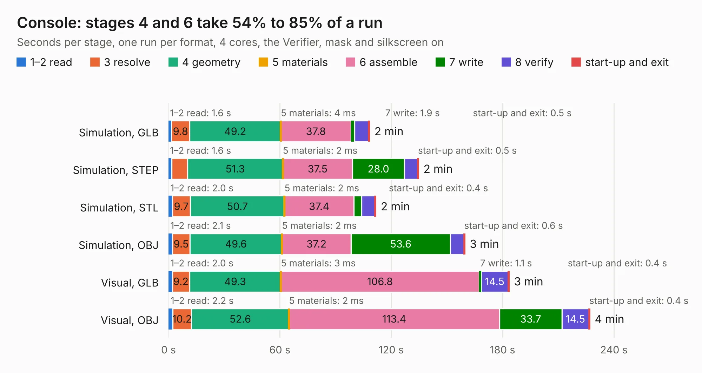

# 842. Console

Board 842 of the 3,121 of [Corpus Testing](../Corpus-Testing.md), on [Corpus Page 8](../CorpusTestingPages/Corpus-Testing-08.md#842-console).

| Mode and format | 1–2 read | 3 resolve | 4 geometry | 5 materials | 6 assemble | 7 write | 8 verify | start-up and exit | Total |
|---|---:|---:|---:|---:|---:|---:|---:|---:|---:|
| Simulation, GLB | 1.6 | 9.8 | 49.2 | 4&nbsp;ms | 37.8 | 1.9 | 7.5 | 0.5 | 108.2 |
| Simulation, STEP | 1.6 | 8.7 | 51.3 | 2&nbsp;ms | 37.5 | 28.0 | 7.1 | 0.5 | 134.7 |
| Simulation, STL | 2.0 | 9.7 | 50.7 | 2&nbsp;ms | 37.4 | 4.2 | 7.1 | 0.4 | 111.7 |
| Simulation, OBJ | 2.1 | 9.5 | 49.6 | 2&nbsp;ms | 37.2 | 53.6 | 7.1 | 0.6 | 159.6 |
| Visual, GLB | 2.0 | 9.2 | 49.3 | 3&nbsp;ms | 106.8 | 1.1 | 14.5 | 0.4 | 183.5 |
| Visual, OBJ | 2.2 | 10.2 | 52.6 | 2&nbsp;ms | 113.4 | 33.7 | 14.5 | 0.4 | 227.0 |

<table align="center"><tr><td valign="top">

| Board | Repo: [danwerner21/TI99_22](https://github.com/danwerner21/TI99_22) Board: `Console.kicad_pcb` |
|---|---|
| Folder | mainboard |
| Complexity | 294&nbsp;/&nbsp;1000 (size&nbsp;229, features&nbsp;65) |
| KESE&nbsp;features | through vias, rounded, trapezoid or chamfered pads, drill offsets, filled zones, curved board outline |
| Tested | 9th November 2026 |
| Copper&nbsp;layers | 2 |
| File&nbsp;format | KiCad 6 (20211014) |
| Parts,&nbsp;tracks,&nbsp;vias | 244, 9,062, 592 |
| Triangles,&nbsp;simulation | 9,777,460 in 365 parts |
| Verifier | PASS in all six runs |

</td><td valign="top">

<table>
<tr><th>File type</th><th>File size</th><th>Peak memory used</th></tr>
<tr><th colspan="3" align="left">Simulation</th></tr>
<tr><td>GLB</td><td align="right">334&nbsp;MB</td><td align="right">3.2&nbsp;GB</td></tr>
<tr><td>STEP</td><td align="right">1.8&nbsp;GB</td><td align="right">3.8&nbsp;GB</td></tr>
<tr><td>STL</td><td align="right">489&nbsp;MB</td><td align="right">3.2&nbsp;GB</td></tr>
<tr><td>OBJ</td><td align="right">1.0&nbsp;GB</td><td align="right">6.1&nbsp;GB</td></tr>
<tr><th colspan="3" align="left">Visual</th></tr>
<tr><td>GLB</td><td align="right">215&nbsp;MB</td><td align="right">3.3&nbsp;GB</td></tr>
<tr><td>OBJ</td><td align="right">688&nbsp;MB</td><td align="right">4.2&nbsp;GB</td></tr>
</table>

</td></tr></table>

| Previous | Next |
|:---|---:|
| [841. Keyboard](b0841b_TI99-22_Keyboard.md) | [843. unicorn](b0843b_TI99-22_unicorn.md) |
