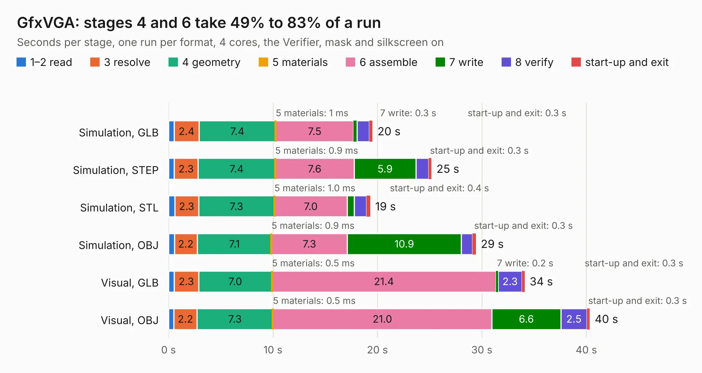

# 842. GfxVGA

Board 842 of the 3,102 of [Corpus Testing](../Corpus-Testing.md), on [Corpus Page 8](../CorpusTestingPages/Corpus-Testing-08.md#842-gfxvga).

| Mode and format | 1–2 read | 3 resolve | 4 geometry | 5 materials | 6 assemble | 7 write | 8 verify | start-up and exit | Total |
|---|---:|---:|---:|---:|---:|---:|---:|---:|---:|
| Simulation, GLB | 0.5 | 2.4 | 7.4 | 1&nbsp;ms | 7.5 | 0.3 | 1.2 | 0.3 | 19.5 |
| Simulation, STEP | 0.5 | 2.3 | 7.4 | 0.9&nbsp;ms | 7.6 | 5.9 | 1.2 | 0.3 | 25.2 |
| Simulation, STL | 0.6 | 2.3 | 7.3 | 1.0&nbsp;ms | 7.0 | 0.7 | 1.2 | 0.4 | 19.3 |
| Simulation, OBJ | 0.6 | 2.2 | 7.1 | 0.9&nbsp;ms | 7.3 | 10.9 | 1.1 | 0.3 | 29.4 |
| Visual, GLB | 0.5 | 2.3 | 7.0 | 0.5&nbsp;ms | 21.4 | 0.2 | 2.3 | 0.3 | 34.1 |
| Visual, OBJ | 0.5 | 2.2 | 7.3 | 0.5&nbsp;ms | 21.0 | 6.6 | 2.5 | 0.3 | 40.3 |

<table align="center"><tr><td valign="top">

| Board | Repo: [ddraig68k/hardware](https://github.com/ddraig68k/hardware) Board: `GfxVGA.kicad_pcb` |
|---|---|
| Folder | expansion / GfxVGA |
| Complexity | 294&nbsp;/&nbsp;1000 (size&nbsp;209, features&nbsp;85) |
| KESE&nbsp;features | through vias, rounded, trapezoid or chamfered pads, filled zones, curved board outline, stack-up, dielectric εr and tanδ |
| Tested | 9th November 2026 |
| Copper&nbsp;layers | 4 |
| File&nbsp;format | KiCad 9 (20241229) |
| Parts,&nbsp;tracks,&nbsp;vias | 96, 1,375, 250 |
| Triangles,&nbsp;simulation | 2,112,700 in 219 parts |
| Verifier | PASS in all six runs |

</td><td valign="top">

<table>
<tr><th>File type</th><th>File size</th><th>Peak memory used</th></tr>
<tr><th colspan="3" align="left">Simulation</th></tr>
<tr><td>GLB</td><td align="right">71&nbsp;MB</td><td align="right">739&nbsp;MB</td></tr>
<tr><td>STEP</td><td align="right">264&nbsp;MB</td><td align="right">893&nbsp;MB</td></tr>
<tr><td>STL</td><td align="right">106&nbsp;MB</td><td align="right">702&nbsp;MB</td></tr>
<tr><td>OBJ</td><td align="right">221&nbsp;MB</td><td align="right">1.4&nbsp;GB</td></tr>
<tr><th colspan="3" align="left">Visual</th></tr>
<tr><td>GLB</td><td align="right">45&nbsp;MB</td><td align="right">921&nbsp;MB</td></tr>
<tr><td>OBJ</td><td align="right">139&nbsp;MB</td><td align="right">1.0&nbsp;GB</td></tr>
</table>

</td></tr></table>

| Previous | Next |
|:---|---:|
| [841. GfxV9990](b0841b_hardware_GfxV9990.md) | [843. JoypadController](b0843b_hardware_JoypadController.md) |
