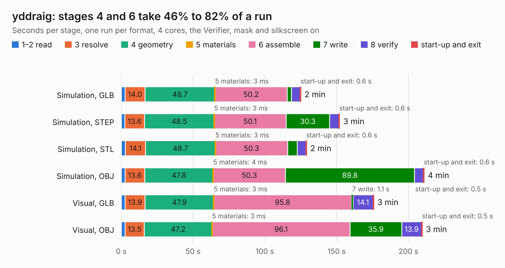

# 842. yddraig

Board 842 of the 3,100 of [Corpus Testing](../Corpus-Testing.md), on [Corpus Page 8](../CorpusTestingPages/Corpus-Testing-08.md#842-yddraig).

| Mode and format | 1–2 read | 3 resolve | 4 geometry | 5 materials | 6 assemble | 7 write | 8 verify | start-up and exit | Total |
|---|---:|---:|---:|---:|---:|---:|---:|---:|---:|
| Simulation, GLB | 2.6 | 14.0 | 48.7 | 3&nbsp;ms | 50.2 | 3.0 | 6.0 | 0.6 | 125.2 |
| Simulation, STEP | 2.5 | 13.6 | 48.5 | 3&nbsp;ms | 50.1 | 30.3 | 6.4 | 0.6 | 152.1 |
| Simulation, STL | 2.8 | 14.1 | 48.7 | 3&nbsp;ms | 50.3 | 6.8 | 6.0 | 0.6 | 129.2 |
| Simulation, OBJ | 2.7 | 13.6 | 47.8 | 4&nbsp;ms | 50.3 | 89.8 | 6.3 | 0.6 | 211.0 |
| Visual, GLB | 2.6 | 13.9 | 47.9 | 3&nbsp;ms | 95.8 | 1.1 | 14.1 | 0.5 | 175.9 |
| Visual, OBJ | 2.6 | 13.5 | 47.2 | 3&nbsp;ms | 96.1 | 35.9 | 13.9 | 0.5 | 209.7 |

<table align="center"><tr><td valign="top">

| Board | Repo: [ddraig68k/hardware](https://github.com/ddraig68k/hardware) Board: `yddraig.kicad_pcb` |
|---|---|
| Folder | yddraig |
| Complexity | 344&nbsp;/&nbsp;1000 (size&nbsp;279, features&nbsp;65) |
| KESE&nbsp;features | through vias, rounded, trapezoid or chamfered pads, filled zones, copper text, curved board outline |
| Tested | 9th November 2026 |
| Copper&nbsp;layers | 4 |
| File&nbsp;format | KiCad 9 (20241229) |
| Parts,&nbsp;tracks,&nbsp;vias | 217, 4,848, 1,042 |
| Triangles,&nbsp;simulation | 16,082,112 in 493 parts |
| Verifier | PASS in all six runs |

</td><td valign="top">

<table>
<tr><th>File type</th><th>File size</th><th>Peak memory used</th></tr>
<tr><th colspan="3" align="left">Simulation</th></tr>
<tr><td>GLB</td><td align="right">540&nbsp;MB</td><td align="right">3.2&nbsp;GB</td></tr>
<tr><td>STEP</td><td align="right">1.8&nbsp;GB</td><td align="right">4.5&nbsp;GB</td></tr>
<tr><td>STL</td><td align="right">804&nbsp;MB</td><td align="right">3.5&nbsp;GB</td></tr>
<tr><td>OBJ</td><td align="right">1.7&nbsp;GB</td><td align="right">10&nbsp;GB</td></tr>
<tr><th colspan="3" align="left">Visual</th></tr>
<tr><td>GLB</td><td align="right">244&nbsp;MB</td><td align="right">4.0&nbsp;GB</td></tr>
<tr><td>OBJ</td><td align="right">795&nbsp;MB</td><td align="right">5.2&nbsp;GB</td></tr>
</table>

</td></tr></table>

| Previous | Next |
|:---|---:|
| [841. JoypadController](b0841b_hardware_JoypadController.md) | [843. muon](b0843b_muon-kbd_muon.md) |
