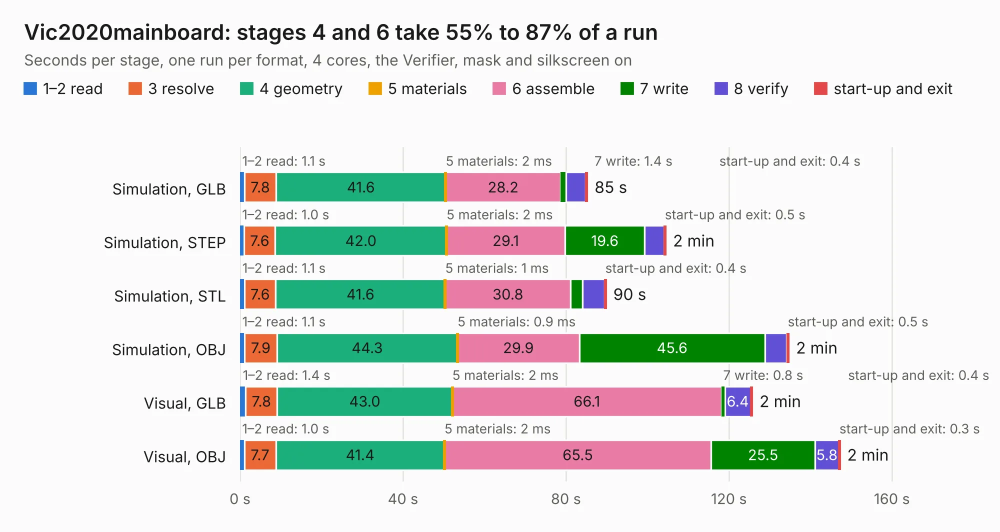

# 843. Vic2020mainboard

Board 843 of the 3,117 of [Corpus Testing](../Corpus-Testing.md), on [Corpus Page 8](../CorpusTestingPages/Corpus-Testing-08.md#843-vic2020mainboard).

| Mode and format | 1–2 read | 3 resolve | 4 geometry | 5 materials | 6 assemble | 7 write | 8 verify | start-up and exit | Total |
|---|---:|---:|---:|---:|---:|---:|---:|---:|---:|
| Simulation, GLB | 1.1 | 7.8 | 41.6 | 2&nbsp;ms | 28.2 | 1.4 | 4.8 | 0.4 | 85.3 |
| Simulation, STEP | 1.0 | 7.6 | 42.0 | 2&nbsp;ms | 29.1 | 19.6 | 4.7 | 0.5 | 104.5 |
| Simulation, STL | 1.1 | 7.6 | 41.6 | 1&nbsp;ms | 30.8 | 3.0 | 5.3 | 0.4 | 89.9 |
| Simulation, OBJ | 1.1 | 7.9 | 44.3 | 0.9&nbsp;ms | 29.9 | 45.6 | 5.3 | 0.5 | 134.7 |
| Visual, GLB | 1.4 | 7.8 | 43.0 | 2&nbsp;ms | 66.1 | 0.8 | 6.4 | 0.4 | 125.7 |
| Visual, OBJ | 1.0 | 7.7 | 41.4 | 2&nbsp;ms | 65.5 | 25.5 | 5.8 | 0.3 | 147.3 |

<table align="center"><tr><td valign="top">

| Board | Repo: [danwerner21/vic2020](https://github.com/danwerner21/vic2020) Board: `Vic2020mainboard.kicad_pcb` |
|---|---|
| Folder | vic2020mainboard |
| Complexity | 270&nbsp;/&nbsp;1000 (size&nbsp;215, features&nbsp;55) |
| KESE&nbsp;features | through vias, slotted holes, filled zones, curved board outline |
| Tested | 9th November 2026 |
| Copper&nbsp;layers | 2 |
| File&nbsp;format | KiCad 5 (20171130) |
| Parts,&nbsp;tracks,&nbsp;vias | 129, 5,946, 398 |
| Triangles,&nbsp;simulation | 6,529,804 in 197 parts |
| Verifier | PASS in all six runs |

</td><td valign="top">

<table>
<tr><th>File type</th><th>File size</th><th>Peak memory used</th></tr>
<tr><th colspan="3" align="left">Simulation</th></tr>
<tr><td>GLB</td><td align="right">225&nbsp;MB</td><td align="right">1.7&nbsp;GB</td></tr>
<tr><td>STEP</td><td align="right">1.2&nbsp;GB</td><td align="right">2.3&nbsp;GB</td></tr>
<tr><td>STL</td><td align="right">327&nbsp;MB</td><td align="right">1.8&nbsp;GB</td></tr>
<tr><td>OBJ</td><td align="right">704&nbsp;MB</td><td align="right">4.2&nbsp;GB</td></tr>
<tr><th colspan="3" align="left">Visual</th></tr>
<tr><td>GLB</td><td align="right">136&nbsp;MB</td><td align="right">2.2&nbsp;GB</td></tr>
<tr><td>OBJ</td><td align="right">430&nbsp;MB</td><td align="right">2.8&nbsp;GB</td></tr>
</table>

</td></tr></table>

| Previous | Next |
|:---|---:|
| [842. vic2020keyboard](b0842b_vic2020_vic2020keyboard.md) | [844. we816](b0844b_we816_we816.md) |
