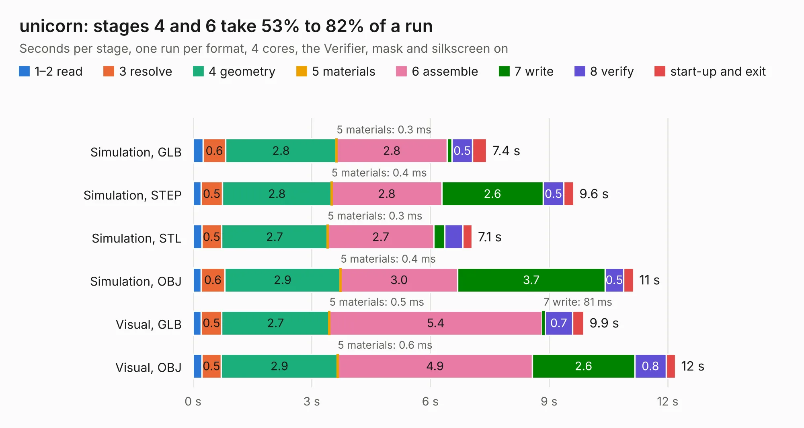

# 844. unicorn

Board 844 of the 3,123 of [Corpus Testing](../Corpus-Testing.md), on [Corpus Page 8](../CorpusTestingPages/Corpus-Testing-08.md#844-unicorn).

| Mode and format | 1–2 read | 3 resolve | 4 geometry | 5 materials | 6 assemble | 7 write | 8 verify | start-up and exit | Total |
|---|---:|---:|---:|---:|---:|---:|---:|---:|---:|
| Simulation, GLB | 0.3 | 0.6 | 2.8 | 0.3&nbsp;ms | 2.8 | 0.1 | 0.5 | 0.4 | 7.4 |
| Simulation, STEP | 0.2 | 0.5 | 2.8 | 0.4&nbsp;ms | 2.8 | 2.6 | 0.5 | 0.3 | 9.6 |
| Simulation, STL | 0.2 | 0.5 | 2.7 | 0.3&nbsp;ms | 2.7 | 0.3 | 0.5 | 0.2 | 7.1 |
| Simulation, OBJ | 0.2 | 0.6 | 2.9 | 0.4&nbsp;ms | 3.0 | 3.7 | 0.5 | 0.3 | 11.1 |
| Visual, GLB | 0.2 | 0.5 | 2.7 | 0.5&nbsp;ms | 5.4 | 81&nbsp;ms | 0.7 | 0.3 | 9.9 |
| Visual, OBJ | 0.2 | 0.5 | 2.9 | 0.6&nbsp;ms | 4.9 | 2.6 | 0.8 | 0.2 | 12.2 |

<table align="center"><tr><td valign="top">

| Board | Repo: [danwerner21/TI99_22](https://github.com/danwerner21/TI99_22) Board: `unicorn.kicad_pcb` |
|---|---|
| Folder | unicornboard / unicorn |
| Complexity | 197&nbsp;/&nbsp;1000 (size&nbsp;132, features&nbsp;65) |
| KESE&nbsp;features | through vias, filled zones, stack-up, dielectric εr and tanδ |
| Tested | 9th November 2026 |
| Copper&nbsp;layers | 2 |
| File&nbsp;format | KiCad 6 (20211014) |
| Parts,&nbsp;tracks,&nbsp;vias | 6, 281, 8 |
| Triangles,&nbsp;simulation | 666,686 in 57 parts |
| Verifier | PASS in all six runs |

</td><td valign="top">

<table>
<tr><th>File type</th><th>File size</th><th>Peak memory used</th></tr>
<tr><th colspan="3" align="left">Simulation</th></tr>
<tr><td>GLB</td><td align="right">22&nbsp;MB</td><td align="right">372&nbsp;MB</td></tr>
<tr><td>STEP</td><td align="right">106&nbsp;MB</td><td align="right">417&nbsp;MB</td></tr>
<tr><td>STL</td><td align="right">33&nbsp;MB</td><td align="right">373&nbsp;MB</td></tr>
<tr><td>OBJ</td><td align="right">66&nbsp;MB</td><td align="right">470&nbsp;MB</td></tr>
<tr><th colspan="3" align="left">Visual</th></tr>
<tr><td>GLB</td><td align="right">14&nbsp;MB</td><td align="right">408&nbsp;MB</td></tr>
<tr><td>OBJ</td><td align="right">43&nbsp;MB</td><td align="right">402&nbsp;MB</td></tr>
</table>

</td></tr></table>

| Previous | Next |
|:---|---:|
| [843. Console](b0843b_TI99-22_Console.md) | [845. vic2020keyboard](b0845b_vic2020_vic2020keyboard.md) |
