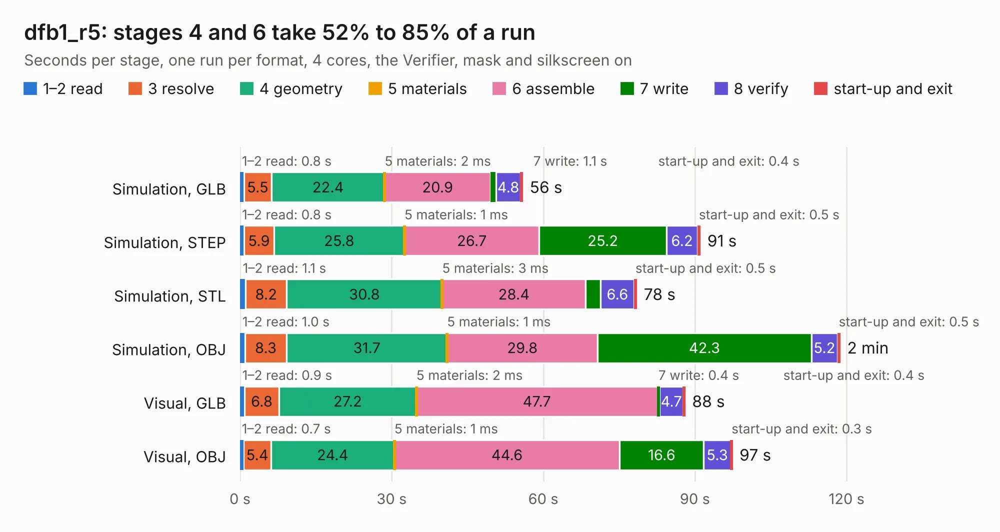

# 847. dfb1_r5

Board 847 of the 3,100 of [Corpus Testing](../Corpus-Testing.md), on [Corpus Page 8](../CorpusTestingPages/Corpus-Testing-08.md#847-dfb1_r5).

| Mode and format | 1–2 read | 3 resolve | 4 geometry | 5 materials | 6 assemble | 7 write | 8 verify | start-up and exit | Total |
|---|---:|---:|---:|---:|---:|---:|---:|---:|---:|
| Simulation, GLB | 0.8 | 5.5 | 22.4 | 2&nbsp;ms | 20.9 | 1.1 | 4.8 | 0.4 | 55.9 |
| Simulation, STEP | 0.8 | 5.9 | 25.8 | 1&nbsp;ms | 26.7 | 25.2 | 6.2 | 0.5 | 91.0 |
| Simulation, STL | 1.1 | 8.2 | 30.8 | 3&nbsp;ms | 28.4 | 3.0 | 6.6 | 0.5 | 78.5 |
| Simulation, OBJ | 1.0 | 8.3 | 31.7 | 1&nbsp;ms | 29.8 | 42.3 | 5.2 | 0.5 | 118.7 |
| Visual, GLB | 0.9 | 6.8 | 27.2 | 2&nbsp;ms | 47.7 | 0.4 | 4.7 | 0.4 | 88.0 |
| Visual, OBJ | 0.7 | 5.4 | 24.4 | 1&nbsp;ms | 44.6 | 16.6 | 5.3 | 0.3 | 97.4 |

<table align="center"><tr><td valign="top">

| Board | Repo: [dh219/DFB](https://github.com/dh219/DFB) Board: `dfb1_r5.kicad_pcb` |
|---|---|
| Folder | DFB1 / kicad5 / dfb1_r5 |
| Complexity | 334&nbsp;/&nbsp;1000 (size&nbsp;264, features&nbsp;70) |
| KESE&nbsp;features | through vias, custom pads, rounded, trapezoid or chamfered pads, filled zones, copper drawings |
| Tested | 9th November 2026 |
| Copper&nbsp;layers | 4 |
| File&nbsp;format | KiCad 5 (20171130) |
| Parts,&nbsp;tracks,&nbsp;vias | 79, 3,144, 369 |
| Triangles,&nbsp;simulation | 5,193,380 in 255 parts |
| Verifier | PASS in all six runs |

</td><td valign="top">

<table>
<tr><th>File type</th><th>File size</th><th>Peak memory used</th></tr>
<tr><th colspan="3" align="left">Simulation</th></tr>
<tr><td>GLB</td><td align="right">175&nbsp;MB</td><td align="right">1.5&nbsp;GB</td></tr>
<tr><td>STEP</td><td align="right">634&nbsp;MB</td><td align="right">1.7&nbsp;GB</td></tr>
<tr><td>STL</td><td align="right">260&nbsp;MB</td><td align="right">1.5&nbsp;GB</td></tr>
<tr><td>OBJ</td><td align="right">548&nbsp;MB</td><td align="right">3.3&nbsp;GB</td></tr>
<tr><th colspan="3" align="left">Visual</th></tr>
<tr><td>GLB</td><td align="right">87&nbsp;MB</td><td align="right">1.5&nbsp;GB</td></tr>
<tr><td>OBJ</td><td align="right">273&nbsp;MB</td><td align="right">1.8&nbsp;GB</td></tr>
</table>

</td></tr></table>

| Previous | Next |
|:---|---:|
| [846. DDR4_8GB_UDIMM](b0846b_ddr4-8gb-udimm_DDR4-8GB-UDIMM.md) | [848. laptop_kbrd](b0848b_novenaX-kicad_laptop-kbrd.md) |
