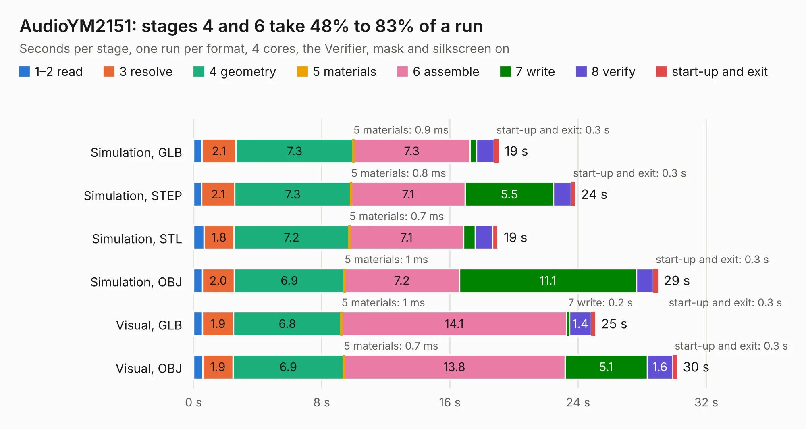

# 848. AudioYM2151

Board 848 of the 3,121 of [Corpus Testing](../Corpus-Testing.md), on [Corpus Page 8](../CorpusTestingPages/Corpus-Testing-08.md#848-audioym2151).

| Mode and format | 1–2 read | 3 resolve | 4 geometry | 5 materials | 6 assemble | 7 write | 8 verify | start-up and exit | Total |
|---|---:|---:|---:|---:|---:|---:|---:|---:|---:|
| Simulation, GLB | 0.5 | 2.1 | 7.3 | 0.9&nbsp;ms | 7.3 | 0.4 | 1.1 | 0.3 | 19.1 |
| Simulation, STEP | 0.5 | 2.1 | 7.3 | 0.8&nbsp;ms | 7.1 | 5.5 | 1.1 | 0.3 | 23.8 |
| Simulation, STL | 0.7 | 1.8 | 7.2 | 0.7&nbsp;ms | 7.1 | 0.7 | 1.1 | 0.3 | 19.0 |
| Simulation, OBJ | 0.6 | 2.0 | 6.9 | 1&nbsp;ms | 7.2 | 11.1 | 1.1 | 0.3 | 29.0 |
| Visual, GLB | 0.6 | 1.9 | 6.8 | 1&nbsp;ms | 14.1 | 0.2 | 1.4 | 0.3 | 25.1 |
| Visual, OBJ | 0.6 | 1.9 | 6.9 | 0.7&nbsp;ms | 13.8 | 5.1 | 1.6 | 0.3 | 30.2 |

<table align="center"><tr><td valign="top">

| Board | Repo: [ddraig68k/hardware](https://github.com/ddraig68k/hardware) Board: `AudioYM2151.kicad_pcb` |
|---|---|
| Folder | expansion / AudioYM2151 |
| Complexity | 301&nbsp;/&nbsp;1000 (size&nbsp;226, features&nbsp;75) |
| KESE&nbsp;features | through vias, slotted holes, rounded, trapezoid or chamfered pads, filled zones, copper text, curved board outline |
| Tested | 9th November 2026 |
| Copper&nbsp;layers | 4 |
| File&nbsp;format | KiCad 8 (20240108) |
| Parts,&nbsp;tracks,&nbsp;vias | 54, 666, 47 |
| Triangles,&nbsp;simulation | 2,254,706 in 163 parts |
| Verifier | PASS in all six runs |

</td><td valign="top">

<table>
<tr><th>File type</th><th>File size</th><th>Peak memory used</th></tr>
<tr><th colspan="3" align="left">Simulation</th></tr>
<tr><td>GLB</td><td align="right">76&nbsp;MB</td><td align="right">727&nbsp;MB</td></tr>
<tr><td>STEP</td><td align="right">271&nbsp;MB</td><td align="right">866&nbsp;MB</td></tr>
<tr><td>STL</td><td align="right">113&nbsp;MB</td><td align="right">734&nbsp;MB</td></tr>
<tr><td>OBJ</td><td align="right">235&nbsp;MB</td><td align="right">1.5&nbsp;GB</td></tr>
<tr><th colspan="3" align="left">Visual</th></tr>
<tr><td>GLB</td><td align="right">37&nbsp;MB</td><td align="right">838&nbsp;MB</td></tr>
<tr><td>OBJ</td><td align="right">111&nbsp;MB</td><td align="right">876&nbsp;MB</td></tr>
</table>

</td></tr></table>

| Previous | Next |
|:---|---:|
| [847. AudioSID](b0847b_hardware_AudioSID.md) | [849. Eth8019](b0849b_hardware_Eth8019.md) |
