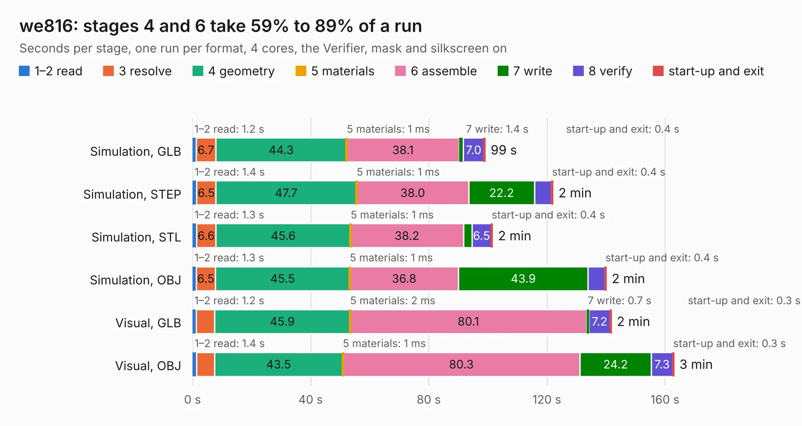

# 848. we816

Board 848 of the 3,132 of [Corpus Testing](../Corpus-Testing.md), on [Corpus Page 8](../CorpusTestingPages/Corpus-Testing-08.md#848-we816).

| Mode and format | 1–2 read | 3 resolve | 4 geometry | 5 materials | 6 assemble | 7 write | 8 verify | start-up and exit | Total |
|---|---:|---:|---:|---:|---:|---:|---:|---:|---:|
| Simulation, GLB | 1.2 | 6.7 | 44.3 | 1&nbsp;ms | 38.1 | 1.4 | 7.0 | 0.4 | 99.0 |
| Simulation, STEP | 1.4 | 6.5 | 47.7 | 1&nbsp;ms | 38.0 | 22.2 | 5.8 | 0.4 | 122.0 |
| Simulation, STL | 1.3 | 6.6 | 45.6 | 1&nbsp;ms | 38.2 | 2.9 | 6.5 | 0.4 | 101.5 |
| Simulation, OBJ | 1.3 | 6.5 | 45.5 | 1&nbsp;ms | 36.8 | 43.9 | 5.7 | 0.4 | 140.0 |
| Visual, GLB | 1.2 | 6.2 | 45.9 | 2&nbsp;ms | 80.1 | 0.7 | 7.2 | 0.3 | 141.8 |
| Visual, OBJ | 1.4 | 6.1 | 43.5 | 1&nbsp;ms | 80.3 | 24.2 | 7.3 | 0.3 | 163.0 |

<table align="center"><tr><td valign="top">

| Board | Repo: [danwerner21/we816](https://github.com/danwerner21/we816) Board: `we816.kicad_pcb` |
|---|---|
| Folder | Hardware |
| Complexity | 287&nbsp;/&nbsp;1000 (size&nbsp;212, features&nbsp;75) |
| KESE&nbsp;features | through vias, slotted holes, rounded, trapezoid or chamfered pads, drill offsets, filled zones, curved board outline |
| Tested | 9th November 2026 |
| Copper&nbsp;layers | 2 |
| File&nbsp;format | KiCad 6 (20211014) |
| Parts,&nbsp;tracks,&nbsp;vias | 130, 5,339, 183 |
| Triangles,&nbsp;simulation | 7,297,986 in 342 parts |
| Verifier | PASS in all six runs |

</td><td valign="top">

<table>
<tr><th>File type</th><th>File size</th><th>Peak memory used</th></tr>
<tr><th colspan="3" align="left">Simulation</th></tr>
<tr><td>GLB</td><td align="right">252&nbsp;MB</td><td align="right">2.0&nbsp;GB</td></tr>
<tr><td>STEP</td><td align="right">1.4&nbsp;GB</td><td align="right">2.5&nbsp;GB</td></tr>
<tr><td>STL</td><td align="right">365&nbsp;MB</td><td align="right">1.9&nbsp;GB</td></tr>
<tr><td>OBJ</td><td align="right">797&nbsp;MB</td><td align="right">4.7&nbsp;GB</td></tr>
<tr><th colspan="3" align="left">Visual</th></tr>
<tr><td>GLB</td><td align="right">144&nbsp;MB</td><td align="right">2.3&nbsp;GB</td></tr>
<tr><td>OBJ</td><td align="right">462&nbsp;MB</td><td align="right">3.0&nbsp;GB</td></tr>
</table>

</td></tr></table>

| Previous | Next |
|:---|---:|
| [847. Vic2020mainboard](b0847b_vic2020_Vic2020mainboard.md) | [849. AudioSID](b0849b_hardware_AudioSID.md) |
