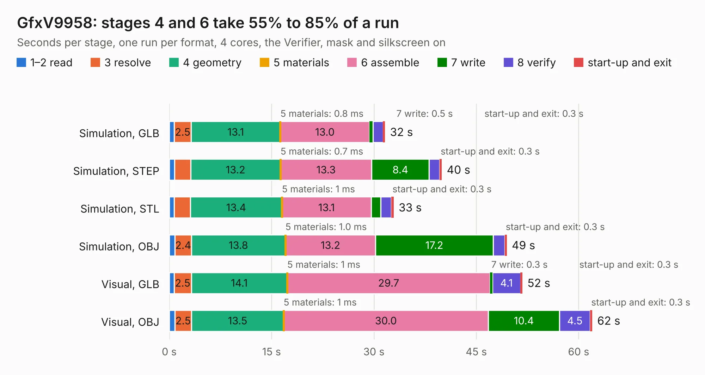

# 853. GfxV9958

Board 853 of the 3,132 of [Corpus Testing](../Corpus-Testing.md), on [Corpus Page 8](../CorpusTestingPages/Corpus-Testing-08.md#853-gfxv9958).

| Mode and format | 1–2 read | 3 resolve | 4 geometry | 5 materials | 6 assemble | 7 write | 8 verify | start-up and exit | Total |
|---|---:|---:|---:|---:|---:|---:|---:|---:|---:|
| Simulation, GLB | 0.7 | 2.5 | 13.1 | 0.8&nbsp;ms | 13.0 | 0.5 | 1.5 | 0.3 | 31.6 |
| Simulation, STEP | 0.8 | 2.4 | 13.2 | 0.7&nbsp;ms | 13.3 | 8.4 | 1.5 | 0.3 | 39.9 |
| Simulation, STL | 0.7 | 2.4 | 13.4 | 1&nbsp;ms | 13.1 | 1.4 | 1.5 | 0.3 | 32.9 |
| Simulation, OBJ | 0.8 | 2.4 | 13.8 | 1.0&nbsp;ms | 13.2 | 17.2 | 1.7 | 0.3 | 49.5 |
| Visual, GLB | 0.7 | 2.5 | 14.1 | 1&nbsp;ms | 29.7 | 0.3 | 4.1 | 0.3 | 51.8 |
| Visual, OBJ | 0.8 | 2.5 | 13.5 | 1&nbsp;ms | 30.0 | 10.4 | 4.5 | 0.3 | 62.0 |

<table align="center"><tr><td valign="top">

| Board | Repo: [ddraig68k/hardware](https://github.com/ddraig68k/hardware) Board: `GfxV9958.kicad_pcb` |
|---|---|
| Folder | expansion / GfxV9958 |
| Complexity | 298&nbsp;/&nbsp;1000 (size&nbsp;223, features&nbsp;75) |
| KESE&nbsp;features | through vias, slotted holes, rounded, trapezoid or chamfered pads, filled zones, copper text, curved board outline |
| Tested | 9th November 2026 |
| Copper&nbsp;layers | 2 |
| File&nbsp;format | KiCad 8 (20240108) |
| Parts,&nbsp;tracks,&nbsp;vias | 69, 1,045, 153 |
| Triangles,&nbsp;simulation | 3,196,584 in 176 parts |
| Verifier | PASS in all six runs |

</td><td valign="top">

<table>
<tr><th>File type</th><th>File size</th><th>Peak memory used</th></tr>
<tr><th colspan="3" align="left">Simulation</th></tr>
<tr><td>GLB</td><td align="right">107&nbsp;MB</td><td align="right">1.1&nbsp;GB</td></tr>
<tr><td>STEP</td><td align="right">460&nbsp;MB</td><td align="right">1.3&nbsp;GB</td></tr>
<tr><td>STL</td><td align="right">160&nbsp;MB</td><td align="right">1.1&nbsp;GB</td></tr>
<tr><td>OBJ</td><td align="right">334&nbsp;MB</td><td align="right">2.0&nbsp;GB</td></tr>
<tr><th colspan="3" align="left">Visual</th></tr>
<tr><td>GLB</td><td align="right">69&nbsp;MB</td><td align="right">1.2&nbsp;GB</td></tr>
<tr><td>OBJ</td><td align="right">216&nbsp;MB</td><td align="right">1.4&nbsp;GB</td></tr>
</table>

</td></tr></table>

| Previous | Next |
|:---|---:|
| [852. GfxTMS9918](b0852b_hardware_GfxTMS9918.md) | [854. GfxV9990](b0854b_hardware_GfxV9990.md) |
