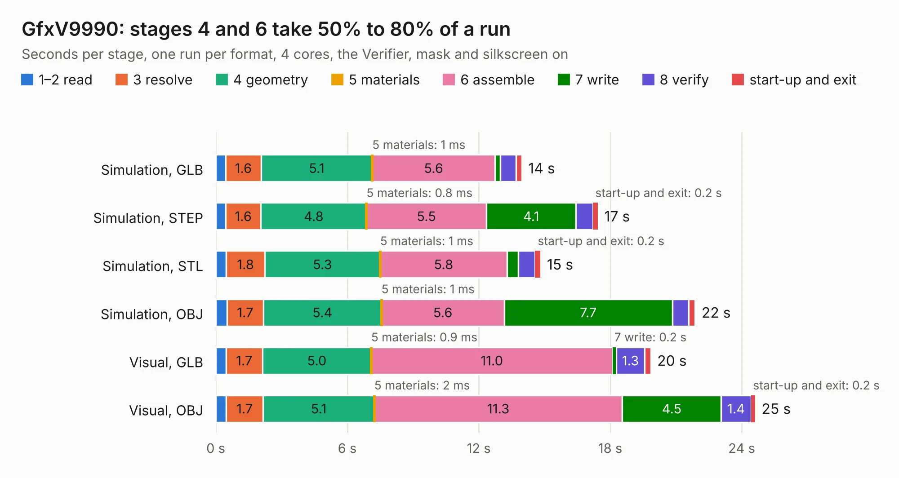

# 853. GfxV9990

Board 853 of the 3,127 of [Corpus Testing](../Corpus-Testing.md), on [Corpus Page 8](../CorpusTestingPages/Corpus-Testing-08.md#853-gfxv9990).

| Mode and format | 1–2 read | 3 resolve | 4 geometry | 5 materials | 6 assemble | 7 write | 8 verify | start-up and exit | Total |
|---|---:|---:|---:|---:|---:|---:|---:|---:|---:|
| Simulation, GLB | 0.5 | 1.6 | 5.1 | 1&nbsp;ms | 5.6 | 0.2 | 0.7 | 0.3 | 14.0 |
| Simulation, STEP | 0.4 | 1.6 | 4.8 | 0.8&nbsp;ms | 5.5 | 4.1 | 0.8 | 0.2 | 17.4 |
| Simulation, STL | 0.5 | 1.8 | 5.3 | 1&nbsp;ms | 5.8 | 0.5 | 0.8 | 0.2 | 14.8 |
| Simulation, OBJ | 0.5 | 1.7 | 5.4 | 1&nbsp;ms | 5.6 | 7.7 | 0.7 | 0.3 | 21.9 |
| Visual, GLB | 0.5 | 1.7 | 5.0 | 0.9&nbsp;ms | 11.0 | 0.2 | 1.3 | 0.3 | 19.9 |
| Visual, OBJ | 0.5 | 1.7 | 5.1 | 2&nbsp;ms | 11.3 | 4.5 | 1.4 | 0.2 | 24.6 |

<table align="center"><tr><td valign="top">

| Board | Repo: [ddraig68k/hardware](https://github.com/ddraig68k/hardware) Board: `GfxV9990.kicad_pcb` |
|---|---|
| Folder | expansion / GfxV9990 |
| Complexity | 331&nbsp;/&nbsp;1000 (size&nbsp;256, features&nbsp;75) |
| KESE&nbsp;features | through vias, slotted holes, rounded, trapezoid or chamfered pads, filled zones, copper text, curved board outline |
| Tested | 9th November 2026 |
| Copper&nbsp;layers | 4 |
| File&nbsp;format | KiCad 8 (20240108) |
| Parts,&nbsp;tracks,&nbsp;vias | 70, 1,292, 182 |
| Triangles,&nbsp;simulation | 1,889,402 in 232 parts |
| Verifier | PASS in all six runs |

</td><td valign="top">

<table>
<tr><th>File type</th><th>File size</th><th>Peak memory used</th></tr>
<tr><th colspan="3" align="left">Simulation</th></tr>
<tr><td>GLB</td><td align="right">64&nbsp;MB</td><td align="right">644&nbsp;MB</td></tr>
<tr><td>STEP</td><td align="right">237&nbsp;MB</td><td align="right">777&nbsp;MB</td></tr>
<tr><td>STL</td><td align="right">94&nbsp;MB</td><td align="right">636&nbsp;MB</td></tr>
<tr><td>OBJ</td><td align="right">195&nbsp;MB</td><td align="right">1.3&nbsp;GB</td></tr>
<tr><th colspan="3" align="left">Visual</th></tr>
<tr><td>GLB</td><td align="right">37&nbsp;MB</td><td align="right">782&nbsp;MB</td></tr>
<tr><td>OBJ</td><td align="right">114&nbsp;MB</td><td align="right">869&nbsp;MB</td></tr>
</table>

</td></tr></table>

| Previous | Next |
|:---|---:|
| [852. GfxV9958](b0852b_hardware_GfxV9958.md) | [854. GfxVGA](b0854b_hardware_GfxVGA.md) |
