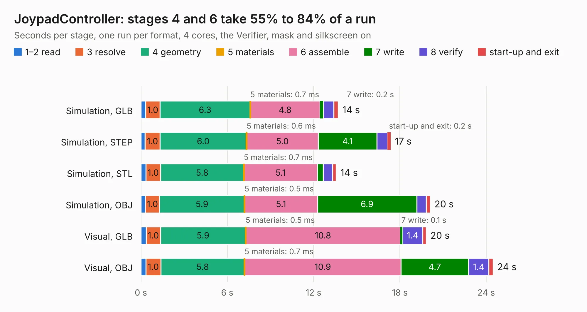

# 854. JoypadController

Board 854 of the 3,121 of [Corpus Testing](../Corpus-Testing.md), on [Corpus Page 8](../CorpusTestingPages/Corpus-Testing-08.md#854-joypadcontroller).

| Mode and format | 1–2 read | 3 resolve | 4 geometry | 5 materials | 6 assemble | 7 write | 8 verify | start-up and exit | Total |
|---|---:|---:|---:|---:|---:|---:|---:|---:|---:|
| Simulation, GLB | 0.3 | 1.0 | 6.3 | 0.7&nbsp;ms | 4.8 | 0.2 | 0.7 | 0.3 | 13.7 |
| Simulation, STEP | 0.3 | 1.0 | 6.0 | 0.6&nbsp;ms | 5.0 | 4.1 | 0.7 | 0.2 | 17.4 |
| Simulation, STL | 0.3 | 1.0 | 5.8 | 0.7&nbsp;ms | 5.1 | 0.4 | 0.7 | 0.3 | 13.6 |
| Simulation, OBJ | 0.3 | 1.0 | 5.9 | 0.5&nbsp;ms | 5.1 | 6.9 | 0.7 | 0.3 | 20.1 |
| Visual, GLB | 0.4 | 1.0 | 5.9 | 0.5&nbsp;ms | 10.8 | 0.1 | 1.4 | 0.2 | 19.8 |
| Visual, OBJ | 0.3 | 1.0 | 5.8 | 0.7&nbsp;ms | 10.9 | 4.7 | 1.4 | 0.3 | 24.5 |

<table align="center"><tr><td valign="top">

| Board | Repo: [ddraig68k/hardware](https://github.com/ddraig68k/hardware) Board: `JoypadController.kicad_pcb` |
|---|---|
| Folder | expansion / JoypadController |
| Complexity | 265&nbsp;/&nbsp;1000 (size&nbsp;200, features&nbsp;65) |
| KESE&nbsp;features | through vias, rounded, trapezoid or chamfered pads, filled zones, copper text, curved board outline |
| Tested | 9th November 2026 |
| Copper&nbsp;layers | 2 |
| File&nbsp;format | KiCad 8 (20240108) |
| Parts,&nbsp;tracks,&nbsp;vias | 32, 421, 66 |
| Triangles,&nbsp;simulation | 1,511,678 in 115 parts |
| Verifier | PASS in all six runs |

</td><td valign="top">

<table>
<tr><th>File type</th><th>File size</th><th>Peak memory used</th></tr>
<tr><th colspan="3" align="left">Simulation</th></tr>
<tr><td>GLB</td><td align="right">49&nbsp;MB</td><td align="right">689&nbsp;MB</td></tr>
<tr><td>STEP</td><td align="right">215&nbsp;MB</td><td align="right">703&nbsp;MB</td></tr>
<tr><td>STL</td><td align="right">76&nbsp;MB</td><td align="right">677&nbsp;MB</td></tr>
<tr><td>OBJ</td><td align="right">154&nbsp;MB</td><td align="right">979&nbsp;MB</td></tr>
<tr><th colspan="3" align="left">Visual</th></tr>
<tr><td>GLB</td><td align="right">32&nbsp;MB</td><td align="right">658&nbsp;MB</td></tr>
<tr><td>OBJ</td><td align="right">98&nbsp;MB</td><td align="right">746&nbsp;MB</td></tr>
</table>

</td></tr></table>

| Previous | Next |
|:---|---:|
| [853. GfxVGA](b0853b_hardware_GfxVGA.md) | [855. yddraig](b0855b_hardware_yddraig.md) |
