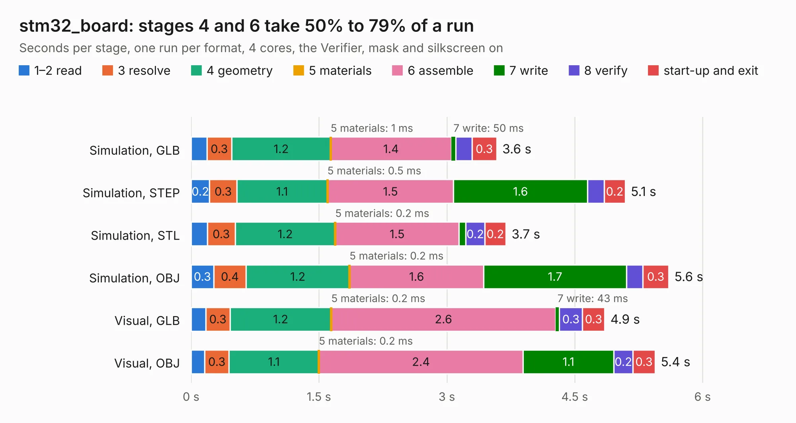

# 857. stm32_board

Board 857 of the 3,118 of [Corpus Testing](../Corpus-Testing.md), on [Corpus Page 8](../CorpusTestingPages/Corpus-Testing-08.md#857-stm32_board).

| Mode and format | 1–2 read | 3 resolve | 4 geometry | 5 materials | 6 assemble | 7 write | 8 verify | start-up and exit | Total |
|---|---:|---:|---:|---:|---:|---:|---:|---:|---:|
| Simulation, GLB | 0.2 | 0.3 | 1.2 | 1&nbsp;ms | 1.4 | 50&nbsp;ms | 0.2 | 0.3 | 3.6 |
| Simulation, STEP | 0.2 | 0.3 | 1.1 | 0.5&nbsp;ms | 1.5 | 1.6 | 0.2 | 0.2 | 5.1 |
| Simulation, STL | 0.2 | 0.3 | 1.2 | 0.2&nbsp;ms | 1.5 | 80&nbsp;ms | 0.2 | 0.2 | 3.7 |
| Simulation, OBJ | 0.3 | 0.4 | 1.2 | 0.2&nbsp;ms | 1.6 | 1.7 | 0.2 | 0.3 | 5.6 |
| Visual, GLB | 0.2 | 0.3 | 1.2 | 0.2&nbsp;ms | 2.6 | 43&nbsp;ms | 0.3 | 0.3 | 4.9 |
| Visual, OBJ | 0.2 | 0.3 | 1.1 | 0.2&nbsp;ms | 2.4 | 1.1 | 0.2 | 0.3 | 5.4 |

<table align="center"><tr><td valign="top">

| Board | Repo: [devnithw/stm32-devboard](https://github.com/devnithw/stm32-devboard) Board: `stm32_board.kicad_pcb` |
|---|---|
| Complexity | 280&nbsp;/&nbsp;1000 (size&nbsp;185, features&nbsp;95) |
| KESE&nbsp;features | through vias, slotted holes, rounded, trapezoid or chamfered pads, filled zones, curved board outline, stack-up, dielectric εr and tanδ |
| Tested | 9th November 2026 |
| Copper&nbsp;layers | 2 |
| File&nbsp;format | KiCad 7 (20221018) |
| Parts,&nbsp;tracks,&nbsp;vias | 28, 198, 23 |
| Triangles,&nbsp;simulation | 249,750 in 58 parts |
| Verifier | PASS in all six runs |

</td><td valign="top">

<table>
<tr><th>File type</th><th>File size</th><th>Peak memory used</th></tr>
<tr><th colspan="3" align="left">Simulation</th></tr>
<tr><td>GLB</td><td align="right">8.5&nbsp;MB</td><td align="right">233&nbsp;MB</td></tr>
<tr><td>STEP</td><td align="right">38&nbsp;MB</td><td align="right">255&nbsp;MB</td></tr>
<tr><td>STL</td><td align="right">12&nbsp;MB</td><td align="right">230&nbsp;MB</td></tr>
<tr><td>OBJ</td><td align="right">25&nbsp;MB</td><td align="right">234&nbsp;MB</td></tr>
<tr><th colspan="3" align="left">Visual</th></tr>
<tr><td>GLB</td><td align="right">6.5&nbsp;MB</td><td align="right">237&nbsp;MB</td></tr>
<tr><td>OBJ</td><td align="right">19&nbsp;MB</td><td align="right">237&nbsp;MB</td></tr>
</table>

</td></tr></table>

| Previous | Next |
|:---|---:|
| [856. FC_REV_A](b0856b_flight-controller-v1_FC-REV-A.md) | [858. DDR4_8GB_UDIMM](b0858b_ddr4-8gb-udimm_DDR4-8GB-UDIMM.md) |
