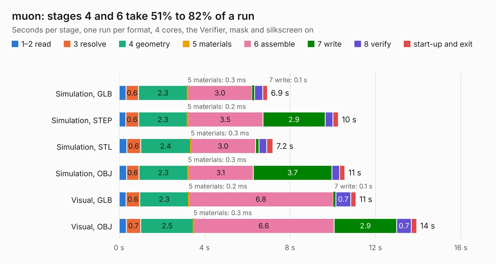

# 858. muon

Board 858 of the 3,131 of [Corpus Testing](../Corpus-Testing.md), on [Corpus Page 8](../CorpusTestingPages/Corpus-Testing-08.md#858-muon).

| Mode and format | 1–2 read | 3 resolve | 4 geometry | 5 materials | 6 assemble | 7 write | 8 verify | start-up and exit | Total |
|---|---:|---:|---:|---:|---:|---:|---:|---:|---:|
| Simulation, GLB | 0.3 | 0.6 | 2.3 | 0.3&nbsp;ms | 3.0 | 0.1 | 0.4 | 0.2 | 6.9 |
| Simulation, STEP | 0.3 | 0.6 | 2.3 | 0.2&nbsp;ms | 3.5 | 2.9 | 0.4 | 0.2 | 10.3 |
| Simulation, STL | 0.4 | 0.6 | 2.4 | 0.3&nbsp;ms | 3.0 | 0.2 | 0.4 | 0.3 | 7.2 |
| Simulation, OBJ | 0.3 | 0.6 | 2.3 | 0.3&nbsp;ms | 3.1 | 3.7 | 0.4 | 0.2 | 10.6 |
| Visual, GLB | 0.3 | 0.6 | 2.3 | 0.2&nbsp;ms | 6.8 | 0.1 | 0.7 | 0.2 | 11.1 |
| Visual, OBJ | 0.3 | 0.7 | 2.5 | 0.3&nbsp;ms | 6.6 | 2.9 | 0.7 | 0.3 | 13.9 |

<table align="center"><tr><td valign="top">

| Board | Repo: [Dekanova/muon-kbd](https://github.com/Dekanova/muon-kbd) Board: `muon.kicad_pcb` |
|---|---|
| Folder | pcb |
| Complexity | 298&nbsp;/&nbsp;1000 (size&nbsp;203, features&nbsp;95) |
| KESE&nbsp;features | through vias, slotted holes, rounded, trapezoid or chamfered pads, filled zones, curved board outline, stack-up, dielectric εr and tanδ |
| Tested | 9th November 2026 |
| Copper&nbsp;layers | 2 |
| File&nbsp;format | KiCad 6 (20211014) |
| Parts,&nbsp;tracks,&nbsp;vias | 55, 381, 50 |
| Triangles,&nbsp;simulation | 568,856 in 79 parts |
| Verifier | PASS in all six runs |

</td><td valign="top">

<table>
<tr><th>File type</th><th>File size</th><th>Peak memory used</th></tr>
<tr><th colspan="3" align="left">Simulation</th></tr>
<tr><td>GLB</td><td align="right">20&nbsp;MB</td><td align="right">347&nbsp;MB</td></tr>
<tr><td>STEP</td><td align="right">108&nbsp;MB</td><td align="right">421&nbsp;MB</td></tr>
<tr><td>STL</td><td align="right">28&nbsp;MB</td><td align="right">350&nbsp;MB</td></tr>
<tr><td>OBJ</td><td align="right">58&nbsp;MB</td><td align="right">436&nbsp;MB</td></tr>
<tr><th colspan="3" align="left">Visual</th></tr>
<tr><td>GLB</td><td align="right">17&nbsp;MB</td><td align="right">474&nbsp;MB</td></tr>
<tr><td>OBJ</td><td align="right">50&nbsp;MB</td><td align="right">481&nbsp;MB</td></tr>
</table>

</td></tr></table>

| Previous | Next |
|:---|---:|
| [857. yddraig](b0857b_hardware_yddraig.md) | [859. FC_REV_A](b0859b_flight-controller-v1_FC-REV-A.md) |
