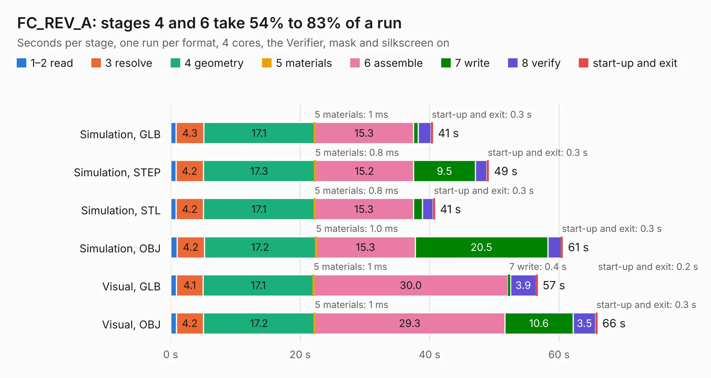

# 859. FC_REV_A

Board 859 of the 3,132 of [Corpus Testing](../Corpus-Testing.md), on [Corpus Page 8](../CorpusTestingPages/Corpus-Testing-08.md#859-fc_rev_a).

| Mode and format | 1–2 read | 3 resolve | 4 geometry | 5 materials | 6 assemble | 7 write | 8 verify | start-up and exit | Total |
|---|---:|---:|---:|---:|---:|---:|---:|---:|---:|
| Simulation, GLB | 0.9 | 4.3 | 17.1 | 1&nbsp;ms | 15.3 | 0.7 | 1.9 | 0.3 | 40.5 |
| Simulation, STEP | 0.8 | 4.2 | 17.3 | 0.8&nbsp;ms | 15.2 | 9.5 | 1.8 | 0.3 | 49.2 |
| Simulation, STL | 0.8 | 4.2 | 17.1 | 0.8&nbsp;ms | 15.3 | 1.4 | 1.7 | 0.3 | 40.8 |
| Simulation, OBJ | 1.0 | 4.2 | 17.2 | 1.0&nbsp;ms | 15.3 | 20.5 | 2.0 | 0.3 | 60.6 |
| Visual, GLB | 0.9 | 4.1 | 17.1 | 1&nbsp;ms | 30.0 | 0.4 | 3.9 | 0.2 | 56.7 |
| Visual, OBJ | 0.9 | 4.2 | 17.2 | 1&nbsp;ms | 29.3 | 10.6 | 3.5 | 0.3 | 65.9 |

<table align="center"><tr><td valign="top">

| Board | Repo: [desanv01/flight-controller-v1](https://github.com/desanv01/flight-controller-v1) Board: `FC_REV_A.kicad_pcb` |
|---|---|
| Folder | fabrication / jlcpcb / source / hardware |
| Complexity | 342&nbsp;/&nbsp;1000 (size&nbsp;287, features&nbsp;55) |
| KESE&nbsp;features | through vias, slotted holes, rounded, trapezoid or chamfered pads, filled zones |
| Tested | 9th November 2026 |
| Copper&nbsp;layers | 6 |
| File&nbsp;format | KiCad 10 (20260206) |
| Parts,&nbsp;tracks,&nbsp;vias | 311, 3,989, 531 |
| Triangles,&nbsp;simulation | 4,674,492 in 318 parts |
| Verifier | PASS in all six runs |

</td><td valign="top">

<table>
<tr><th>File type</th><th>File size</th><th>Peak memory used</th></tr>
<tr><th colspan="3" align="left">Simulation</th></tr>
<tr><td>GLB</td><td align="right">162&nbsp;MB</td><td align="right">1.2&nbsp;GB</td></tr>
<tr><td>STEP</td><td align="right">672&nbsp;MB</td><td align="right">1.7&nbsp;GB</td></tr>
<tr><td>STL</td><td align="right">234&nbsp;MB</td><td align="right">1.2&nbsp;GB</td></tr>
<tr><td>OBJ</td><td align="right">503&nbsp;MB</td><td align="right">3.1&nbsp;GB</td></tr>
<tr><th colspan="3" align="left">Visual</th></tr>
<tr><td>GLB</td><td align="right">81&nbsp;MB</td><td align="right">1.4&nbsp;GB</td></tr>
<tr><td>OBJ</td><td align="right">265&nbsp;MB</td><td align="right">1.8&nbsp;GB</td></tr>
</table>

</td></tr></table>

| Previous | Next |
|:---|---:|
| [858. muon](b0858b_muon-kbd_muon.md) | [860. stm32_board](b0860b_stm32-devboard_stm32-board.md) |
