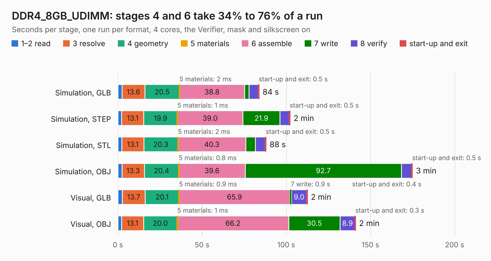

# 860. DDR4_8GB_UDIMM

Board 860 of the 3,125 of [Corpus Testing](../Corpus-Testing.md), on [Corpus Page 8](../CorpusTestingPages/Corpus-Testing-08.md#860-ddr4_8gb_udimm).

| Mode and format | 1–2 read | 3 resolve | 4 geometry | 5 materials | 6 assemble | 7 write | 8 verify | start-up and exit | Total |
|---|---:|---:|---:|---:|---:|---:|---:|---:|---:|
| Simulation, GLB | 2.5 | 13.6 | 20.5 | 2&nbsp;ms | 38.8 | 2.6 | 5.5 | 0.5 | 83.9 |
| Simulation, STEP | 2.3 | 13.1 | 19.9 | 1&nbsp;ms | 39.0 | 21.9 | 5.6 | 0.5 | 102.3 |
| Simulation, STL | 2.3 | 13.1 | 20.3 | 2&nbsp;ms | 40.3 | 5.7 | 5.8 | 0.5 | 88.1 |
| Simulation, OBJ | 2.4 | 13.3 | 20.4 | 0.8&nbsp;ms | 39.6 | 92.7 | 6.1 | 0.5 | 175.0 |
| Visual, GLB | 2.6 | 13.7 | 20.1 | 0.9&nbsp;ms | 65.9 | 0.9 | 9.0 | 0.4 | 112.6 |
| Visual, OBJ | 2.1 | 13.1 | 20.0 | 1&nbsp;ms | 66.2 | 30.5 | 8.9 | 0.3 | 141.2 |

<table align="center"><tr><td valign="top">

| Board | Repo: [dganin-hw/ddr4-8gb-udimm](https://github.com/dganin-hw/ddr4-8gb-udimm) Board: `DDR4_8GB_UDIMM.kicad_pcb` |
|---|---|
| Folder | kicad |
| Complexity | 478&nbsp;/&nbsp;1000 (size&nbsp;348, features&nbsp;130) |
| KESE&nbsp;features | through vias, covered, plugged, capped or filled vias, rounded, trapezoid or chamfered pads, filled zones, curved board outline, stack-up, dielectric εr and tanδ, copper finish |
| Tested | 9th November 2026 |
| Copper&nbsp;layers | 10 |
| File&nbsp;format | KiCad 10 (20260206) |
| Parts,&nbsp;tracks,&nbsp;vias | 306, 11,005, 1,577 |
| Triangles,&nbsp;simulation | 13,736,090 in 319 parts |
| Verifier | PASS in all six runs |

</td><td valign="top">

<table>
<tr><th>File type</th><th>File size</th><th>Peak memory used</th></tr>
<tr><th colspan="3" align="left">Simulation</th></tr>
<tr><td>GLB</td><td align="right">453&nbsp;MB</td><td align="right">2.9&nbsp;GB</td></tr>
<tr><td>STEP</td><td align="right">1.1&nbsp;GB</td><td align="right">4.0&nbsp;GB</td></tr>
<tr><td>STL</td><td align="right">687&nbsp;MB</td><td align="right">2.8&nbsp;GB</td></tr>
<tr><td>OBJ</td><td align="right">1.5&nbsp;GB</td><td align="right">8.5&nbsp;GB</td></tr>
<tr><th colspan="3" align="left">Visual</th></tr>
<tr><td>GLB</td><td align="right">180&nbsp;MB</td><td align="right">3.1&nbsp;GB</td></tr>
<tr><td>OBJ</td><td align="right">601&nbsp;MB</td><td align="right">3.8&nbsp;GB</td></tr>
</table>

</td></tr></table>

| Previous | Next |
|:---|---:|
| [859. stm32_board](b0859b_stm32-devboard_stm32-board.md) | [861. dfb1_r5](b0861b_DFB_dfb1-r5.md) |
