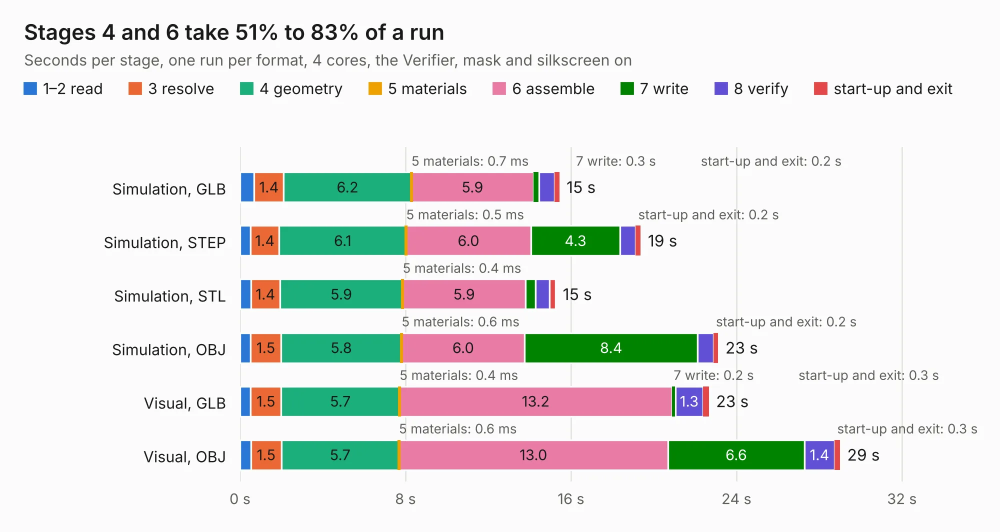

# 861. Nixie_proj_conflict-20171112-163801

Board 861 of the 3,116 of [Corpus Testing](../Corpus-Testing.md), on [Corpus Page 8](../CorpusTestingPages/Corpus-Testing-08.md#861-nixie_proj_conflict-20171112-163801).

| Mode and format | 1–2 read | 3 resolve | 4 geometry | 5 materials | 6 assemble | 7 write | 8 verify | start-up and exit | Total |
|---|---:|---:|---:|---:|---:|---:|---:|---:|---:|
| Simulation, GLB | 0.7 | 1.4 | 6.2 | 0.7&nbsp;ms | 5.9 | 0.3 | 0.8 | 0.2 | 15.4 |
| Simulation, STEP | 0.5 | 1.4 | 6.1 | 0.5&nbsp;ms | 6.0 | 4.3 | 0.8 | 0.2 | 19.4 |
| Simulation, STL | 0.5 | 1.4 | 5.9 | 0.4&nbsp;ms | 5.9 | 0.5 | 0.7 | 0.3 | 15.3 |
| Simulation, OBJ | 0.5 | 1.5 | 5.8 | 0.6&nbsp;ms | 6.0 | 8.4 | 0.8 | 0.2 | 23.1 |
| Visual, GLB | 0.5 | 1.5 | 5.7 | 0.4&nbsp;ms | 13.2 | 0.2 | 1.3 | 0.3 | 22.7 |
| Visual, OBJ | 0.5 | 1.5 | 5.7 | 0.6&nbsp;ms | 13.0 | 6.6 | 1.4 | 0.3 | 29.0 |

<table align="center"><tr><td valign="top">

| Board | Repo: [dm2lct/tlnixie](https://github.com/dm2lct/tlnixie) Board: `Nixie_proj_conflict-20171112-163801.kicad_pcb` |
|---|---|
| Complexity | 300&nbsp;/&nbsp;1000 (size&nbsp;235, features&nbsp;65) |
| KESE&nbsp;features | through vias, drill offsets, filled zones, copper text, curved board outline |
| Tested | 9th November 2026 |
| Copper&nbsp;layers | 2 |
| File&nbsp;format | KiCad 4 (4) |
| Parts,&nbsp;tracks,&nbsp;vias | 110, 1,233, 118 |
| Triangles,&nbsp;simulation | 1,296,404 in 121 parts |
| Verifier | PASS in all six runs |

</td><td valign="top">

<table>
<tr><th>File type</th><th>File size</th><th>Peak memory used</th></tr>
<tr><th colspan="3" align="left">Simulation</th></tr>
<tr><td>GLB</td><td align="right">45&nbsp;MB</td><td align="right">484&nbsp;MB</td></tr>
<tr><td>STEP</td><td align="right">219&nbsp;MB</td><td align="right">631&nbsp;MB</td></tr>
<tr><td>STL</td><td align="right">65&nbsp;MB</td><td align="right">488&nbsp;MB</td></tr>
<tr><td>OBJ</td><td align="right">134&nbsp;MB</td><td align="right">896&nbsp;MB</td></tr>
<tr><th colspan="3" align="left">Visual</th></tr>
<tr><td>GLB</td><td align="right">34&nbsp;MB</td><td align="right">815&nbsp;MB</td></tr>
<tr><td>OBJ</td><td align="right">102&nbsp;MB</td><td align="right">747&nbsp;MB</td></tr>
</table>

</td></tr></table>

| Previous | Next |
|:---|---:|
| [860. Nixie_proj](b0860b_tlnixie_Nixie-proj.md) | [862. Nucleo2USB](b0862b_Nucleo2USB_Nucleo2USB.md) |
