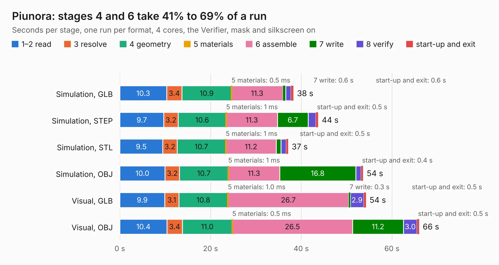

# 862. Piunora

Board 862 of the 3,121 of [Corpus Testing](../Corpus-Testing.md), on [Corpus Page 8](../CorpusTestingPages/Corpus-Testing-08.md#862-piunora).

| Mode and format | 1–2 read | 3 resolve | 4 geometry | 5 materials | 6 assemble | 7 write | 8 verify | start-up and exit | Total |
|---|---:|---:|---:|---:|---:|---:|---:|---:|---:|
| Simulation, GLB | 10.3 | 3.4 | 10.9 | 0.5&nbsp;ms | 11.3 | 0.6 | 1.2 | 0.6 | 38.3 |
| Simulation, STEP | 9.7 | 3.2 | 10.6 | 1&nbsp;ms | 11.3 | 6.7 | 1.7 | 0.5 | 43.8 |
| Simulation, STL | 9.5 | 3.2 | 10.7 | 1&nbsp;ms | 11.2 | 1.0 | 1.2 | 0.5 | 37.1 |
| Simulation, OBJ | 10.0 | 3.2 | 10.7 | 1&nbsp;ms | 11.3 | 16.8 | 1.2 | 0.4 | 53.7 |
| Visual, GLB | 9.9 | 3.1 | 10.8 | 1.0&nbsp;ms | 26.7 | 0.3 | 2.9 | 0.5 | 54.3 |
| Visual, OBJ | 10.4 | 3.4 | 11.0 | 0.5&nbsp;ms | 26.5 | 11.2 | 3.0 | 0.5 | 66.0 |

<table align="center"><tr><td valign="top">

| Board | Repo: [Diodes-Delight/Piunora-Hardware](https://github.com/Diodes-Delight/Piunora-Hardware) Board: `Piunora.kicad_pcb` |
|---|---|
| Folder | KiCad |
| Complexity | 274&nbsp;/&nbsp;1000 (size&nbsp;214, features&nbsp;60) |
| KESE&nbsp;features | microvias, rounded, trapezoid or chamfered pads, curved board outline |
| Tested | 9th November 2026 |
| Copper&nbsp;layers | 4 |
| File&nbsp;format | KiCad 6 (20211014) |
| Parts,&nbsp;tracks,&nbsp;vias | 67, 2,148, 570 |
| Triangles,&nbsp;simulation | 2,836,050 in 130 parts |
| Verifier | PASS in all six runs |

</td><td valign="top">

<table>
<tr><th>File type</th><th>File size</th><th>Peak memory used</th></tr>
<tr><th colspan="3" align="left">Simulation</th></tr>
<tr><td>GLB</td><td align="right">97&nbsp;MB</td><td align="right">1.3&nbsp;GB</td></tr>
<tr><td>STEP</td><td align="right">318&nbsp;MB</td><td align="right">1.5&nbsp;GB</td></tr>
<tr><td>STL</td><td align="right">142&nbsp;MB</td><td align="right">1.3&nbsp;GB</td></tr>
<tr><td>OBJ</td><td align="right">299&nbsp;MB</td><td align="right">2.2&nbsp;GB</td></tr>
<tr><th colspan="3" align="left">Visual</th></tr>
<tr><td>GLB</td><td align="right">62&nbsp;MB</td><td align="right">1.5&nbsp;GB</td></tr>
<tr><td>OBJ</td><td align="right">194&nbsp;MB</td><td align="right">1.7&nbsp;GB</td></tr>
</table>

</td></tr></table>

| Previous | Next |
|:---|---:|
| [861. laptop_kbrd](b0861b_novenaX-kicad_laptop-kbrd.md) | [863. Nixie_proj](b0863b_tlnixie_Nixie-proj.md) |
