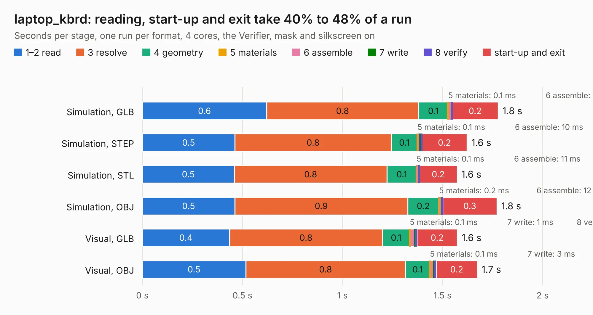

# 863. laptop_kbrd

Board 863 of the 3,131 of [Corpus Testing](../Corpus-Testing.md), on [Corpus Page 8](../CorpusTestingPages/Corpus-Testing-08.md#863-laptop_kbrd).

| Mode and format | 1–2 read | 3 resolve | 4 geometry | 5 materials | 6 assemble | 7 write | 8 verify | start-up and exit | Total |
|---|---:|---:|---:|---:|---:|---:|---:|---:|---:|
| Simulation, GLB | 0.6 | 0.8 | 0.1 | 0.1&nbsp;ms | 16&nbsp;ms | 2&nbsp;ms | 2&nbsp;ms | 0.2 | 1.8 |
| Simulation, STEP | 0.5 | 0.8 | 0.1 | 0.1&nbsp;ms | 10&nbsp;ms | 10&nbsp;ms | 2&nbsp;ms | 0.2 | 1.6 |
| Simulation, STL | 0.5 | 0.8 | 0.1 | 0.1&nbsp;ms | 11&nbsp;ms | 1&nbsp;ms | 2&nbsp;ms | 0.2 | 1.6 |
| Simulation, OBJ | 0.5 | 0.9 | 0.2 | 0.2&nbsp;ms | 12&nbsp;ms | 4&nbsp;ms | 2&nbsp;ms | 0.3 | 1.8 |
| Visual, GLB | 0.4 | 0.8 | 0.1 | 0.1&nbsp;ms | 25&nbsp;ms | 1&nbsp;ms | 10&nbsp;ms | 0.2 | 1.6 |
| Visual, OBJ | 0.5 | 0.8 | 0.1 | 0.1&nbsp;ms | 20&nbsp;ms | 3&nbsp;ms | 8&nbsp;ms | 0.2 | 1.7 |

<table align="center"><tr><td valign="top">

| Board | Repo: [dileepvr/novenaX_kicad](https://github.com/dileepvr/novenaX_kicad) Board: `laptop_kbrd.kicad_pcb` |
|---|---|
| Complexity | 288&nbsp;/&nbsp;1000 (size&nbsp;263, features&nbsp;25) |
| KESE&nbsp;features | through vias, curved board outline |
| Tested | 9th November 2026 |
| Copper&nbsp;layers | 2 |
| File&nbsp;format | KiCad 3 (3) |
| Parts,&nbsp;tracks,&nbsp;vias | 143, 3,347, 349 |
| Triangles,&nbsp;simulation | 536 in 3 parts |
| Verifier | PASS in all six runs |

</td><td valign="top">

<table>
<tr><th>File type</th><th>File size</th><th>Peak memory used</th></tr>
<tr><th colspan="3" align="left">Simulation</th></tr>
<tr><td>GLB</td><td align="right">18&nbsp;kB</td><td align="right">89&nbsp;MB</td></tr>
<tr><td>STEP</td><td align="right">126&nbsp;kB</td><td align="right">88&nbsp;MB</td></tr>
<tr><td>STL</td><td align="right">27&nbsp;kB</td><td align="right">89&nbsp;MB</td></tr>
<tr><td>OBJ</td><td align="right">50&nbsp;kB</td><td align="right">87&nbsp;MB</td></tr>
<tr><th colspan="3" align="left">Visual</th></tr>
<tr><td>GLB</td><td align="right">24&nbsp;kB</td><td align="right">88&nbsp;MB</td></tr>
<tr><td>OBJ</td><td align="right">50&nbsp;kB</td><td align="right">87&nbsp;MB</td></tr>
</table>

</td></tr></table>

| Previous | Next |
|:---|---:|
| [862. dfb1_r5](b0862b_DFB_dfb1-r5.md) | [864. Piunora](b0864b_Piunora-Hardware_Piunora.md) |
