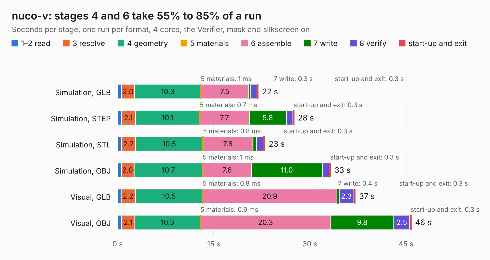

# 867. nuco-v

Board 867 of the 3,125 of [Corpus Testing](../Corpus-Testing.md), on [Corpus Page 9](../CorpusTestingPages/Corpus-Testing-09.md#867-nuco-v).

| Mode and format | 1–2 read | 3 resolve | 4 geometry | 5 materials | 6 assemble | 7 write | 8 verify | start-up and exit | Total |
|---|---:|---:|---:|---:|---:|---:|---:|---:|---:|
| Simulation, GLB | 0.6 | 2.0 | 10.3 | 1&nbsp;ms | 7.5 | 0.3 | 1.0 | 0.3 | 22.0 |
| Simulation, STEP | 0.6 | 2.1 | 10.1 | 0.7&nbsp;ms | 7.7 | 5.8 | 1.0 | 0.3 | 27.6 |
| Simulation, STL | 0.6 | 2.2 | 10.5 | 0.8&nbsp;ms | 7.8 | 0.6 | 1.1 | 0.3 | 23.0 |
| Simulation, OBJ | 0.6 | 2.0 | 10.7 | 1&nbsp;ms | 7.6 | 11.0 | 1.1 | 0.3 | 33.3 |
| Visual, GLB | 0.5 | 2.2 | 10.5 | 0.8&nbsp;ms | 20.9 | 0.4 | 2.3 | 0.3 | 37.1 |
| Visual, OBJ | 0.6 | 2.1 | 10.3 | 0.9&nbsp;ms | 20.3 | 9.8 | 2.5 | 0.3 | 45.9 |

<table align="center"><tr><td valign="top">

| Board | Repo: [dmitrystu/nuco-v](https://github.com/dmitrystu/nuco-v) Board: `nuco-v.kicad_pcb` |
|---|---|
| Complexity | 335&nbsp;/&nbsp;1000 (size&nbsp;245, features&nbsp;90) |
| KESE&nbsp;features | through vias, slotted holes, custom pads, rounded, trapezoid or chamfered pads, filled zones, copper drawings, curved board outline |
| Tested | 9th November 2026 |
| Copper&nbsp;layers | 2 |
| File&nbsp;format | KiCad 5 (20171130) |
| Parts,&nbsp;tracks,&nbsp;vias | 137, 1,827, 208 |
| Triangles,&nbsp;simulation | 1,844,586 in 195 parts |
| Verifier | PASS in all six runs |

</td><td valign="top">

<table>
<tr><th>File type</th><th>File size</th><th>Peak memory used</th></tr>
<tr><th colspan="3" align="left">Simulation</th></tr>
<tr><td>GLB</td><td align="right">64&nbsp;MB</td><td align="right">694&nbsp;MB</td></tr>
<tr><td>STEP</td><td align="right">309&nbsp;MB</td><td align="right">891&nbsp;MB</td></tr>
<tr><td>STL</td><td align="right">92&nbsp;MB</td><td align="right">746&nbsp;MB</td></tr>
<tr><td>OBJ</td><td align="right">193&nbsp;MB</td><td align="right">1.2&nbsp;GB</td></tr>
<tr><th colspan="3" align="left">Visual</th></tr>
<tr><td>GLB</td><td align="right">54&nbsp;MB</td><td align="right">1.0&nbsp;GB</td></tr>
<tr><td>OBJ</td><td align="right">166&nbsp;MB</td><td align="right">1.2&nbsp;GB</td></tr>
</table>

</td></tr></table>

| Previous | Next |
|:---|---:|
| [866. Nucleo2USB](b0866b_Nucleo2USB_Nucleo2USB.md) | [868. twonkie](b0868b_Twonkie_twonkie.md) |
