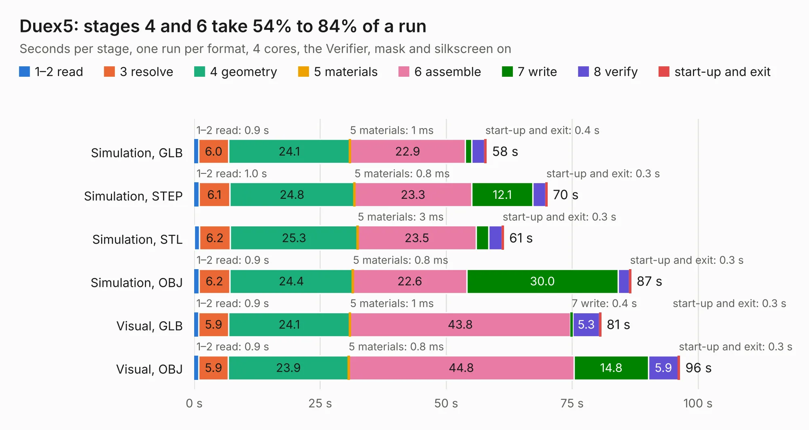

# 868. Duex5

Board 868 of the 3,110 of [Corpus Testing](../Corpus-Testing.md), on [Corpus Page 9](../CorpusTestingPages/Corpus-Testing-09.md#868-duex5).

| Mode and format | 1–2 read | 3 resolve | 4 geometry | 5 materials | 6 assemble | 7 write | 8 verify | start-up and exit | Total |
|---|---:|---:|---:|---:|---:|---:|---:|---:|---:|
| Simulation, GLB | 0.9 | 6.0 | 24.1 | 1&nbsp;ms | 22.9 | 1.3 | 2.5 | 0.4 | 58.0 |
| Simulation, STEP | 1.0 | 6.1 | 24.8 | 0.8&nbsp;ms | 23.3 | 12.1 | 2.5 | 0.3 | 70.0 |
| Simulation, STL | 1.0 | 6.2 | 25.3 | 3&nbsp;ms | 23.5 | 2.5 | 2.6 | 0.3 | 61.4 |
| Simulation, OBJ | 0.9 | 6.2 | 24.4 | 0.8&nbsp;ms | 22.6 | 30.0 | 2.2 | 0.3 | 86.7 |
| Visual, GLB | 0.9 | 5.9 | 24.1 | 1&nbsp;ms | 43.8 | 0.4 | 5.3 | 0.3 | 80.7 |
| Visual, OBJ | 0.9 | 5.9 | 23.9 | 0.8&nbsp;ms | 44.8 | 14.8 | 5.9 | 0.3 | 96.3 |

<table align="center"><tr><td valign="top">

| Board | Repo: [Duet3D/Duet-2-Hardware](https://github.com/Duet3D/Duet-2-Hardware) Board: `Duex5.kicad_pcb` |
|---|---|
| Folder | Duet_Expansion / Duex5v0.11 |
| Complexity | 331&nbsp;/&nbsp;1000 (size&nbsp;276, features&nbsp;55) |
| KESE&nbsp;features | through vias, slotted holes, rounded, trapezoid or chamfered pads, filled zones |
| Tested | 9th November 2026 |
| Copper&nbsp;layers | 4 |
| File&nbsp;format | KiCad 5 (20171130) |
| Parts,&nbsp;tracks,&nbsp;vias | 251, 2,906, 1,119 |
| Triangles,&nbsp;simulation | 6,417,510 in 217 parts |
| Verifier | PASS in all six runs |

</td><td valign="top">

<table>
<tr><th>File type</th><th>File size</th><th>Peak memory used</th></tr>
<tr><th colspan="3" align="left">Simulation</th></tr>
<tr><td>GLB</td><td align="right">222&nbsp;MB</td><td align="right">1.4&nbsp;GB</td></tr>
<tr><td>STEP</td><td align="right">810&nbsp;MB</td><td align="right">1.9&nbsp;GB</td></tr>
<tr><td>STL</td><td align="right">321&nbsp;MB</td><td align="right">1.5&nbsp;GB</td></tr>
<tr><td>OBJ</td><td align="right">710&nbsp;MB</td><td align="right">4.2&nbsp;GB</td></tr>
<tr><th colspan="3" align="left">Visual</th></tr>
<tr><td>GLB</td><td align="right">115&nbsp;MB</td><td align="right">1.9&nbsp;GB</td></tr>
<tr><td>OBJ</td><td align="right">371&nbsp;MB</td><td align="right">2.5&nbsp;GB</td></tr>
</table>

</td></tr></table>

| Previous | Next |
|:---|---:|
| [867. DuetEthernet](b0867b_Duet-2-Hardware_DuetEthernet.md) | [869. Duex5](b0869b_Duet-2-Hardware_Duet-Expansion-Duex5v0-7_Duex5.md) |
