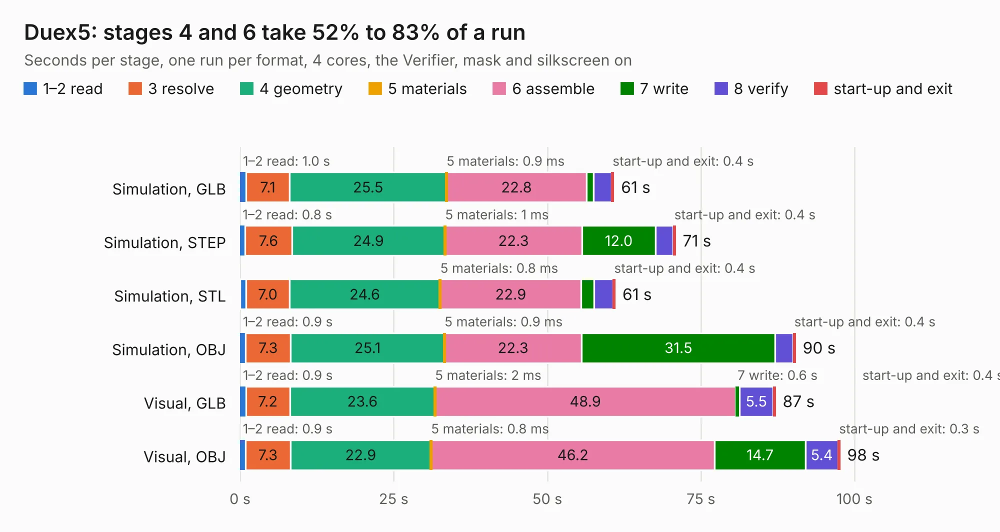

# 868. Duex5

Board 868 of the 3,108 of [Corpus Testing](../Corpus-Testing.md), on [Corpus Page 9](../CorpusTestingPages/Corpus-Testing-09.md#868-duex5).

| Mode and format | 1–2 read | 3 resolve | 4 geometry | 5 materials | 6 assemble | 7 write | 8 verify | start-up and exit | Total |
|---|---:|---:|---:|---:|---:|---:|---:|---:|---:|
| Simulation, GLB | 1.0 | 7.1 | 25.5 | 0.9&nbsp;ms | 22.8 | 1.1 | 2.9 | 0.4 | 60.8 |
| Simulation, STEP | 0.8 | 7.6 | 24.9 | 1&nbsp;ms | 22.3 | 12.0 | 2.9 | 0.4 | 70.9 |
| Simulation, STL | 1.0 | 7.0 | 24.6 | 0.8&nbsp;ms | 22.9 | 2.1 | 3.1 | 0.4 | 61.1 |
| Simulation, OBJ | 0.9 | 7.3 | 25.1 | 0.9&nbsp;ms | 22.3 | 31.5 | 2.9 | 0.4 | 90.4 |
| Visual, GLB | 0.9 | 7.2 | 23.6 | 2&nbsp;ms | 48.9 | 0.6 | 5.5 | 0.4 | 87.2 |
| Visual, OBJ | 0.9 | 7.3 | 22.9 | 0.8&nbsp;ms | 46.2 | 14.7 | 5.4 | 0.3 | 97.6 |

<table align="center"><tr><td valign="top">

| Board | Repo: [Duet3D/Duet-2-Hardware](https://github.com/Duet3D/Duet-2-Hardware) Board: `Duex5.kicad_pcb` |
|---|---|
| Folder | Duet_Expansion / Duex5v0.7 |
| Complexity | 271&nbsp;/&nbsp;1000 (size&nbsp;236, features&nbsp;35) |
| KESE&nbsp;features | through vias, filled zones |
| Tested | 9th November 2026 |
| Copper&nbsp;layers | 4 |
| File&nbsp;format | KiCad 4 (4) |
| Parts,&nbsp;tracks,&nbsp;vias | 201, 3,551, 1,147 |
| Triangles,&nbsp;simulation | 5,628,398 in 190 parts |
| Verifier | PASS in all six runs |

</td><td valign="top">

<table>
<tr><th>File type</th><th>File size</th><th>Peak memory used</th></tr>
<tr><th colspan="3" align="left">Simulation</th></tr>
<tr><td>GLB</td><td align="right">194&nbsp;MB</td><td align="right">1.2&nbsp;GB</td></tr>
<tr><td>STEP</td><td align="right">644&nbsp;MB</td><td align="right">1.7&nbsp;GB</td></tr>
<tr><td>STL</td><td align="right">281&nbsp;MB</td><td align="right">1.1&nbsp;GB</td></tr>
<tr><td>OBJ</td><td align="right">622&nbsp;MB</td><td align="right">3.6&nbsp;GB</td></tr>
<tr><th colspan="3" align="left">Visual</th></tr>
<tr><td>GLB</td><td align="right">102&nbsp;MB</td><td align="right">1.8&nbsp;GB</td></tr>
<tr><td>OBJ</td><td align="right">330&nbsp;MB</td><td align="right">2.2&nbsp;GB</td></tr>
</table>

</td></tr></table>

| Previous | Next |
|:---|---:|
| [867. Duex5](b0867b_Duet-2-Hardware_Duet-Expansion-Duex5v0-11_Duex5.md) | [869. Duex5](b0869b_Duet-2-Hardware_Duet-Expansion-Duex5v0-8_Duex5.md) |
