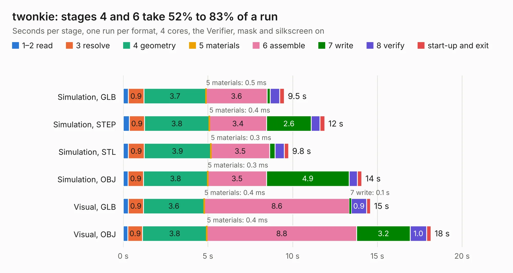

# 868. twonkie

Board 868 of the 3,129 of [Corpus Testing](../Corpus-Testing.md), on [Corpus Page 9](../CorpusTestingPages/Corpus-Testing-09.md#868-twonkie).

| Mode and format | 1–2 read | 3 resolve | 4 geometry | 5 materials | 6 assemble | 7 write | 8 verify | start-up and exit | Total |
|---|---:|---:|---:|---:|---:|---:|---:|---:|---:|
| Simulation, GLB | 0.3 | 0.9 | 3.7 | 0.5&nbsp;ms | 3.6 | 0.2 | 0.6 | 0.3 | 9.5 |
| Simulation, STEP | 0.4 | 0.9 | 3.8 | 0.4&nbsp;ms | 3.4 | 2.6 | 0.5 | 0.3 | 11.9 |
| Simulation, STL | 0.3 | 0.9 | 3.9 | 0.3&nbsp;ms | 3.5 | 0.3 | 0.5 | 0.3 | 9.8 |
| Simulation, OBJ | 0.3 | 0.9 | 3.8 | 0.3&nbsp;ms | 3.5 | 4.9 | 0.5 | 0.3 | 14.1 |
| Visual, GLB | 0.3 | 0.9 | 3.6 | 0.4&nbsp;ms | 8.6 | 0.1 | 0.9 | 0.2 | 14.6 |
| Visual, OBJ | 0.3 | 0.9 | 3.8 | 0.4&nbsp;ms | 8.8 | 3.2 | 1.0 | 0.3 | 18.2 |

<table align="center"><tr><td valign="top">

| Board | Repo: [dojoe/Twonkie](https://github.com/dojoe/Twonkie) Board: `twonkie.kicad_pcb` |
|---|---|
| Folder | hw |
| Complexity | 329&nbsp;/&nbsp;1000 (size&nbsp;234, features&nbsp;95) |
| KESE&nbsp;features | through vias, slotted holes, rounded, trapezoid or chamfered pads, filled zones, curved board outline, stack-up, dielectric εr and tanδ |
| Tested | 9th November 2026 |
| Copper&nbsp;layers | 4 |
| File&nbsp;format | KiCad 8 (20240108) |
| Parts,&nbsp;tracks,&nbsp;vias | 56, 879, 120 |
| Triangles,&nbsp;simulation | 971,502 in 94 parts |
| Verifier | PASS in all six runs |

</td><td valign="top">

<table>
<tr><th>File type</th><th>File size</th><th>Peak memory used</th></tr>
<tr><th colspan="3" align="left">Simulation</th></tr>
<tr><td>GLB</td><td align="right">34&nbsp;MB</td><td align="right">431&nbsp;MB</td></tr>
<tr><td>STEP</td><td align="right">176&nbsp;MB</td><td align="right">466&nbsp;MB</td></tr>
<tr><td>STL</td><td align="right">49&nbsp;MB</td><td align="right">433&nbsp;MB</td></tr>
<tr><td>OBJ</td><td align="right">102&nbsp;MB</td><td align="right">710&nbsp;MB</td></tr>
<tr><th colspan="3" align="left">Visual</th></tr>
<tr><td>GLB</td><td align="right">22&nbsp;MB</td><td align="right">492&nbsp;MB</td></tr>
<tr><td>OBJ</td><td align="right">67&nbsp;MB</td><td align="right">542&nbsp;MB</td></tr>
</table>

</td></tr></table>

| Previous | Next |
|:---|---:|
| [867. nuco-v](b0867b_nuco-v_nuco-v.md) | [869. Domesday Duplicator](b0869b_domesdayduplicator_Domesday-Duplicator.md) |
