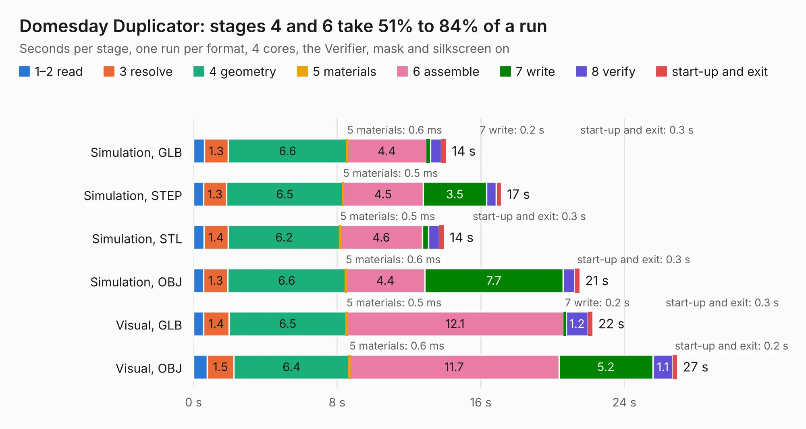

# 869. Domesday Duplicator

Board 869 of the 3,126 of [Corpus Testing](../Corpus-Testing.md), on [Corpus Page 9](../CorpusTestingPages/Corpus-Testing-09.md#869-domesday-duplicator).

| Mode and format | 1–2 read | 3 resolve | 4 geometry | 5 materials | 6 assemble | 7 write | 8 verify | start-up and exit | Total |
|---|---:|---:|---:|---:|---:|---:|---:|---:|---:|
| Simulation, GLB | 0.6 | 1.3 | 6.6 | 0.6&nbsp;ms | 4.4 | 0.2 | 0.6 | 0.3 | 14.1 |
| Simulation, STEP | 0.6 | 1.3 | 6.5 | 0.5&nbsp;ms | 4.5 | 3.5 | 0.5 | 0.3 | 17.1 |
| Simulation, STL | 0.6 | 1.4 | 6.2 | 0.5&nbsp;ms | 4.6 | 0.3 | 0.6 | 0.3 | 13.9 |
| Simulation, OBJ | 0.6 | 1.3 | 6.6 | 0.6&nbsp;ms | 4.4 | 7.7 | 0.7 | 0.3 | 21.5 |
| Visual, GLB | 0.6 | 1.4 | 6.5 | 0.5&nbsp;ms | 12.1 | 0.2 | 1.2 | 0.3 | 22.2 |
| Visual, OBJ | 0.8 | 1.5 | 6.4 | 0.6&nbsp;ms | 11.7 | 5.2 | 1.1 | 0.2 | 26.9 |

<table align="center"><tr><td valign="top">

| Board | Repo: [domesday86/domesdayduplicator](https://github.com/domesday86/domesdayduplicator) Board: `Domesday Duplicator.kicad_pcb` |
|---|---|
| Folder | hardware / pcb |
| Complexity | 208&nbsp;/&nbsp;1000 (size&nbsp;173, features&nbsp;35) |
| KESE&nbsp;features | through vias, filled zones |
| Tested | 9th November 2026 |
| Copper&nbsp;layers | 2 |
| File&nbsp;format | KiCad 10 (20260206) |
| Parts,&nbsp;tracks,&nbsp;vias | 59, 766, 49 |
| Triangles,&nbsp;simulation | 1,224,380 in 103 parts |
| Verifier | PASS in all six runs |

</td><td valign="top">

<table>
<tr><th>File type</th><th>File size</th><th>Peak memory used</th></tr>
<tr><th colspan="3" align="left">Simulation</th></tr>
<tr><td>GLB</td><td align="right">41&nbsp;MB</td><td align="right">496&nbsp;MB</td></tr>
<tr><td>STEP</td><td align="right">198&nbsp;MB</td><td align="right">578&nbsp;MB</td></tr>
<tr><td>STL</td><td align="right">61&nbsp;MB</td><td align="right">486&nbsp;MB</td></tr>
<tr><td>OBJ</td><td align="right">126&nbsp;MB</td><td align="right">854&nbsp;MB</td></tr>
<tr><th colspan="3" align="left">Visual</th></tr>
<tr><td>GLB</td><td align="right">30&nbsp;MB</td><td align="right">699&nbsp;MB</td></tr>
<tr><td>OBJ</td><td align="right">90&nbsp;MB</td><td align="right">690&nbsp;MB</td></tr>
</table>

</td></tr></table>

| Previous | Next |
|:---|---:|
| [868. twonkie](b0868b_Twonkie_twonkie.md) | [870. haasoscope_pro_adc_fpga_board](b0870b_HaasoscopePro_haasoscope-pro-adc-fpga-board.md) |
