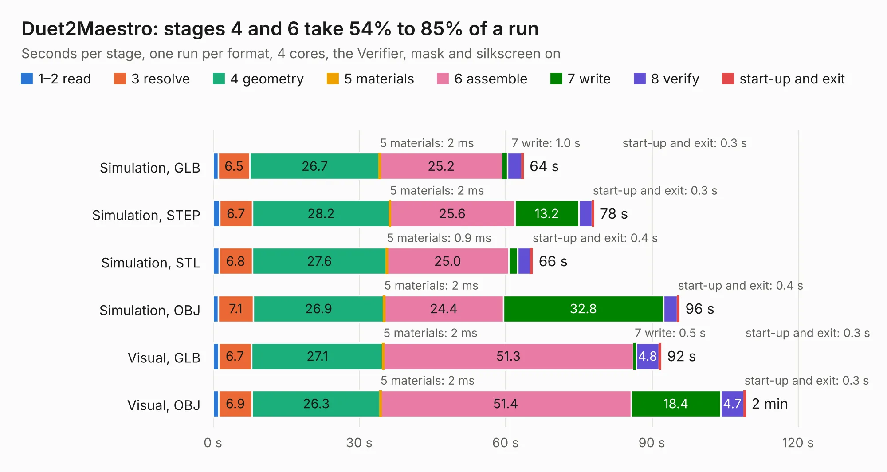

# 870. Duet2Maestro

Board 870 of the 3,120 of [Corpus Testing](../Corpus-Testing.md), on [Corpus Page 9](../CorpusTestingPages/Corpus-Testing-09.md#870-duet2maestro).

| Mode and format | 1–2 read | 3 resolve | 4 geometry | 5 materials | 6 assemble | 7 write | 8 verify | start-up and exit | Total |
|---|---:|---:|---:|---:|---:|---:|---:|---:|---:|
| Simulation, GLB | 1.1 | 6.5 | 26.7 | 2&nbsp;ms | 25.2 | 1.0 | 2.9 | 0.3 | 63.6 |
| Simulation, STEP | 1.4 | 6.7 | 28.2 | 2&nbsp;ms | 25.6 | 13.2 | 2.7 | 0.3 | 78.1 |
| Simulation, STL | 1.2 | 6.8 | 27.6 | 0.9&nbsp;ms | 25.0 | 1.9 | 2.6 | 0.4 | 65.5 |
| Simulation, OBJ | 1.1 | 7.1 | 26.9 | 2&nbsp;ms | 24.4 | 32.8 | 2.8 | 0.4 | 95.6 |
| Visual, GLB | 1.1 | 6.7 | 27.1 | 2&nbsp;ms | 51.3 | 0.5 | 4.8 | 0.3 | 91.9 |
| Visual, OBJ | 1.2 | 6.9 | 26.3 | 2&nbsp;ms | 51.4 | 18.4 | 4.7 | 0.3 | 109.1 |

<table align="center"><tr><td valign="top">

| Board | Repo: [Duet3D/Duet-2-Hardware](https://github.com/Duet3D/Duet-2-Hardware) Board: `Duet2Maestro.kicad_pcb` |
|---|---|
| Folder | Duet2 / Duet2Maestro_v1.0 |
| Complexity | 345&nbsp;/&nbsp;1000 (size&nbsp;300, features&nbsp;45) |
| KESE&nbsp;features | through vias, slotted holes, filled zones |
| Tested | 9th November 2026 |
| Copper&nbsp;layers | 4 |
| File&nbsp;format | KiCad 5 (20171130) |
| Parts,&nbsp;tracks,&nbsp;vias | 322, 4,775, 786 |
| Triangles,&nbsp;simulation | 5,568,974 in 257 parts |
| Verifier | PASS in all six runs |

</td><td valign="top">

<table>
<tr><th>File type</th><th>File size</th><th>Peak memory used</th></tr>
<tr><th colspan="3" align="left">Simulation</th></tr>
<tr><td>GLB</td><td align="right">194&nbsp;MB</td><td align="right">1.4&nbsp;GB</td></tr>
<tr><td>STEP</td><td align="right">772&nbsp;MB</td><td align="right">1.8&nbsp;GB</td></tr>
<tr><td>STL</td><td align="right">278&nbsp;MB</td><td align="right">1.3&nbsp;GB</td></tr>
<tr><td>OBJ</td><td align="right">618&nbsp;MB</td><td align="right">3.6&nbsp;GB</td></tr>
<tr><th colspan="3" align="left">Visual</th></tr>
<tr><td>GLB</td><td align="right">114&nbsp;MB</td><td align="right">1.9&nbsp;GB</td></tr>
<tr><td>OBJ</td><td align="right">366&nbsp;MB</td><td align="right">2.3&nbsp;GB</td></tr>
</table>

</td></tr></table>

| Previous | Next |
|:---|---:|
| [869. haasoscope_pro_adc_fpga_board](b0869b_HaasoscopePro_haasoscope-pro-adc-fpga-board.md) | [871. DuetWifi](b0871b_Duet-2-Hardware_DuetWifi.md) |
