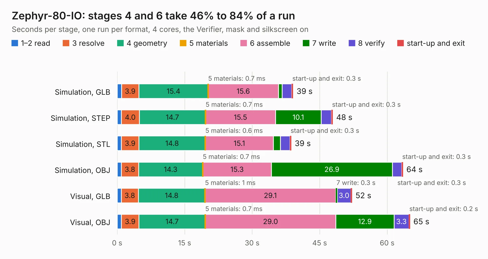

# 870. Zephyr-80-IO

Board 870 of the 3,101 of [Corpus Testing](../Corpus-Testing.md), on [Corpus Page 9](../CorpusTestingPages/Corpus-Testing-09.md#870-zephyr-80-io).

| Mode and format | 1–2 read | 3 resolve | 4 geometry | 5 materials | 6 assemble | 7 write | 8 verify | start-up and exit | Total |
|---|---:|---:|---:|---:|---:|---:|---:|---:|---:|
| Simulation, GLB | 1.0 | 3.9 | 15.4 | 0.7&nbsp;ms | 15.6 | 0.8 | 2.1 | 0.3 | 39.1 |
| Simulation, STEP | 0.9 | 4.0 | 14.7 | 0.7&nbsp;ms | 15.5 | 10.1 | 2.3 | 0.3 | 47.9 |
| Simulation, STL | 0.9 | 3.9 | 14.8 | 0.6&nbsp;ms | 15.1 | 1.5 | 2.1 | 0.3 | 38.7 |
| Simulation, OBJ | 0.9 | 3.8 | 14.3 | 0.7&nbsp;ms | 15.3 | 26.9 | 2.1 | 0.3 | 63.5 |
| Visual, GLB | 0.9 | 3.8 | 14.8 | 1&nbsp;ms | 29.1 | 0.3 | 3.0 | 0.3 | 52.2 |
| Visual, OBJ | 0.9 | 3.9 | 14.7 | 0.7&nbsp;ms | 29.0 | 12.9 | 3.3 | 0.2 | 65.1 |

<table align="center"><tr><td valign="top">

| Board | Repo: [dumaiss/Zephyr-80](https://github.com/dumaiss/Zephyr-80) Board: `Zephyr-80-IO.kicad_pcb` |
|---|---|
| Folder | Schem / Zephyr-80-IO |
| Complexity | 348&nbsp;/&nbsp;1000 (size&nbsp;263, features&nbsp;85) |
| KESE&nbsp;features | through vias, slotted holes, rounded, trapezoid or chamfered pads, filled zones, stack-up, dielectric εr and tanδ |
| Tested | 9th November 2026 |
| Copper&nbsp;layers | 6 |
| File&nbsp;format | KiCad 10 (20260206) |
| Parts,&nbsp;tracks,&nbsp;vias | 95, 1,806, 359 |
| Triangles,&nbsp;simulation | 4,990,652 in 224 parts |
| Verifier | PASS in all six runs |

</td><td valign="top">

<table>
<tr><th>File type</th><th>File size</th><th>Peak memory used</th></tr>
<tr><th colspan="3" align="left">Simulation</th></tr>
<tr><td>GLB</td><td align="right">166&nbsp;MB</td><td align="right">1.3&nbsp;GB</td></tr>
<tr><td>STEP</td><td align="right">571&nbsp;MB</td><td align="right">1.6&nbsp;GB</td></tr>
<tr><td>STL</td><td align="right">250&nbsp;MB</td><td align="right">1.3&nbsp;GB</td></tr>
<tr><td>OBJ</td><td align="right">529&nbsp;MB</td><td align="right">3.1&nbsp;GB</td></tr>
<tr><th colspan="3" align="left">Visual</th></tr>
<tr><td>GLB</td><td align="right">84&nbsp;MB</td><td align="right">1.5&nbsp;GB</td></tr>
<tr><td>OBJ</td><td align="right">268&nbsp;MB</td><td align="right">1.8&nbsp;GB</td></tr>
</table>

</td></tr></table>

| Previous | Next |
|:---|---:|
| [869. Zephyr-80-CPU](b0869b_Zephyr-80_Zephyr-80-CPU.md) | [871. ESP32_TouchDown_Rev1.1](b0871b_esp32-touchdown_ESP32-TouchDown-Rev1-1.md) |
