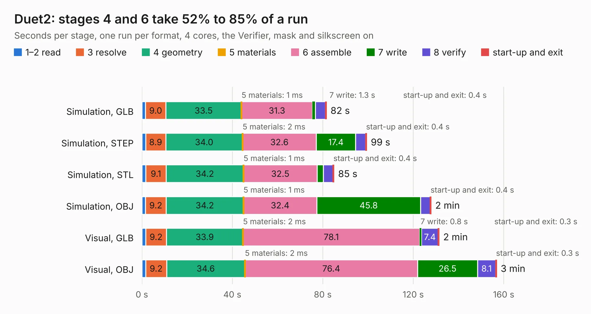

# 871. Duet2

Board 871 of the 3,118 of [Corpus Testing](../Corpus-Testing.md), on [Corpus Page 9](../CorpusTestingPages/Corpus-Testing-09.md#871-duet2).

| Mode and format | 1–2 read | 3 resolve | 4 geometry | 5 materials | 6 assemble | 7 write | 8 verify | start-up and exit | Total |
|---|---:|---:|---:|---:|---:|---:|---:|---:|---:|
| Simulation, GLB | 1.6 | 9.0 | 33.5 | 1&nbsp;ms | 31.3 | 1.3 | 4.4 | 0.4 | 81.6 |
| Simulation, STEP | 1.7 | 8.9 | 34.0 | 2&nbsp;ms | 32.6 | 17.4 | 4.4 | 0.4 | 99.4 |
| Simulation, STL | 1.7 | 9.1 | 34.2 | 1&nbsp;ms | 32.5 | 2.7 | 4.3 | 0.4 | 84.9 |
| Simulation, OBJ | 1.6 | 9.2 | 34.2 | 1&nbsp;ms | 32.4 | 45.8 | 4.3 | 0.4 | 127.9 |
| Visual, GLB | 1.7 | 9.2 | 33.9 | 2&nbsp;ms | 78.1 | 0.8 | 7.4 | 0.3 | 131.4 |
| Visual, OBJ | 1.7 | 9.2 | 34.6 | 2&nbsp;ms | 76.4 | 26.5 | 8.1 | 0.3 | 156.8 |

<table align="center"><tr><td valign="top">

| Board | Repo: [Duet3D/Duet-2-Hardware](https://github.com/Duet3D/Duet-2-Hardware) Board: `Duet2.kicad_pcb` |
|---|---|
| Folder | Duet2 / Duet2v1.05 |
| Complexity | 332&nbsp;/&nbsp;1000 (size&nbsp;287, features&nbsp;45) |
| KESE&nbsp;features | through vias, slotted holes, filled zones |
| Tested | 9th November 2026 |
| Copper&nbsp;layers | 4 |
| File&nbsp;format | KiCad 5 (20171130) |
| Parts,&nbsp;tracks,&nbsp;vias | 333, 6,897, 1,084 |
| Triangles,&nbsp;simulation | 7,008,616 in 317 parts |
| Verifier | PASS in all six runs |

</td><td valign="top">

<table>
<tr><th>File type</th><th>File size</th><th>Peak memory used</th></tr>
<tr><th colspan="3" align="left">Simulation</th></tr>
<tr><td>GLB</td><td align="right">245&nbsp;MB</td><td align="right">1.6&nbsp;GB</td></tr>
<tr><td>STEP</td><td align="right">951&nbsp;MB</td><td align="right">2.2&nbsp;GB</td></tr>
<tr><td>STL</td><td align="right">350&nbsp;MB</td><td align="right">1.6&nbsp;GB</td></tr>
<tr><td>OBJ</td><td align="right">781&nbsp;MB</td><td align="right">4.6&nbsp;GB</td></tr>
<tr><th colspan="3" align="left">Visual</th></tr>
<tr><td>GLB</td><td align="right">146&nbsp;MB</td><td align="right">2.4&nbsp;GB</td></tr>
<tr><td>OBJ</td><td align="right">475&nbsp;MB</td><td align="right">3.0&nbsp;GB</td></tr>
</table>

</td></tr></table>

| Previous | Next |
|:---|---:|
| [870. DuetWifi](b0870b_Duet-2-Hardware_DuetWifi.md) | [872. Duet2](b0872b_Duet-2-Hardware_Duet2-Duet2v1-06_Duet2.md) |
