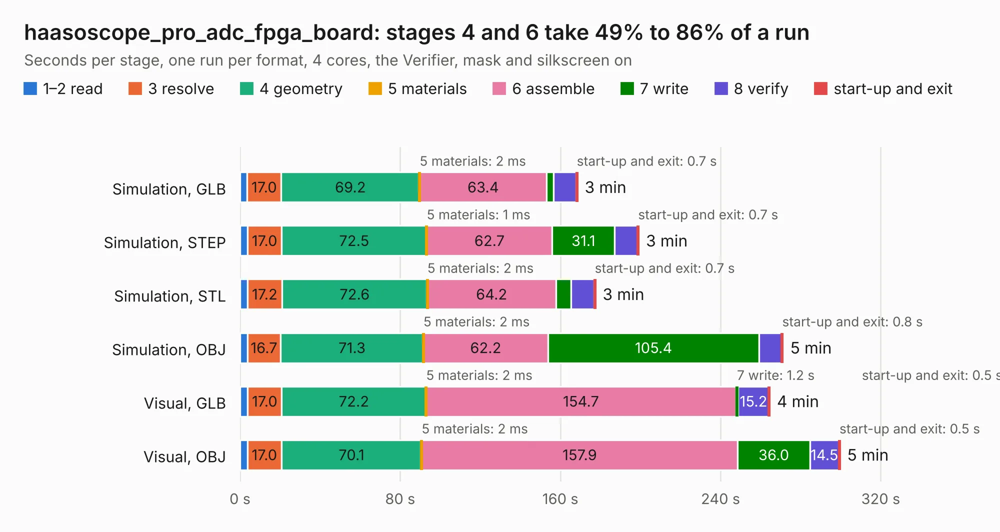

# 871. haasoscope_pro_adc_fpga_board

Board 871 of the 3,132 of [Corpus Testing](../Corpus-Testing.md), on [Corpus Page 9](../CorpusTestingPages/Corpus-Testing-09.md#871-haasoscope_pro_adc_fpga_board).

| Mode and format | 1–2 read | 3 resolve | 4 geometry | 5 materials | 6 assemble | 7 write | 8 verify | start-up and exit | Total |
|---|---:|---:|---:|---:|---:|---:|---:|---:|---:|
| Simulation, GLB | 3.6 | 17.0 | 69.2 | 2&nbsp;ms | 63.4 | 3.5 | 11.2 | 0.7 | 168.6 |
| Simulation, STEP | 3.8 | 17.0 | 72.5 | 1&nbsp;ms | 62.7 | 31.1 | 11.5 | 0.7 | 199.2 |
| Simulation, STL | 3.7 | 17.2 | 72.6 | 2&nbsp;ms | 64.2 | 7.7 | 11.4 | 0.7 | 177.6 |
| Simulation, OBJ | 3.6 | 16.7 | 71.3 | 2&nbsp;ms | 62.2 | 105.4 | 11.2 | 0.8 | 271.2 |
| Visual, GLB | 3.8 | 17.0 | 72.2 | 2&nbsp;ms | 154.7 | 1.2 | 15.2 | 0.5 | 264.6 |
| Visual, OBJ | 3.7 | 17.0 | 70.1 | 2&nbsp;ms | 157.9 | 36.0 | 14.5 | 0.5 | 299.7 |

<table align="center"><tr><td valign="top">

| Board | Repo: [drandyhaas/HaasoscopePro](https://github.com/drandyhaas/HaasoscopePro) Board: `haasoscope_pro_adc_fpga_board.kicad_pcb` |
|---|---|
| Folder | adc board / Kicad |
| Complexity | 412&nbsp;/&nbsp;1000 (size&nbsp;337, features&nbsp;75) |
| KESE&nbsp;features | through vias, rounded, trapezoid or chamfered pads, filled zones, stack-up, dielectric εr and tanδ |
| Tested | 9th November 2026 |
| Copper&nbsp;layers | 10 |
| File&nbsp;format | KiCad 9 (20241229) |
| Parts,&nbsp;tracks,&nbsp;vias | 582, 6,239, 1,360 |
| Triangles,&nbsp;simulation | 16,440,106 in 497 parts |
| Verifier | PASS in all six runs |

</td><td valign="top">

<table>
<tr><th>File type</th><th>File size</th><th>Peak memory used</th></tr>
<tr><th colspan="3" align="left">Simulation</th></tr>
<tr><td>GLB</td><td align="right">549&nbsp;MB</td><td align="right">3.8&nbsp;GB</td></tr>
<tr><td>STEP</td><td align="right">1.7&nbsp;GB</td><td align="right">4.8&nbsp;GB</td></tr>
<tr><td>STL</td><td align="right">822&nbsp;MB</td><td align="right">3.5&nbsp;GB</td></tr>
<tr><td>OBJ</td><td align="right">1.9&nbsp;GB</td><td align="right">11&nbsp;GB</td></tr>
<tr><th colspan="3" align="left">Visual</th></tr>
<tr><td>GLB</td><td align="right">229&nbsp;MB</td><td align="right">4.0&nbsp;GB</td></tr>
<tr><td>OBJ</td><td align="right">763&nbsp;MB</td><td align="right">5.0&nbsp;GB</td></tr>
</table>

</td></tr></table>

| Previous | Next |
|:---|---:|
| [870. Domesday Duplicator](b0870b_domesdayduplicator_Domesday-Duplicator.md) | [872. Duet2Maestro](b0872b_Duet-2-Hardware_Duet2Maestro.md) |
