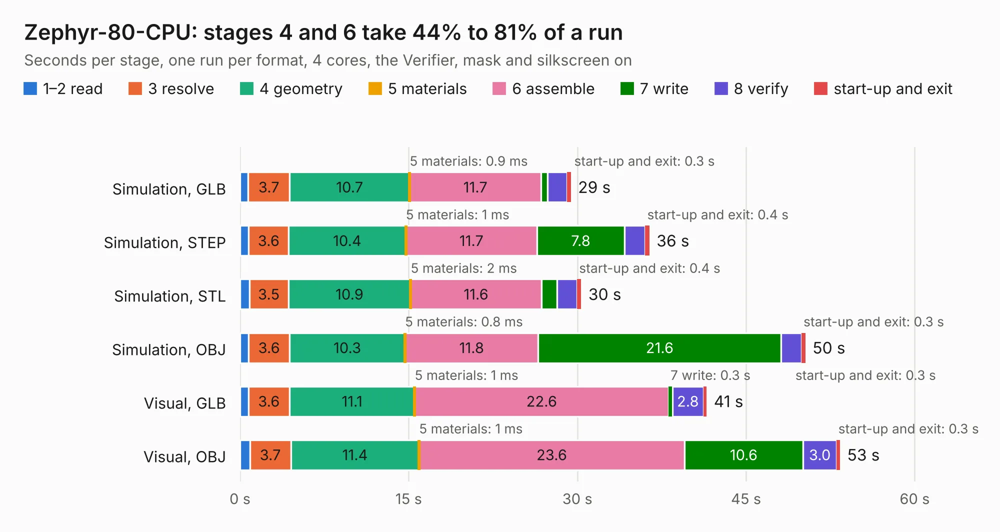

# 871. Zephyr-80-CPU

Board 871 of the 3,103 of [Corpus Testing](../Corpus-Testing.md), on [Corpus Page 9](../CorpusTestingPages/Corpus-Testing-09.md#871-zephyr-80-cpu).

| Mode and format | 1–2 read | 3 resolve | 4 geometry | 5 materials | 6 assemble | 7 write | 8 verify | start-up and exit | Total |
|---|---:|---:|---:|---:|---:|---:|---:|---:|---:|
| Simulation, GLB | 0.7 | 3.7 | 10.7 | 0.9&nbsp;ms | 11.7 | 0.6 | 1.7 | 0.3 | 29.4 |
| Simulation, STEP | 0.8 | 3.6 | 10.4 | 1&nbsp;ms | 11.7 | 7.8 | 1.8 | 0.4 | 36.4 |
| Simulation, STL | 0.8 | 3.5 | 10.9 | 2&nbsp;ms | 11.6 | 1.4 | 1.8 | 0.4 | 30.3 |
| Simulation, OBJ | 0.8 | 3.6 | 10.3 | 0.8&nbsp;ms | 11.8 | 21.6 | 1.8 | 0.3 | 50.3 |
| Visual, GLB | 0.7 | 3.6 | 11.1 | 1&nbsp;ms | 22.6 | 0.3 | 2.8 | 0.3 | 41.5 |
| Visual, OBJ | 0.9 | 3.7 | 11.4 | 1&nbsp;ms | 23.6 | 10.6 | 3.0 | 0.3 | 53.4 |

<table align="center"><tr><td valign="top">

| Board | Repo: [dumaiss/Zephyr-80](https://github.com/dumaiss/Zephyr-80) Board: `Zephyr-80-CPU.kicad_pcb` |
|---|---|
| Folder | Schem / Zephyr-80-CPU |
| Complexity | 272&nbsp;/&nbsp;1000 (size&nbsp;197, features&nbsp;75) |
| KESE&nbsp;features | through vias, rounded, trapezoid or chamfered pads, filled zones, stack-up, dielectric εr and tanδ |
| Tested | 9th November 2026 |
| Copper&nbsp;layers | 6 |
| File&nbsp;format | KiCad 10 (20260206) |
| Parts,&nbsp;tracks,&nbsp;vias | 18, 1,053, 221 |
| Triangles,&nbsp;simulation | 3,420,402 in 131 parts |
| Verifier | PASS in all six runs |

</td><td valign="top">

<table>
<tr><th>File type</th><th>File size</th><th>Peak memory used</th></tr>
<tr><th colspan="3" align="left">Simulation</th></tr>
<tr><td>GLB</td><td align="right">114&nbsp;MB</td><td align="right">1.0&nbsp;GB</td></tr>
<tr><td>STEP</td><td align="right">359&nbsp;MB</td><td align="right">1.2&nbsp;GB</td></tr>
<tr><td>STL</td><td align="right">171&nbsp;MB</td><td align="right">967&nbsp;MB</td></tr>
<tr><td>OBJ</td><td align="right">358&nbsp;MB</td><td align="right">2.2&nbsp;GB</td></tr>
<tr><th colspan="3" align="left">Visual</th></tr>
<tr><td>GLB</td><td align="right">51&nbsp;MB</td><td align="right">1.2&nbsp;GB</td></tr>
<tr><td>OBJ</td><td align="right">159&nbsp;MB</td><td align="right">1.2&nbsp;GB</td></tr>
</table>

</td></tr></table>

| Previous | Next |
|:---|---:|
| [870. EthernetModule](b0870b_Duet-2-Hardware_EthernetModule.md) | [872. Zephyr-80-IO](b0872b_Zephyr-80_Zephyr-80-IO.md) |
